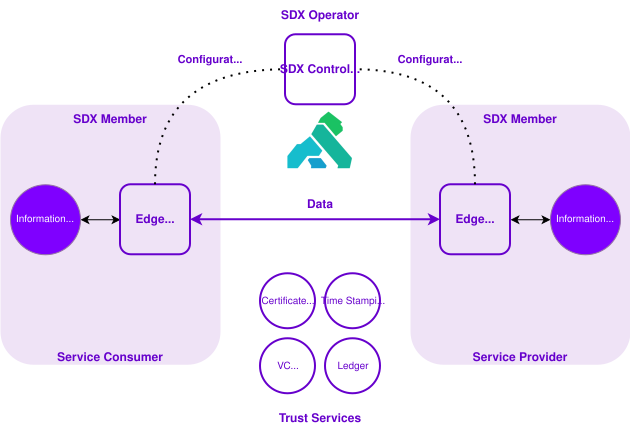

# Provider Journey Master Documentation

> Generated proof-of-concept output. Review before use or publication.

## Contents

- [Building Trusted Digital Services](#source-building-trusted-digital-services)
    - [Connected services overview](#building-trusted-digital-services-docsindex)
    - [Purpose and value](#building-trusted-digital-services-docspurpose-and-value)
    - [Trusted digital service building blocks](#building-trusted-digital-services-docsbuilding-blocks)
    - [Authoritative Data Register (ADR)](#building-trusted-digital-services-docsauthoritative-data-register)
    - [Eligibility Factor Verification (EFV)](#building-trusted-digital-services-docseligibility-factor-verification)
    - [Secure Data Exchange (SDX)](#building-trusted-digital-services-docssecure-data-exchange)
    - [API Services Portal](#building-trusted-digital-services-docsapi-services-portal)
    - [Integration Toolkit (ITK)](#building-trusted-digital-services-docsintegration-toolkit)
    - [Privacy and security](#building-trusted-digital-services-docsprivacy-and-security)
    - [Governance and policy](#building-trusted-digital-services-docsgovernance-and-policy)
    - [Roles and responsibilities](#building-trusted-digital-services-docsroles-and-responsibilities)
    - [Limits and constraints](#building-trusted-digital-services-docslimits-and-constraints)
    - [Support](#building-trusted-digital-services-docssupport)
- [Integration Toolkit](#source-integration-toolkit)
    - [Integration Toolkit (ITK)](#integration-toolkit-docsindex)
    - [Areas of ITK](#integration-toolkit-docsareas-of-itk)
    - [Finding and using ITK](#integration-toolkit-docsfinding-and-using-itk)
    - [Milestone updates](#integration-toolkit-docsmilestone-updates)
    - [Support](#integration-toolkit-docssupport)
- [Authoritative Data Registers](#source-adr-techdoc)
    - [Get started with data](#adr-techdoc-adr-techdocs-draft-v2)
    - [Find and use datasets](#adr-techdoc-adr-techdocs-draft-v2--find-and-use-datasets)
    - [Provide data](#adr-techdoc-adr-techdocs-draft-v2--provide-data-1)
    - [How data is classified](#adr-techdoc-adr-techdocs-draft-v2--how-data-is-classified)
    - [Publishing a dataset](#adr-techdoc-adr-techdocs-draft-v2--publishing-a-dataset)
    - [High-value data](#adr-techdoc-adr-techdocs-draft-v2--high-value-data-2)
    - [Authoritative data](#adr-techdoc-adr-techdocs-draft-v2--authoritative-data-2)
    - [Authoritative Data Designation](#adr-techdoc-adr-techdocs-draft-v2--authoritative-data-designation)
    - [Data registers](#adr-techdoc-adr-techdocs-draft-v2--data-registers-1)
    - [Data Register Standard](#adr-techdoc-adr-techdocs-draft-v2--data-register-standard)
    - [Semantics](#adr-techdoc-adr-techdocs-draft-v2--semantics-1)
    - [Data dictionaries](#adr-techdoc-adr-techdocs-draft-v2--data-dictionaries-3)
    - [Connected Services Data Glossary](#adr-techdoc-adr-techdocs-draft-v2--connected-services-data-glossary-3)
- [Secure Data Exchange](#source-secure-data-exchange)
    - [Secure Data Exchange (SDX)](#secure-data-exchange-docsindex)
    - [SDX Roles and Responsibilities](#secure-data-exchange-docsgetting-started-with-sdxsdx-roles-and-responsibilities)
    - [Environments](#secure-data-exchange-docsgetting-started-with-sdxenvironments)
    - [Publish a Service](#secure-data-exchange-docsgetting-started-with-sdxpublish-a-service)
    - [Consume a Service](#secure-data-exchange-docsgetting-started-with-sdxconsume-a-service)
    - [Onboarding Process](#secure-data-exchange-docsgetting-started-with-sdxonboarding-processonboarding-process)
    - [Onboarding an Organization](#secure-data-exchange-docsgetting-started-with-sdxonboarding-processonboarding-an-organization)
    - [Install an Edge Runtime Group](#secure-data-exchange-docsgetting-started-with-sdxonboarding-processinstall-an-edge-runtime-group)
    - [Set Up Organization Signing](#secure-data-exchange-docsgetting-started-with-sdxonboarding-processset-up-organization-signing)
    - [Managing Subsystems](#secure-data-exchange-docsgetting-started-with-sdxonboarding-processmanaging-subsystems)
    - [Managing Services](#secure-data-exchange-docsgetting-started-with-sdxonboarding-processmanaging-services)
    - [Connecting a Service](#secure-data-exchange-docsgetting-started-with-sdxonboarding-processconnecting-a-service)
    - [Connection Resources](#secure-data-exchange-docsgetting-started-with-sdxonboarding-processconnection-resources)
    - [Experimental Features – LAB Only](#secure-data-exchange-docsexperimental-features)
    - [References](#secure-data-exchange-docsreferences)
    - [Support](#secure-data-exchange-docssupport)
- [API Services Portal - SDX Documentation](#source-aps-infra-platform-sdx)
    - [Get Support](#aps-infra-platform-sdx-documentationhow-toget-support)
    - [Onboarding an Organization](#aps-infra-platform-sdx-documentationhow-tosdx-org-onboarding)
    - [Install an Edge Runtime Group](#aps-infra-platform-sdx-documentationhow-tosdx-edge-runtime-groups)
    - [Setup Organization Signing](#aps-infra-platform-sdx-documentationhow-tosdx-org-signing)
    - [Managing Subsystems](#aps-infra-platform-sdx-documentationhow-tosdx-subsystems)
    - [Managing Services](#aps-infra-platform-sdx-documentationhow-tosdx-services)
    - [Connecting a Service](#aps-infra-platform-sdx-documentationhow-tosdx-connections)
    - [Connection Resources](#aps-infra-platform-sdx-documentationhow-tosdx-connection-resources)
    - [Secure Data Exchange (SDX)](#aps-infra-platform-sdx-documentationconceptssecure-data-exchange)
    - [Restish CLI](#aps-infra-platform-sdx-documentationreferencerestish-cli)
    - [SDX Data Access Protocol](#aps-infra-platform-sdx-documentationreferencesdxdata-access-protocol)
    - [SDX Environments](#aps-infra-platform-sdx-documentationreferencesdxenvironments)
    - [Event Management](#aps-infra-platform-sdx-documentationhow-tosdx-ape-event-mgmt)
    - [Policy Management](#aps-infra-platform-sdx-documentationhow-tosdx-ape-policy-mgmt)
- [Eligibility Factor Verification](#source-efv-techdoc)
    - [Introduction](#efv-techdoc-docsindex)
    - [Getting Started](#efv-techdoc-docsgetting-started)
    - [Eligibility Factors](#efv-techdoc-docseligibility-factors)
    - [Income Verification](#efv-techdoc-docsincome-verification)
    - [Support](#efv-techdoc-docssupport)
- [BC Data Catalogue](#source-bc-data-catalogue)

# Building Trusted Digital Services {#source-building-trusted-digital-services}

<!-- source: https://github.com/bcgov/connected-services-techdocs.git@b05987f45ca7dad9aac3a749c0babfaaaf589516:getting-started/docs/index.md -->

## Connected services overview {#building-trusted-digital-services-docsindex}


[Connected Services BC](https://digital.gov.bc.ca/2025/07/21/building-connected-services/) is working toward a future where people and businesses in B.C. experience government services as simple, connected, and easy to access, no matter which ministry or program is behind them.

This documentation is for the people who need to understand what's involved in building a trusted digital service: developers, product owners, data owners, and data custodians. It explains the building blocks involved and what makes this way of working different from how things have been done in the past.

This documentation is the starting point for understanding these building blocks. Explore each one below to learn what it does and why it matters.

### Explore the building blocks {#building-trusted-digital-services-docsindex--explore-the-building-blocks}

- [Authoritative Data Register (ADR)](#building-trusted-digital-services-docsauthoritative-data-register)
- [Eligibility Factor Verification (EFV)](#building-trusted-digital-services-docseligibility-factor-verification)
- [Secure Data Exchange (SDX)](#building-trusted-digital-services-docssecure-data-exchange)
- [API Services Portal](#building-trusted-digital-services-docsapi-services-portal)
- BC Data Catalogue (BCDC)
- [Integration Toolkit (ITK)](#building-trusted-digital-services-docsintegration-toolkit)

### Availability {#building-trusted-digital-services-docsindex--availability}

This documentation is available now. Some building blocks, like Secure Data Exchange, are further along than others. Check each page for its current status.

### Learn more {#building-trusted-digital-services-docsindex--learn-more}

To understand the broader purpose behind these building blocks, review [Purpose and value](#building-trusted-digital-services-docspurpose-and-value).

To understand how these building blocks fit together, review [Trusted digital service building blocks](#building-trusted-digital-services-docsbuilding-blocks).

<!-- source: https://github.com/bcgov/connected-services-techdocs.git@b05987f45ca7dad9aac3a749c0babfaaaf589516:getting-started/docs/purpose-and-value.md -->

## Purpose and value {#building-trusted-digital-services-docspurpose-and-value}


Government programs often need information that already exists in another ministry or system.

Today, this can cause real problems:

- Delays
- Duplicate integrations
- Repeated data collection
- Inconsistent definitions
- Manual verification processes

Connected Services BC is working toward a future where people and businesses experience government services as simple and connected. This is true regardless of which ministry or program is behind them. Delivering on that vision requires developers and program teams to connect, share, and reuse trusted data across government. This needs to happen securely and consistently.

This works through common building blocks that enable:

- Access to authoritative data
- Reusable eligibility checks
- Secure, policy-aligned data exchange
- Dataset discovery
- Documentation that helps you understand what's available across these areas

As these capabilities become available, they're designed to support both sides of this work: data providers who register, maintain, and share trusted data, and data consumers who access and reuse it. One of the aims of this work is a clear, easy path to discovering trusted data, replacing today's reality of word of mouth and manual digging to find the right source or contact. Over time, this means less duplicate effort for providers publishing the same data multiple ways, and fewer one-off integrations for consumers trying to access what they need. Teams will be able to use and reuse standardized components on both sides of that journey.

See [Trusted digital service building blocks](#building-trusted-digital-services-docsbuilding-blocks) for more on how these components work together, and [Roles and responsibilities](#building-trusted-digital-services-docsroles-and-responsibilities) for how provider and consumer roles fit into this work.

### A quick example {#building-trusted-digital-services-docspurpose-and-value--a-quick-example}

Say a ministry is launching a new income-support program. It needs to confirm applicants meet an income requirement.

Today, this usually means the applicant uploads tax documents. Staff then manually review them as part of the application.

Eligibility Factor Verification (EFV) is developing an income verification check, its first eligibility factor. In time, a program may be able to request that check directly, instead of asking applicants to upload documents. This is still in development, and available factors will depend on program need, data source agreements, and policy requirements.

That's the value these building blocks are working toward: less duplicate work, more consistent decisions, and secure, accountable data reuse.

### What this means for you {#building-trusted-digital-services-docspurpose-and-value--what-this-means-for-you}

The building blocks are at different stages. Some are operating services today, while others are still being developed or expanded. The integrated journey described in this documentation is also evolving as the building blocks become more closely connected.

Together, the current and planned capabilities are intended to support the following outcomes.

For developers, these building blocks will support:

- Faster integrations with reusable components
- Less custom validation logic
- Access to governed and trusted data sources
- Consistent integration guidance and sandbox environments

For product owners and program leads, they will support:

- Clear data ownership and accountability
- Less duplication of datasets
- More consistent eligibility decisions
- Scalable cross-ministry service design

For data custodians, data managers, and data providers, they will support:

- Clear designation of authoritative data
- Defined access and reuse policies
- Fewer ad hoc data-sharing requests
- Improved visibility into how data is used
- Structured governance processes for oversight and accountability

Together, these building blocks are intended to help developers and program teams create digital services that are consistent, secure and work well together across government. Available capabilities and the connections between them will continue to expand over time.

### Explore the components {#building-trusted-digital-services-docspurpose-and-value--explore-the-components}

A trusted digital service is delivered through reusable building blocks.

To see how these components work together, review [Trusted digital service building blocks](#building-trusted-digital-services-docsbuilding-blocks).

<!-- source: https://github.com/bcgov/connected-services-techdocs.git@b05987f45ca7dad9aac3a749c0babfaaaf589516:getting-started/docs/building-blocks.md -->

## Trusted digital service building blocks {#building-trusted-digital-services-docsbuilding-blocks}


Building a trusted digital service means drawing on reusable building blocks that work together to support secure, consistent data reuse across government.

Each building block plays a specific role in supporting the people who provide trusted data and the people who consume it. For example, a data custodian registering a dataset as authoritative is a provider. A developer connecting to that data through Secure Data Exchange is a consumer. Together, these building blocks reduce duplicate integrations, improve data trust, and support more seamless service delivery.

### Authoritative Data Register (ADR) {#building-trusted-digital-services-docsbuilding-blocks--authoritative-data-register-adr}

*Authoritative Data Register* is the register that holds information on datasets designated as authoritative. These are official sources of truth for specific information, like residency, enrollment, property ownership, or program status.

It provides trusted, governed data that other programs can rely on.

[Learn more about ADR](#building-trusted-digital-services-docsauthoritative-data-register).

### Eligibility Factor Verification (EFV) {#building-trusted-digital-services-docsbuilding-blocks--eligibility-factor-verification-efv}

*Eligibility Factor Verification* checks applicant details against program rules. It confirms whether someone meets the requirements for a specific government program.

For example:

- Is this person a BC resident? Yes/no
- Is this individual enrolled in a specific program? Yes/no

EFVs reduce manual verification and help standardize eligibility checks across programs.

[Learn more about EFV](#building-trusted-digital-services-docseligibility-factor-verification).

### Secure Data Exchange (SDX) {#building-trusted-digital-services-docsbuilding-blocks--secure-data-exchange-sdx}

*Secure Data Exchange* provides a governed way to move approved data between systems.

It ensures that data sharing is secure, policy-aligned, and auditable. Teams don't need to build a custom integration for each connection.

[Learn more about SDX](#building-trusted-digital-services-docssecure-data-exchange).

### API Services Portal {#building-trusted-digital-services-docsbuilding-blocks--api-services-portal}

*API Services Portal* is a central gateway for connecting APIs across government. It covers routing, access control, and general API management.

[Learn more about API Services Portal](#building-trusted-digital-services-docsapi-services-portal).

### BC Data Catalogue (BCDC) {#building-trusted-digital-services-docsbuilding-blocks--bc-data-catalogue-bcdc}

*BC Data Catalogue* helps people find datasets available across government and understand how to access them.

[Explore the BC Data Catalogue](https://catalogue.data.gov.bc.ca/).

### Integration Toolkit (ITK) {#building-trusted-digital-services-docsbuilding-blocks--integration-toolkit-itk}

*Integration Toolkit* is documentation that helps you understand the building blocks above, what each one does, and how they fit together.

Over time, this is expected to grow into a compiled, end-to-end reference guide, refined as each building block matures, including checklists, templates, and more detailed guidance. Right now, ITK's job is to help you understand what's available and point you to each team's own documentation.

[Learn more about ITK](#building-trusted-digital-services-docsintegration-toolkit).

<!-- source: https://github.com/bcgov/connected-services-techdocs.git@b05987f45ca7dad9aac3a749c0babfaaaf589516:getting-started/docs/authoritative-data-register.md -->

## Authoritative Data Register (ADR) {#building-trusted-digital-services-docsauthoritative-data-register}


### What it is {#building-trusted-digital-services-docsauthoritative-data-register--what-it-is}

_Authoritative Data_ is a dataset formally designated as the trusted source for a specific purpose within government. 

The ADR service provides the governance process that identifies, assesses, certifies, and oversees these datasets. 

Authoritative status is contextual. A dataset is authoritative for **a defined scope and use case**, not for all purposes. 

### Who this is for {#building-trusted-digital-services-docsauthoritative-data-register--who-this-is-for}

ADR supports both those who publish authoritative data and those who integrate with it. 

**Primary audience** 

- Developers building integrations 
- Solution architects designing cross-ministry services 

**Secondary audience** 

- Data custodians 
- Product owners 
- Program and policy leads 
- Data managers 

### When to use authoritative data {#building-trusted-digital-services-docsauthoritative-data-register--when-to-use-authoritative-data}

Use Authoritative Data when: 

- You need a trusted, government-approved dataset 
- You are building eligibility, verification, or automation logic 
- You are integrating across ministries or systems 
- You want to reduce duplication or avoid shadow datasets 
- You need clarity on definitions, ownership, and accountability 

Do not assume that all datasets are authoritative. Always confirm status before integrating. 

### How ADR works (high level) {#building-trusted-digital-services-docsauthoritative-data-register--how-adr-works-high-level}

ADR formalizes how datasets are reviewed and certified. 

1. A data custodian submits a dataset for review. 
2. The dataset is assessed against authoritative data criteria. 
3. A governance body reviews and endorses (or declines) certification. 
4. Approved datasets are listed in the Authoritative Data Directory. 
5. Certified datasets are monitored and maintained over time. 

Authoritative certification is not a one-time approval. It requires ongoing oversight. 

<!-- source: https://github.com/bcgov/connected-services-techdocs.git@b05987f45ca7dad9aac3a749c0babfaaaf589516:getting-started/docs/eligibility-factor-verification.md -->

## Eligibility Factor Verification (EFV) {#building-trusted-digital-services-docseligibility-factor-verification}


### What it is {#building-trusted-digital-services-docseligibility-factor-verification--what-it-is}

*Eligibility Factor Verification*, or EFV, helps government programs check specific facts used in eligibility decisions. 

EFV is intended for situations where a program needs to verify information through an approved or trusted source, instead of relying only on applicant-submitted documents or manual review. 

EFV can help programs reduce repeated document checks, support more consistent decisions, and keep a record of what was checked, when, and against what source. 

EFV does not decide if someone is eligible for a program. It is not a program rule engine and does not approve or deny applications. Programs still own their eligibility rules and make the final decision. 

### Who this is for {#building-trusted-digital-services-docseligibility-factor-verification--who-this-is-for}

EFV supports both those building eligibility systems and those responsible for program outcomes. 

**Primary audience**

- Developers building eligibility tools and integrations 
- Solution architects designing automated adjudication systems 

**Secondary audience**

- Product owners managing benefit programs 
- Program and policy leads defining eligibility criteria 
- Adjudicators and intake staff using decision-support tools 

### When to use Eligibility Factor Verification {#building-trusted-digital-services-docseligibility-factor-verification--when-to-use-eligibility-factor-verification}

EFV may be useful when your program needs to check a specific fact used in an eligibility decision. 

EFV may help when your program wants to:

- Use a trusted source instead of applicant-submitted documents 
- Reduce manual document review or staff follow-up 
- Support more consistent decisions 
- Keep a record of what was checked, when, and against what source 
- Help staff focus on exceptions or higher-risk cases 
- Reuse a verification pattern that may also help other programs 

### How it works (high level) {#building-trusted-digital-services-docseligibility-factor-verification--how-it-works-high-level}

1. A program needs to confirm whether an applicant meets a specific eligibility requirement. 
2. With EFV, the program requests a verification check through a trusted Authoritative Data source.
3. A verification check compares applicant information to the trusted dataset. 
4. The program applies its own rules and decides what happens next. 

### Where to go next {#building-trusted-digital-services-docseligibility-factor-verification--where-to-go-next}

- Read the [EFV documentation](#efv-techdoc-docsindex) for details

<!-- source: https://github.com/bcgov/connected-services-techdocs.git@b05987f45ca7dad9aac3a749c0babfaaaf589516:getting-started/docs/secure-data-exchange.md -->

## Secure Data Exchange (SDX) {#building-trusted-digital-services-docssecure-data-exchange}


### What it is {#building-trusted-digital-services-docssecure-data-exchange--what-it-is}

_Secure Data Exchange_ (SDX) helps organizations safely share sensitive information with each other.

It protects information as it moves from one organization to another and ensures that only approved systems can send and receive it.

SDX protects exchanges by:

- Encrypting information while it is being exchanged
- Confirming that participating systems are approved
- Checking that information has not been changed in transit
- Applying rules that control access and permitted actions
- Keeping records of exchanges for auditing and review
- Recording who participated in an exchange when it happened

Together, these controls help organizations protect sensitive information and support B.C.'s security, privacy, and regulatory requirements.

### Who should use SDX {#building-trusted-digital-services-docssecure-data-exchange--who-should-use-sdx}

SDX is for organizations participating in Connected Services that need to share sensitive information with other organizations.

Participants may include B.C. government ministries and partner organizations such as LTSA and ICBC.

An organization can:

- Provide information or services to other approved organizations
- Consume information or services provided by another organization
- Do both

### When you should use SDX {#building-trusted-digital-services-docssecure-data-exchange--when-you-should-use-sdx}

Use SDX when information needs to be shared between organizations and the exchange needs stronger security, access control, or accountability.

SDX may be appropriate when:

- Personal, financial, or other sensitive information is being shared
- Access must be limited to approved organizations or systems
- The exchange must be logged or available for audit
- There must be a reliable record of who participated in the exchange

SDX is generally not needed for public or non-sensitive information that does not require these additional controls.

### How it works {#building-trusted-digital-services-docssecure-data-exchange--how-it-works}

Organizations complete the SDX onboarding process before exchanging information. Onboarding sets up the organization, its systems, roles, and secure connections.

Once onboarded:

- Providers make services available to approved consumers. API providers register their APIs using an OpenAPI Specification (OAS).
- Consumers request access to the services they need.
- SDX applies security, access, and logging controls to exchanges between participating systems.

SDX Edge Servers provide the secure connection used by participating organizations.

For more details including setup instructions, see [Getting started with SDX documentation](#secure-data-exchange-docsindex).

### Privacy and security responsibilities {#building-trusted-digital-services-docssecure-data-exchange--privacy-and-security-responsibilities}

SDX provides technical controls that help organizations meet privacy and security requirements.

Using SDX does not replace an organization's responsibility to meet its own privacy, security, governance, and data management requirements.

See [Privacy and security](#building-trusted-digital-services-docsprivacy-and-security) for more information about organizational responsibilities and accountability.

### Where to go next {#building-trusted-digital-services-docssecure-data-exchange--where-to-go-next}
- [Getting started with SDX documentation](#secure-data-exchange-docsindex)
- Or go directly to [SDX onboarding documentation](#aps-infra-platform-sdx-documentationhow-tosdx-org-onboarding)

<!-- source: https://github.com/bcgov/connected-services-techdocs.git@b05987f45ca7dad9aac3a749c0babfaaaf589516:getting-started/docs/api-services-portal.md -->

## API Services Portal {#building-trusted-digital-services-docsapi-services-portal}


### What is this? {#building-trusted-digital-services-docsapi-services-portal--what-is-this}

The [*API Services Portal*](https://api.gov.bc.ca/) is a central online tool that helps government applications connect and talk to each other safely. Built on an open-source gateway system, it handles background traffic, checks permissions, and keeps network requests running smoothly. 

### Who should use API Services Portal? {#building-trusted-digital-services-docsapi-services-portal--who-should-use-api-services-portal}

- Teams sharing data: B.C. government developers who want to share and protect their system services. 
- Teams looking for data: Developers who need to find, request access to, and connect existing government services to their own apps. 

### When should I use API Services Portal? {#building-trusted-digital-services-docsapi-services-portal--when-should-i-use-api-services-portal}

Use the API Services Portal when you need a simple, secure way to send information between government applications. It is ideal when you need to: 

- Connect to standard government data feeds and web services. 
- Protect your service from getting overloaded by controlling how many requests come in at once. 
- Make sure only approved systems can log in and see your data. 
- See clear reports on how often your service is being used and if any errors happen.

!!! Note
     If your team needs to transfer highly sensitive personal data between organizations with legal tracking, look at [Secure Data Exchange (SDX)](#building-trusted-digital-services-docssecure-data-exchange) as well.

### How it works (high-level) {#building-trusted-digital-services-docsapi-services-portal--how-it-works-high-level}

- Find: Search the API Directory to see what services are already available. 
- Set up: Log in with your IDIR account to register your service and set basic security rules. 
- Connect: The portal acts as a secure front door, checking each request before passing it safely to your system.

### Where to go next {#building-trusted-digital-services-docsapi-services-portal--where-to-go-next}

- Read the beginner guide on how to [Connect to the API Services Portal](https://digital.gov.bc.ca/technology/api/portal/). 
- Check out full technical details on [API Program Services documentation](#aps-infra-platform-sdx-documentationhow-toget-support).
- Browse available tools on the [BC Government API Services Portal](https://api.gov.bc.ca/).

<!-- source: https://github.com/bcgov/connected-services-techdocs.git@b05987f45ca7dad9aac3a749c0babfaaaf589516:getting-started/docs/integration-toolkit.md -->

## Integration Toolkit (ITK) {#building-trusted-digital-services-docsintegration-toolkit}


### What is this? {#building-trusted-digital-services-docsintegration-toolkit--what-is-this}

The *Integration Toolkit* (ITK) is documentation that brings together information about the building blocks used to build a trusted digital service: Authoritative Data Register (ADR), Eligibility Factor Verification (EFV), Secure Data Exchange (SDX), API Services Portal, and BC Data Catalogue (BCDC). It explains what each one does, how they relate to each other, and where to go to learn more.

ITK isn't a separate application, portal, or catalogue. Right now, it's documentation—this page and the pages it links to—and it's expected to grow into a more complete, end-to-end guide as the building blocks themselves mature.

### Who is this for? {#building-trusted-digital-services-docsintegration-toolkit--who-is-this-for}

- Developers, product owners, data owners, and data custodians who need to understand what building a trusted digital service involves, including the building blocks they'll interact with and why they matter
- Teams who already know they want to connect, share, or reuse trusted data, and are ready to start a conversation with a building block's team about what's possible today, since each team is progressing its own tools independently

### When should I use this? {#building-trusted-digital-services-docsintegration-toolkit--when-should-i-use-this}

Use ITK when you're trying to understand what's involved in building a trusted digital service, before you dive into a specific building block's documentation, or when you're not yet sure which building block applies to what you're trying to do.

### How it works (high-level) {#building-trusted-digital-services-docsintegration-toolkit--how-it-works-high-level}

Right now, ITK provides connective guidance across the provider journey. It explains how the building blocks, such as authoritative data, eligibility checks, and secure data exchange, relate to each other, and points you to each one's own documentation to go deeper.

Over time, the goal is for that path to become more guided, walking you through a full integration from start to finish, rather than handing you off to separate documentation for each piece.

### Where to go next {#building-trusted-digital-services-docsintegration-toolkit--where-to-go-next}

- Read the full [ITK documentation](#integration-toolkit-docsindex)

<!-- source: https://github.com/bcgov/connected-services-techdocs.git@b05987f45ca7dad9aac3a749c0babfaaaf589516:getting-started/docs/privacy-and-security.md -->

## Privacy and security {#building-trusted-digital-services-docsprivacy-and-security}


Secure Data Exchange (SDX) provides the secure, policy-driven trust foundation for data exchange that crosses privacy zones between organizations or that involves private information. For data exchange that doesn't meet that bar, the API Services Portal may be the right path instead. See [API Services Portal](#building-trusted-digital-services-docsapi-services-portal) for its approach to access and security.

This page describes the privacy and security model that applies when SDX is used.

SDX does not centralize or store program data. Data remains with the ministry or public body that owns it. Instead, it enables secure, auditable exchange between trusted systems.

Privacy and security controls are embedded into the technical design, not added afterward.

### Secure exchange by design {#building-trusted-digital-services-docsprivacy-and-security--secure-exchange-by-design}

When data exchange crosses privacy zones between organizations or involves private information, it goes through Secure Data Exchange (SDX). SDX enforces these controls:

- Authentication of participating systems
- Verification that requests are unaltered
- Real-time access control
- Timestamped logging of transactions

These controls ensure that only authorized, policy-compliant requests are fulfilled.

For technical details on how SDX implements these controls, including request verification and Edge Server architecture, see [Secure Data Exchange (SDX)](#building-trusted-digital-services-docssecure-data-exchange).

### Data ownership and control {#building-trusted-digital-services-docsprivacy-and-security--data-ownership-and-control}

SDX does not take ownership of ministry or public body data, such as ICBC data.

- Ministries and public bodies remain custodians of their data
- Access decisions are enforced based on predefined policies
- Data is exchanged directly between approved participants
- No centralized data repository is created

This model supports working across systems while preserving program accountability.

### Identity and access enforcement {#building-trusted-digital-services-docsprivacy-and-security--identity-and-access-enforcement}

Access is controlled at request time using short-lived, scoped tokens.

Each request must meet these conditions:

- Be authenticated
- Meet defined access policies
- Be validated before any data is exchanged

Access enforcement is automated and consistent across participants.

### Logging, audit, and transparency {#building-trusted-digital-services-docsprivacy-and-security--logging-audit-and-transparency}

All transactions are logged automatically.

- Requests are timestamped
- Actions are auditable
- Records support compliance and oversight
- Logging enables accountability without exposing underlying data

This design supports transparency while minimizing data exposure.

### Scaling securely {#building-trusted-digital-services-docsprivacy-and-security--scaling-securely}

As more capabilities and partners are added over time, the same trust and security foundation applies.

- New partners onboard under shared trust rules
- Policies are enforced consistently
- Security controls do not need to be rebuilt for each integration

This helps this work grow securely across ministries.

### How decisions are defined {#building-trusted-digital-services-docsprivacy-and-security--how-decisions-are-defined}

Privacy and security controls enforce rules, but those rules are established through governance and policy direction.

Oversight, accountability, and decision-making structures shape how these building blocks are governed. Review [Governance and policy](#building-trusted-digital-services-docsgovernance-and-policy) to learn more.

<!-- source: https://github.com/bcgov/connected-services-techdocs.git@b05987f45ca7dad9aac3a749c0babfaaaf589516:getting-started/docs/governance-and-policy.md -->

## Governance and policy {#building-trusted-digital-services-docsgovernance-and-policy}


Clear governance and policy direction supports responsible, consistent data sharing across ministries.

Governance defines how data is designated, accessed, exchanged, and overseen. It also sets out who is accountable. It shows how decisions are made and how policies are enforced across these building blocks.

Some governance structures are already in place. Others will keep evolving as this work expands and new capabilities are introduced.

Transparency is a core principle of this governance model. It means being clear about how decisions are made and how data is used. This is also what makes Connected Services BC's broader commitment possible: giving people visibility over their own data.

### Evolving governance model {#building-trusted-digital-services-docsgovernance-and-policy--evolving-governance-model}

These building blocks are starting with an initial use case. Governance and policy frameworks are actively being built to support it.

Governance structures, standards, and decision processes are part of the foundational work needed to launch the first connected service.

As more capabilities are introduced over time, governance processes will mature and expand. This supports broader adoption.

Governance decisions, standards, and supporting documentation will be published as they're formalized.

### What governance covers {#building-trusted-digital-services-docsgovernance-and-policy--what-governance-covers}

This governance applies across:

- Authoritative Data designation and certification
- Access control and authorization rules
- Shared standards for interoperability and data exchange
- Logging, oversight, and accountability mechanisms
- Policy alignment across participating ministries

These areas help ensure data reuse is consistent, auditable, and policy-aligned.

### A quick example {#building-trusted-digital-services-docsgovernance-and-policy--a-quick-example}

Say a ministry's address dataset is proposed as a candidate for authoritative designation. This is the kind of dataset that could eventually support a “tell us once” approach to address updates across programs.

A data governance team reviews the proposal against defined criteria. Is the source verified? Is there a clearly accountable custodian? Is quality actively maintained? Are access and security conditions documented?

The review results in a decision. The dataset is designated, deferred, or declined. The decision also states the scope it's authoritative for and any conditions attached.

The ministry's data custodian stays responsible for keeping the dataset accurate afterward. Designation isn't a one-time check; it's an ongoing responsibility. The decision, and the reasoning behind it, becomes part of the governance record.

### Roles and accountability {#building-trusted-digital-services-docsgovernance-and-policy--roles-and-accountability}

Governance does not remove data ownership from ministries.

- Data custodians remain responsible for their data
- Access decisions are governed by defined policies
- Oversight bodies review and endorse authoritative designations
- Technical controls enforce policy decisions consistently

Clear accountability across technical and program areas is essential to maintaining trust.

### Relationship to privacy and security {#building-trusted-digital-services-docsgovernance-and-policy--relationship-to-privacy-and-security}

Governance and policy sets the rules and accountability structures. Privacy and security shows how those rules are technically enforced through Secure Data Exchange (SDX) and related controls.

Review [Privacy and security](#building-trusted-digital-services-docsprivacy-and-security) for details on technical enforcement.

### Who participates {#building-trusted-digital-services-docsgovernance-and-policy--who-participates}

Governance depends on clearly defined roles across ministries and technical teams. To see how different people contribute, review [Roles and responsibilities](#building-trusted-digital-services-docsroles-and-responsibilities).

<!-- source: https://github.com/bcgov/connected-services-techdocs.git@b05987f45ca7dad9aac3a749c0babfaaaf589516:getting-started/docs/roles-and-responsibilities.md -->

## Roles and responsibilities {#building-trusted-digital-services-docsroles-and-responsibilities}


Building a trusted digital service involves multiple roles. These span technical, program, and governance areas.

Clear roles and responsibilities matter. They help ensure data is published, accessed, kept up to date, and shared safely.

This work is starting with an initial use case. Roles and responsibilities will keep being refined and published as it grows.

### Data providers (Suppliers) {#building-trusted-digital-services-docsroles-and-responsibilities--data-providers-suppliers}

Data providers manage and publish authoritative data. These roles may include:

- Data Custodian
- Data Manager
- Data Architect
- Developer
- Data Publisher / Editor

Their responsibilities typically include:

- Keeping data accurate and up to date
- Defining who can use the data and how
- Proposing a dataset for authoritative designation when they believe it qualifies
- Meeting governance and policy requirements

### Data consumers (Subscribers) {#building-trusted-digital-services-docsroles-and-responsibilities--data-consumers-subscribers}

Data consumers use authoritative data or reusable components in their applications and services. These roles may include:

- Developer
- Solution Architect
- Application Manager
- Product Owner
- Policy Lead
- Data Analyst
- Data Scientist
- Program Staff

Their responsibilities typically include:

- Connecting only through approved, controlled methods
- Meeting defined access policies
- Using data only for approved purposes
- Handling sensitive information carefully

### Shared responsibilities {#building-trusted-digital-services-docsroles-and-responsibilities--shared-responsibilities}

Delivering a trusted digital service means providers and consumers work together. They share these responsibilities:

- Agreeing on shared definitions and standards
- Respecting who owns the data and who's responsible for it
- Taking part in governance decisions
- Supporting audits and sharing information openly

### Evolving role clarity {#building-trusted-digital-services-docsroles-and-responsibilities--evolving-role-clarity}

As governance grows and more building blocks are added, roles will become clearer.

Updates will be shared once these are set.

### Working within current scope {#building-trusted-digital-services-docsroles-and-responsibilities--working-within-current-scope}

Roles and responsibilities continue to evolve alongside this work.

To understand the current limits, review [Limits and constraints](#building-trusted-digital-services-docslimits-and-constraints).

<!-- source: https://github.com/bcgov/connected-services-techdocs.git@b05987f45ca7dad9aac3a749c0babfaaaf589516:getting-started/docs/limits-and-constraints.md -->

## Limits and constraints {#building-trusted-digital-services-docslimits-and-constraints}


This work is starting with an initial use case. It will expand iteratively over time.

Connected Services BC's long-term direction is for every high-impact life event or business interaction in B.C. to be a trusted, connected service by 2030. Right now, the focus is on building the foundational pieces that make that possible.

### Current scope {#building-trusted-digital-services-docslimits-and-constraints--current-scope}

At this stage: 

- Implementation is focused on a defined MVP use case
- Not all ministries or datasets are onboarded yet
- Not all processes are consolidated yet
- Some discovery and integration workflows may still be fragmented
- Governance and standards are still being refined

These building blocks already improve on past approaches. Full consolidation and standardization will take more time.

### Incremental expansion {#building-trusted-digital-services-docslimits-and-constraints--incremental-expansion}

As more building blocks and use cases are added, expect these changes:

- More datasets and APIs will become available
- Governance processes will be published as they're formalized
- More ministries will take part

Capabilities will grow step by step, not all at once.

### What this means for teams {#building-trusted-digital-services-docslimits-and-constraints--what-this-means-for-teams}

Teams should:

- Expect components to become available in phases
- Confirm authoritative status and access rules before integrating
- Watch for updates to documentation and governance standards
- Engage early if planning depends on capabilities that aren't ready yet

<!-- source: https://github.com/bcgov/connected-services-techdocs.git@b05987f45ca7dad9aac3a749c0babfaaaf589516:getting-started/docs/support.md -->

## Support {#building-trusted-digital-services-docssupport}


Support is available for teams building a trusted digital service.

This work brings together multiple building blocks. Not all questions will go to the same place. Use the guidance below to help route your request.

Common starting points:

- Understanding what a trusted digital service involves: [Connected services overview](#building-trusted-digital-services-docsindex)
- Understanding these building blocks and getting support with them: [ITK documentation and support](#integration-toolkit-docssupport)
- The bigger picture behind this work: [Building connected services in B.C.](https://digital.gov.bc.ca/2025/07/21/building-connected-services/)


# Integration Toolkit {#source-integration-toolkit}

<!-- source: https://github.com/bcgov/connected-services-techdocs.git@b05987f45ca7dad9aac3a749c0babfaaaf589516:integration-toolkit/docs/index.md -->

## Integration Toolkit (ITK) {#integration-toolkit-docsindex}


Finding information about the government's technical products and services can be hard. You often need to check multiple systems or ask around to find out who owns what. 

*Integration Toolkit* (ITK) is the landing zone for data providers. It's where you get a plain-language introduction to the areas involved, such as authoritative data, eligibility checks, secure data exchange, and datasets, before going deeper into any one area's own documentation. Over time, ITK is expected to grow into a single, end-to-end resource for the whole provider path, right now, it's your starting point for understanding what's out there. 

ITK isn't a separate application or portal. You won't find a button, portal, or menu item called "Integration Toolkit" in DevHub. Right now, ITK is documentation. This page, and the ones it links to, help you understand what's involved and how to get started. 

ITK points to [five areas](#integration-toolkit-docsareas-of-itk) that support data interoperability, managed by the Data Interoperability Foundational Teams (DIFT): 

- Authoritative Data Registers (ADR): shared terms, definitions, and standards for data 
- Eligibility Factor Verification (EFV): checking eligibility against authoritative sources 
- Secure Data Exchange (SDX): ensuring that data sharing is secure, policy-aligned, and auditable
- API Services Portal: a central gateway for connecting APIs across government
- BC Data Catalogue (BCDC): datasets available across government 

Each area is owned and maintained by its own government team. Each team works on its own timeline. This page explains the concept of ITK itself. We keep it up to date, just like each area keeps its own documentation current. But the updates are different. Our updates happen when the ITK concept changes. Their updates happen as their tools change.  

### Explore the areas {#integration-toolkit-docsindex--explore-the-areas}

ITK points to five areas of data interoperability foundational tools.  

See [Areas of ITK](#integration-toolkit-docsareas-of-itk) for what each one does. 

<!-- source: https://github.com/bcgov/connected-services-techdocs.git@b05987f45ca7dad9aac3a749c0babfaaaf589516:integration-toolkit/docs/areas-of-itk.md -->

## Areas of ITK {#integration-toolkit-docsareas-of-itk}


This section introduces each area, what it contributes, and where to go for details. This list may grow as more areas are added over time. 

### Integrated products and services {#integration-toolkit-docsareas-of-itk--integrated-products-and-services}

### Authoritative Data Register (ADR) {#integration-toolkit-docsareas-of-itk--authoritative-data-register-adr}

Shared terms, definitions, relationships, and standards for data. ADR maintains the Connected Services Glossary, keeping shared terms consistent across government.  More detailed ADR documentation will be made available over time.  Read the [ADR overview](#building-trusted-digital-services-docsauthoritative-data-register).

### Eligibility Factor Verification (EFV) {#integration-toolkit-docsareas-of-itk--eligibility-factor-verification-efv}

The ability to check eligibility against authoritative sources, for things like income or residency. More detailed EFV documentation will be made available over time. Read the [EFV documentation](#efv-techdoc-docsindex) for details.

### Secure Data Exchange (SDX) {#integration-toolkit-docsareas-of-itk--secure-data-exchange-sdx}

A service for secure, formal data exchange between specific government agencies and external partners. Read the [SDX documentation](#secure-data-exchange-docsindex) for details.

### API Services Portal {#integration-toolkit-docsareas-of-itk--api-services-portal}

A central gateway for connecting APIs across government. Covers routing, access control, and general API management.  Read the [API Services Portal overview](#building-trusted-digital-services-docsapi-services-portal) for details and helpful links. 

### BC Data Catalogue (BCDC) {#integration-toolkit-docsareas-of-itk--bc-data-catalogue-bcdc}

Datasets available across government. If you're looking to make a dataset available for use, BCDC is where its metadata can be registered and maintained.  BCDC hasn't published its own documentation at this time.  Explore the [BC Data Catalogue](https://catalogue.data.gov.bc.ca/).

### Put into practice {#integration-toolkit-docsareas-of-itk--put-into-practice}

 Knowing what each area does is the first step. Here's how to actually start using ITK today.  See [Finding and using ITK](#integration-toolkit-docsfinding-and-using-itk). 

<!-- source: https://github.com/bcgov/connected-services-techdocs.git@b05987f45ca7dad9aac3a749c0babfaaaf589516:integration-toolkit/docs/finding-and-using-itk.md -->

## Finding and using ITK {#integration-toolkit-docsfinding-and-using-itk}


Right now, ITK is documentation. This documentation, and particularly [Areas of ITK](#integration-toolkit-docsareas-of-itk) will help you understand the pieces. They help you start asking the right questions. They help you explore what these tools can offer.

Over time, this will grow into one compiled reference guide with end-to-end onboarding guidance, including checklists, templates, and more detailed instructions. It will improve step by step, as each area's tools and documentation mature. One of the outcomes we're working toward is a complete provider path from start to finish, though that's not the only outcome this work supports. 

### Learn more {#integration-toolkit-docsfinding-and-using-itk--learn-more}

For the latest on what's been delivered, see [Milestone updates](#integration-toolkit-docsmilestone-updates). 

If you have questions along the way, see [Support](#integration-toolkit-docssupport). 


<!-- source: https://github.com/bcgov/connected-services-techdocs.git@b05987f45ca7dad9aac3a749c0babfaaaf589516:integration-toolkit/docs/milestone-updates.md -->

## Milestone updates {#integration-toolkit-docsmilestone-updates}


This page will be updated with milestone updates and release notes as progress
continues on ITK.

<!-- source: https://github.com/bcgov/connected-services-techdocs.git@b05987f45ca7dad9aac3a749c0babfaaaf589516:integration-toolkit/docs/support.md -->

## Support {#integration-toolkit-docssupport}


ITK is documentation right now, not one single system. Because of this, support works a bit differently than a single help desk. Is your question about the ITK concept itself, like what it is or how the pieces fit together? Submit a support ticket. APS will answer directly or point you to the right team. 

### MS Teams Support Channels {#integration-toolkit-docssupport--ms-teams-support-channels}

The APS team runs Microsoft Teams channels for ITK. Here you can ask questions and get help. You can also stay informed about ITK updates. These channels are open to BC Public Service employees. 

Join by clicking [*IntegrationToolkit-howto*](https://teams.microsoft.com/l/channel/19%3A985f194f790a443d8b3345ff784d9eed%40thread.tacv2/IntegrationToolkit-howto?groupId=a80418da-c27b-406e-89ab-7695b61924d8&tenantId=6fdb5200-3d0d-4a8a-b036-d3685e359adc) and [*IntegrationToolkit-alerts*](https://teams.microsoft.com/l/channel/19%3A82b39b1a908b484286712f977bce47ad%40thread.tacv2/IntegrationToolkit-alerts?groupId=a80418da-c27b-406e-89ab-7695b61924d8&tenantId=6fdb5200-3d0d-4a8a-b036-d3685e359adc) and sign in with your IDIR.

Use the [IntegrationToolkit-howto](https://teams.microsoft.com/l/channel/19%3A985f194f790a443d8b3345ff784d9eed%40thread.tacv2/IntegrationToolkit-howto?groupId=a80418da-c27b-406e-89ab-7695b61924d8&tenantId=6fdb5200-3d0d-4a8a-b036-d3685e359adc) channel for: 

- Questions about what ITK is and how it works 
- Help getting involved with a contributing product or service 
- Feedback on the documentation, and general questions 

Use the [IntegrationToolkit-alerts](https://teams.microsoft.com/l/channel/19%3A82b39b1a908b484286712f977bce47ad%40thread.tacv2/IntegrationToolkit-alerts?groupId=a80418da-c27b-406e-89ab-7695b61924d8&tenantId=6fdb5200-3d0d-4a8a-b036-d3685e359adc) channel to stay informed about: 

- ITK milestone updates and release notes 
- Documentation changes as they are published 

### Support Portal {#integration-toolkit-docssupport--support-portal}

Do you have a complex request, or an issue that needs investigation? 

- Visit the [Support Portal](https://dpdd.atlassian.net/servicedesk/customer/portal/1/group/2/create/664).
- Submit a support request. Describe your issue.
- The APS team will respond within our service timelines. 

Support tickets are the best channel for: 

- Documentation feedback
- Questions that need investigation or follow-up 


# Authoritative Data Registers {#source-adr-techdoc}

<!-- source: sources/ADR Techdocs_Draft V2.docx -->

## Get started with data {#adr-techdoc-adr-techdocs-draft-v2}


**Placeholder: Temporary audience-routing page**

For now its purpose is to split users by intent. Long term, this page will change because the wider ITK experience should already know which path the person is on before they reach this ADR content.

Choose the path that best matches how you work with data.

### Provide data {#adr-techdoc-adr-techdocs-draft-v2--provide-data}

Determine what requirements and guidance apply to the data you want to provide.

\[Get started\]

### Find and use data {#adr-techdoc-adr-techdocs-draft-v2--find-and-use-data}

Find data, understand what it means, and determine whether it fits your needs.

\[Find and use data\]

## Find and use datasets {#adr-techdoc-adr-techdocs-draft-v2--find-and-use-datasets}

Use this guidance when using data through Connected Services to understand what the data represents and determine whether it is appropriate for your needs.

### Search for datasets and APIs {#adr-techdoc-adr-techdocs-draft-v2--search-for-datasets-and-apis}

Placeholder: link to the current approved discovery tools.

**\[Search available datasets and APIs\]**

### Understand how data is classified {#adr-techdoc-adr-techdocs-draft-v2--understand-how-data-is-classified}

Connected Services uses classifications to provide context about the role and status of data.

#### High-value data {#adr-techdoc-adr-techdocs-draft-v2--high-value-data}

High-value data is data that has been identified as holding significant value and being worth sharing across government. Being high-value does not necessarily mean the data is authoritative.

**\[Learn about high-value data\]**

#### Authoritative data {#adr-techdoc-adr-techdocs-draft-v2--authoritative-data}

Authoritative data is data that has been formally designated as the trusted source for a defined purpose and scope. A dataset must first be considered high-value before it can be considered for authoritative designation.

**\[Learn about authoritative data\]**

#### Other data {#adr-techdoc-adr-techdocs-draft-v2--other-data}

Not all data is identified as high-value or designated authoritative. Other data may include operational data that supports programs and services, as well as published datasets that are available for reuse.

**\[Learn about published datasets\]**

### Understand what the data means {#adr-techdoc-adr-techdocs-draft-v2--understand-what-the-data-means}

Classification tells you about the role and status of the data. Semantics helps you understand what the data means. Connected Services supports shared meaning through resources such as:

#### Connected Services Data Glossary {#adr-techdoc-adr-techdocs-draft-v2--connected-services-data-glossary}

Use the Data Glossary to understand shared concepts and terminology used across Connected Services.

**\[Learn about the Data Glossary\]**

#### Data dictionaries {#adr-techdoc-adr-techdocs-draft-v2--data-dictionaries}

Use available data dictionary information to understand the meaning, structure and characteristics of individual fields within a dataset.

**\[Learn about data dictionaries\]**

### Evaluate whether the data fits your needs {#adr-techdoc-adr-techdocs-draft-v2--evaluate-whether-the-data-fits-your-needs}

Before relying on a dataset, review:

- **Purpose and scope:** What is the dataset intended to represent or support?

- **Authoritative scope:** If it is authoritative, what specifically has been designated as trusted?

- **Source and custodian:** Where does the data come from and who is responsible for it?

- **Coverage:** Does it contain the population, subject matter or time period you need?

- **Freshness:** How often is the data updated, and is it current enough for your use?

- **Quality and limitations:** Are there known gaps, quality issues or conditions you need to account for?

- **Definitions and business rules:** Do you understand what the data and its fields mean?

- **Changes over time:** Could changes to the dataset affect how you use it?

- **Access and reuse conditions:** Are there privacy, security, legal or policy requirements that affect your use?

A dataset being authoritative or high-value can provide useful context, but it does not replace the need to assess whether the data fits your specific purpose.

### After you start using the data {#adr-techdoc-adr-techdocs-draft-v2--after-you-start-using-the-data}

Once your service, product or analysis relies on a dataset, continue to monitor changes that could affect how you use it.

You may need to:

- Keep track of changes to the dataset, definitions or authoritative scope

- Review updated documentation and known limitations

- Understand how changes to the source may affect your use

- Confirm that the data continues to meet your business need

- Update your own documentation when your use of the data changes

### Contact us {#adr-techdoc-adr-techdocs-draft-v2--contact-us}

Submit feedback, request more information, or get help through the **\[placeholder link\]**.

## Provide data {#adr-techdoc-adr-techdocs-draft-v2--provide-data-1}

If your team maintains a dataset that needs to be published or made available through Connected Services, start by determining which classification or path applies to your data.

**Not sure how your data is classified?**

Learn how high-value, authoritative and other data relate before you continue.

\[Learn how data is classified\]

### Step 1: Is your data high-value? {#adr-techdoc-adr-techdocs-draft-v2--step-1-is-your-data-high-value}

Start by determining whether your dataset is considered high-value.

#### Yes {#adr-techdoc-adr-techdocs-draft-v2--yes}

Continue to the next step.

#### No {#adr-techdoc-adr-techdocs-draft-v2--no}

Your dataset can follow the standard publishing process.

\[Follow standard data publishing\]

#### Not sure {#adr-techdoc-adr-techdocs-draft-v2--not-sure}

Review the high-value data guidance to determine whether your dataset qualifies.

\[Learn about high-value data\]

### Step 2: Could your high-value data be authoritative? {#adr-techdoc-adr-techdocs-draft-v2--step-2-could-your-high-value-data-be-authoritative}

If your data is high-value, consider whether it may be a candidate for authoritative designation.

Your dataset may be ready for an initial conversation when:

- Its purpose and proposed authoritative scope are clear

- Its source and authority can be verified

- A responsible data custodian is identified

- It can be made available in a machine-readable form

- Sufficient metadata and definitions can be provided

- Relevant security, privacy and Indigenous data considerations can be identified and addressed

These conditions do not guarantee designation. They indicate that the dataset may be ready to be assessed.

#### Yes, it may be authoritative {#adr-techdoc-adr-techdocs-draft-v2--yes-it-may-be-authoritative}

\[Learn what authoritative data means\]

#### No, it does not meet these criteria {#adr-techdoc-adr-techdocs-draft-v2--no-it-does-not-meet-these-criteria}

\[Continue with high-value data guidance\]

### Contact us {#adr-techdoc-adr-techdocs-draft-v2--contact-us-1}

Submit feedback, request more information, or get help through the \[placeholder link\].

## How data is classified {#adr-techdoc-adr-techdocs-draft-v2--how-data-is-classified}

Connected Services uses data classification and designation status to help determine which guidance, requirements and processes may apply to your data. Start by understanding whether your data is high-value, may be authoritative, or follows another publishing path.

#### High-value data {#adr-techdoc-adr-techdocs-draft-v2--high-value-data-1}

High-value data is data that holds significant value and is worth sharing across government. Being identified as high-value may affect the guidance and requirements that apply when the data is provided through Connected Services.

\[Learn about high-value data\]

#### Authoritative data {#adr-techdoc-adr-techdocs-draft-v2--authoritative-data-1}

Authoritative data is data that has been formally designated as the trusted source for a defined purpose and scope. A dataset must first be considered high-value before it can be considered for authoritative designation.

\[Learn about authoritative data\]

#### Other data {#adr-techdoc-adr-techdocs-draft-v2--other-data-1}

Other data may include operational data that supports programs and services, as well as published datasets that are available for reuse without being identified as high-value or designated authoritative.

\[Learn about published datasets\]

### Data registers {#adr-techdoc-adr-techdocs-draft-v2--data-registers}

Authoritative data may also be managed as a data register when it needs to be consistently maintained, shared or reused across services. Not every authoritative dataset needs to be a data register.

\[Learn about data registers\]

### Semantics {#adr-techdoc-adr-techdocs-draft-v2--semantics}

Classification helps determine what role your data plays and which guidance or requirements apply. Semantics helps people and systems understand what the data means. Shared definitions and field-level documentation help make authoritative scope, classification and reuse clearer and more consistent.

Connected Services supports shared meaning through:

#### Data dictionaries {#adr-techdoc-adr-techdocs-draft-v2--data-dictionaries-1}

Document the business and technical information needed to understand individual fields in a dataset or API.

\[Learn more\]

#### Connected Services Data Glossary {#adr-techdoc-adr-techdocs-draft-v2--connected-services-data-glossary-1}

Provides shared definitions and terminology so concepts can be interpreted consistently across teams, systems and services.

\[Learn more\]

\[Learn about semantics\]

### Ready to begin? {#adr-techdoc-adr-techdocs-draft-v2--ready-to-begin}

Continue to the provider guidance to determine your next steps.

\[Get started\]

## Publishing a dataset {#adr-techdoc-adr-techdocs-draft-v2--publishing-a-dataset}

**Placeholder only.** This page should explain how providers publish or manage data that does not follow the high-value or authoritative-data route.

**\[Back to Provide data\]**

## High-value data {#adr-techdoc-adr-techdocs-draft-v2--high-value-data-2}

**Placeholder only.** This page should explain how high-value data is identified, prepared, published, and maintained. It should also explain that high-value data may or may not be authoritative.

**\[Back to Provide data\]**

## Authoritative data {#adr-techdoc-adr-techdocs-draft-v2--authoritative-data-2}

Authoritative data is data that has been formally designated as the trusted source for a defined purpose and scope. Using authoritative data helps people and systems know which source should be relied on when the same or similar information exists in multiple places.

### Why trusted data matters {#adr-techdoc-adr-techdocs-draft-v2--why-trusted-data-matters}

Authoritative data helps reduce uncertainty about which information should be used and supports more consistent reuse across government.

#### Without trusted data {#adr-techdoc-adr-techdocs-draft-v2--without-trusted-data}

- Multiple versions of the same information

- Duplicate collection and maintenance

- Lower confidence in analysis and decision-making

- Difficulty connecting and reusing data across services

#### With trusted data {#adr-techdoc-adr-techdocs-draft-v2--with-trusted-data}

- Clear accountability for the data

- A trusted source for a defined purpose

- Greater confidence when data is shared or reused

- More consistent use of data across services and systems

### When authoritative data may apply {#adr-techdoc-adr-techdocs-draft-v2--when-authoritative-data-may-apply}

A **high-value dataset** may be a potential candidate for authoritative designation when:

- Its purpose and proposed authoritative scope are clear

- Its source and authority can be verified

- A responsible data custodian is identified

- It can be made available in a machine-readable form

- Sufficient metadata and definitions can be provided

- Relevant security, privacy and Indigenous data considerations can be identified and addressed

Authoritative designation applies to a defined purpose and scope. It does not mean that a dataset is the authoritative source for every possible use of the information it contains.

### Think your dataset may be authoritative? {#adr-techdoc-adr-techdocs-draft-v2--think-your-dataset-may-be-authoritative}

If your dataset may be the trusted source for a defined purpose, review the Authoritative Data Designation Process to understand the assessment criteria, what your team needs to prepare, and what happens before and after designation.

**\[Review Authoritative Data Designation Guidance\]**

### Contact us {#adr-techdoc-adr-techdocs-draft-v2--contact-us-2}

Submit feedback, request more information, or get help through the \[placeholder link\].

\[Back to Provide data\]

\[Next: Authoritative Data Designation\]

## Authoritative Data Designation {#adr-techdoc-adr-techdocs-draft-v2--authoritative-data-designation}

The purpose of the Authoritative Data Designation Process (ADDP) is to create confidence in which data source government should trust and reuse. It provides clear accountability, consistent assessment, government-wide recognition, and improved discoverability. The outcome is “Trusted data” that ministries and programs can rely on.

**Already familiar with the designation process?**

\[Jump to Ready to begin\]

### On this page {#adr-techdoc-adr-techdocs-draft-v2--on-this-page}

- \[What authoritative designation means\]

- \[Assessment criteria\]

- \[How the authoritative designation process works\]

- \[Roles and responsibilities\]

- \[When escalation may be required\]

- \[What happens after designation\]

- \[Ready to begin?\]

- \[Contact us\]

### What authoritative designation means {#adr-techdoc-adr-techdocs-draft-v2--what-authoritative-designation-means}

An authoritative designation is the formal recognition of a dataset as the **official and trusted source of truth** for a specific subject area within government. It confirms that the dataset has been assessed against the **Assessment criteria**, supports clear accountability, and can be confidently reused as a trusted source of data.

Designation does not guarantee:

- High data quality or freedom from errors

- Completeness, accuracy, or suitability for every use case

- Unrestricted access, use, or sharing

- Exemption from privacy, legal, policy, or security requirements

Known limitations, data quality issues, and conditions of use should be documented so users understand how the dataset can—and cannot—be relied upon.

### Assessment criteria {#adr-techdoc-adr-techdocs-draft-v2--assessment-criteria}

A candidate dataset is assessed against the following criteria to determine whether it can be formally recognized as authoritative:

- **Clear purpose:** The purpose of the dataset and the need it supports are clearly defined and documented.

- **Verified source:** The dataset's source, authority and role are documented so it is clear why the dataset should be relied upon for the proposed authoritative purpose and scope.

- **Assigned custodian:** A data custodian is identified and accountable for maintaining the dataset over time.

- **High-value:** The data provides significant value to government programs, services, decision-making or reuse across teams and systems.

- **Indigenous data considerations:** Relevant Indigenous data governance, sovereignty, access, use and sharing requirements have been identified and addressed where applicable.

- **Machine-readable data:** The data can be processed, integrated and reused by systems where appropriate.

- **Complete metadata:** The dataset includes sufficient metadata, definitions and context for users to understand and appropriately use the data.

- **Security classification:** The dataset has been appropriately classified and relevant privacy, security and access requirements have been identified.

Meeting one criterion alone does not make a dataset authoritative.

### How the authoritative designation process works {#adr-techdoc-adr-techdocs-draft-v2--how-the-authoritative-designation-process-works}

#### Step 1: Awareness {#adr-techdoc-adr-techdocs-draft-v2--step-1-awareness}

A potential authoritative dataset is identified. A candidate may be identified by a data provider, the Data Governance Team or another governance participant.

#### Step 2: Submission {#adr-techdoc-adr-techdocs-draft-v2--step-2-submission}

The data provider prepares and submits information about the candidate dataset, including its purpose, proposed authoritative scope, custodian and supporting evidence.

#### Step 3: Assessment {#adr-techdoc-adr-techdocs-draft-v2--step-3-assessment}

The candidate is assessed against the authoritative data assessment criteria. The Data Governance Team works with the data provider and relevant subject matter experts to clarify information, identify gaps and understand whether the dataset can serve as the authoritative source for the proposed purpose.

#### Step 4: Decision {#adr-techdoc-adr-techdocs-draft-v2--step-4-decision}

The candidate may be approved as authoritative, not approved, or returned for additional information or updates before a decision is made.

#### Step 5: Post-decision {#adr-techdoc-adr-techdocs-draft-v2--step-5-post-decision}

Once approved, the authoritative designation is documented and the authoritative dataset information is published so users can discover and understand the trusted source. The **data provider** remains responsible for maintaining the dataset and keeping its authoritative information current.

### Roles and responsibilities {#adr-techdoc-adr-techdocs-draft-v2--roles-and-responsibilities}

- **Data Provider:** Identifies and submits datasets, provides context, and remains accountable post-designation

- **Data Governance Team:** Facilitates intake, assessments, and process integrity; coordinates reviews and records decisions

- **Executive Committee:** Provides direction for complex or unresolved cases

### When escalation may be required {#adr-techdoc-adr-techdocs-draft-v2--when-escalation-may-be-required}

Most designation requests are resolved through the standard assessment and governance process.

Escalation may be required when:

- More than one dataset could reasonably be considered authoritative for the same purpose

- The proposed authoritative scope cannot be clearly agreed upon

- Accountability or custodianship is unresolved

- Significant legislative, policy, privacy or security issues require direction

- Indigenous data governance or sovereignty considerations require additional review

### What happens after designation {#adr-techdoc-adr-techdocs-draft-v2--what-happens-after-designation}

Designation is not a one-time activity. Once a dataset is approved as authoritative, the approved purpose and scope are documented and the dataset must continue to be maintained as the trusted source.

#### Maintain the designation {#adr-techdoc-adr-techdocs-draft-v2--maintain-the-designation}

After designation, the data provider is responsible for keeping the authoritative information current. This includes:

- Keeping the data and metadata current

- Maintaining definitions, business rules and semantic information

- Keeping source and lineage information current

- Documenting known quality issues and limitations

- Communicating significant changes

- Reviewing the designation when the source, scope, custodian or use of the data changes

#### Consider whether the data should be a data register {#adr-techdoc-adr-techdocs-draft-v2--consider-whether-the-data-should-be-a-data-register}

Authoritative designation does not automatically mean the dataset needs to be managed as a data register. If the data needs to be consistently shared or reused across services, consider whether the data-register approach applies.

\[Learn about data registers\]

### Ready to begin? {#adr-techdoc-adr-techdocs-draft-v2--ready-to-begin-1}

Before starting the designation process, your team should be able to:

- Identify the data custodian

- Explain the dataset’s purpose and proposed authoritative scope

- Document the source and lineage

- Confirm the data can be made available in a machine-readable form

- Provide relevant metadata and definitions, including existing API specifications or schemas where applicable\
  \[Review data dictionary guidance\]

- Describe known quality and technical limitations

- Explain how the data is maintained and updated

- Identify the technical team responsible for making the data available and managing technical changes

- Explain how significant changes will be managed

If your team can provide this information, you are ready to begin the authoritative designation process and prepare the Candidate Dataset Submission Form.

\[Complete the Candidate Dataset Submission Form\]

### Contact us {#adr-techdoc-adr-techdocs-draft-v2--contact-us-3}

Submit feedback, request more information, or get help through the \[placeholder link\].

## Data registers {#adr-techdoc-adr-techdocs-draft-v2--data-registers-1}

A data register is a set of data that contains authoritative data and follows a specific standard to ensure quality, interoperability and data sharing.

### How data registers relate to authoritative data {#adr-techdoc-adr-techdocs-draft-v2--how-data-registers-relate-to-authoritative-data}

Authoritative designation identifies the trusted source for a defined purpose and scope. A data register provides a standardized way to manage and make that authoritative data available for reuse by applying the requirements of the Data Register Standard.

Not every authoritative dataset needs to become a data register. A data register is a more standardized model for authoritative data that needs to be consistently maintained, shared and reused across services or systems.

### When to consider a data register {#adr-techdoc-adr-techdocs-draft-v2--when-to-consider-a-data-register}

A data register may be appropriate when authoritative data needs to serve as a consistent, trusted source for a defined subject or domain, or when shared reference data is needed so other systems can classify or interpret data consistently.

**Consider a data register when:**

- The authoritative data represents a clearly defined subject or domain

- Multiple systems or services need to rely on the same trusted source

- The data needs to be managed consistently over time

- Stable identifiers and a history of changes are important for reuse

- Shared reference data or code sets need to be used consistently across systems

If your team determines that the data should be managed as a data register, review the Data Register Standard to understand the technical specifications and requirements the register must meet.

\[Read the Data Register Standard\]

### Contact us {#adr-techdoc-adr-techdocs-draft-v2--contact-us-4}

Submit feedback, request more information, or get help through the \[placeholder link\].

\[Back Authoritative Data Designation\]

## Data Register Standard {#adr-techdoc-adr-techdocs-draft-v2--data-register-standard}

The Data Register Standard sets technical specifications for data registers. It is used by data delivery teams that collect and manage authoritative data in the form of data registers.

### About the Data Register Standard {#adr-techdoc-adr-techdocs-draft-v2--about-the-data-register-standard}

The Data Register Standard supports the development of a consistent and well-managed collection of authoritative data in data registers. Data registers that follow the Standard are intended to be trustworthy, secure, documented, discoverable and reusable. The Standard is the authoritative source for the requirements a data register must meet.

\[**Read the Data Register Standard**\]

### Why this standard is important {#adr-techdoc-adr-techdocs-draft-v2--why-this-standard-is-important}

Using a consistent standard for data registers helps government manage and share authoritative data in reliable and interoperable ways.

The Standard helps government:

- Increase trust in services by providing timely, high-quality data

- Support reusable data and more efficient software development

- Improve decision-making, planning and service delivery

- Provide a foundation for new digital products and services

- Reduce duplication and unnecessary cost

- Support progress toward collecting data once and reusing it across government

### Guidance for applying the standard {#adr-techdoc-adr-techdocs-draft-v2--guidance-for-applying-the-standard}

A set of guidelines are available to support the Data Register Standard. The guidelines help teams understand the concept of data registers and how to apply the Standard in practice.

The Guidelines provide additional explanation, considerations and examples across the same areas covered by the Standard, including governance, data accessibility, data quality, architecture, security and privacy.

\[Read the Data Register Standard Guidelines\]

### Resources {#adr-techdoc-adr-techdocs-draft-v2--resources}

Related resources will be added here as the supporting content and links are confirmed.

\[Placeholder link\]

### Contact us {#adr-techdoc-adr-techdocs-draft-v2--contact-us-5}

Submit feedback, request more information, or get help through the \[placeholder link\].

## Semantics {#adr-techdoc-adr-techdocs-draft-v2--semantics-1}

The Connected Services semantic layer connects information through shared meaning. It provides a common framework for defining and organizing concepts, terms, relationships and information used across ministries, systems and services. By establishing a consistent understanding of business and technical concepts, it helps information be more easily discovered, connected, governed and reused.

### Why semantics matter {#adr-techdoc-adr-techdocs-draft-v2--why-semantics-matter}

Shared semantics help make sure your data can be understood consistently by the people and systems that use it.

Clear definitions and field-level documentation can help:

- Explain what the data represents

- Reduce conflicting interpretations of the same concepts

- Support consistent use across systems and services

- Make data easier to share, integrate and reuse

- Clarify the meaning and scope of authoritative data

Without shared meaning, data can be interpreted differently across teams or systems, making it harder to reuse and govern consistently.

### How Connected Services supports shared meaning {#adr-techdoc-adr-techdocs-draft-v2--how-connected-services-supports-shared-meaning}

Authoritative designation and semantics address different aspects of how data is understood and used. Designation identifies which dataset is trusted for a defined purpose and scope. Semantics helps people and systems understand what the data means and how it should be interpreted.

Connected Services supports shared meaning through data dictionaries, the Connected Services Data Glossary and taxonomy. Taxonomy helps organize concepts so information can be classified and discovered consistently.

#### Data dictionaries {#adr-techdoc-adr-techdocs-draft-v2--data-dictionaries-2}

Data dictionaries document the business and technical information needed to understand individual fields in a dataset or API.

\[Learn about data dictionaries\]

#### Connected Services Data Glossary {#adr-techdoc-adr-techdocs-draft-v2--connected-services-data-glossary-2}

The Connected Services Data Glossary provides shared definitions for concepts and terminology so they can be interpreted consistently across teams, systems and services.

\[Learn about the Data Glossary\]

### Contact us {#adr-techdoc-adr-techdocs-draft-v2--contact-us-6}

Submit feedback, request more information, or get help through the \[placeholder link\].

## Data dictionaries {#adr-techdoc-adr-techdocs-draft-v2--data-dictionaries-3}

A data dictionary documents the fields in a dataset or API and provides the business and technical information needed to understand and use those fields.

Connected Services does not maintain a single master data dictionary. Field-level information may already exist in your organization’s API specifications, system documentation, schemas or other metadata.

Use this guidance to understand what field-level information your team should be able to provide when sharing data through Connected Services. You do not need to recreate information that is already documented in an existing source.

### What field-level information should you provide? {#adr-techdoc-adr-techdocs-draft-v2--what-field-level-information-should-you-provide}

Field-level documentation should provide enough information to understand what each field means and how it is implemented.

Depending on the field, this may include:

- Field name

- Business meaning or definition

- Data type and format

- Permissible values

- Constraints and business rules

- Source or lineage information

- Ownership or custodianship information

- Related Connected Services Data Glossary terms, where applicable

This information helps other teams understand what the data represents, how it is structured and how it should be interpreted.

### Use existing documentation {#adr-techdoc-adr-techdocs-draft-v2--use-existing-documentation}

Field-level information does not need to be recreated in a separate document if it is already maintained in an existing technical source.

#### OpenAPI specifications {#adr-techdoc-adr-techdocs-draft-v2--openapi-specifications}

For APIs documented using OpenAPI, field-level information may be included directly in the specification, such as field descriptions, data types, formats, allowed values and other relevant metadata.

#### Other machine-readable documentation {#adr-techdoc-adr-techdocs-draft-v2--other-machine-readable-documentation}

Field-level information may also be documented through formats such as JSON Schema, GraphQL SDL, WSDL or other machine-readable documentation.

#### Existing supporting documentation {#adr-techdoc-adr-techdocs-draft-v2--existing-supporting-documentation}

Relevant information may also already exist in system documentation, data models or other supporting metadata.

Use existing documentation where it provides the information needed to understand the fields rather than creating duplicate documentation solely for Connected Services.

### For authoritative designation {#adr-techdoc-adr-techdocs-draft-v2--for-authoritative-designation}

When a dataset is being considered for authoritative designation, the data dictionary helps demonstrate the proposed scope of authority by documenting the business attributes associated with the dataset.

For the designation process, providers should be prepared to document:

- System field name

- Field description, including the business meaning and intended use

- Provenance of the field, using the Candidate Dataset Submission Form categories: Master, Reference or Derived data

- The source of reference or derived data, where applicable

- Which fields fall within the proposed authoritative scope

Include fields that are exposed to or shared with users and represent meaningful business concepts. Purely technical or system-generated fields generally do not need to be included unless they are required to understand the business meaning of the data.

\[Complete the Data Dictionary section of the Candidate Dataset Submission Form\]

### How data dictionaries relate to the Connected Services Data Glossary {#adr-techdoc-adr-techdocs-draft-v2--how-data-dictionaries-relate-to-the-connected-services-data-glossary}

A data dictionary documents how data is represented in individual fields, including its business and technical details. The Connected Services Data Glossary provides shared definitions for concepts and terms used across Connected Services.

Where an agreed Data Glossary definition exists, reference or align your field-level documentation with it where appropriate.

\[Learn about the Connected Services Data Glossary\]

### Contact us {#adr-techdoc-adr-techdocs-draft-v2--contact-us-7}

Submit feedback, request more information, or get help through the \[placeholder link\].

## Connected Services Data Glossary {#adr-techdoc-adr-techdocs-draft-v2--connected-services-data-glossary-3}

The Connected Services semantic layer connects information through shared meaning. It provides a common framework for defining and organizing the concepts, terms, relationships and information used across ministries, systems and services. By establishing a consistent understanding of business and technical concepts, it enables information to be more easily discovered, connected, governed and reused across the Connected Services ecosystem.

The Connected Services Data Glossary is part of this semantic layer. It provides shared definitions for concepts and terminology so they can be understood and used consistently across teams, systems and services.

### How to use the Data Glossary {#adr-techdoc-adr-techdocs-draft-v2--how-to-use-the-data-glossary}

#### If you use data {#adr-techdoc-adr-techdocs-draft-v2--if-you-use-data}

Use the Data Glossary to confirm the agreed meaning of terms associated with the data you are using.

#### If you provide or manage data {#adr-techdoc-adr-techdocs-draft-v2--if-you-provide-or-manage-data}

Check the Data Glossary when documenting your data to determine whether a shared term or definition already exists. Where an applicable shared definition exists, reference or align your documentation with it.

\[Open the Connected Services Data Glossary\]

### What belongs in the Data Glossary {#adr-techdoc-adr-techdocs-draft-v2--what-belongs-in-the-data-glossary}

The Data Glossary is for concepts and terminology that need a consistent meaning across teams, systems or services. Use the criteria below to determine whether a term belongs.

| **Category** | **Include it when...** |
|:--:|----|
| **Business** | It describes a real-world entity, idea or relationship that business users would recognize independently of a system. |
| **Data** | It defines or qualifies a business concept for use in data, reporting or measurement. |
| **Data management** | It describes concepts related to data quality, lifecycle, stewardship or management. |
| **Integration** | It describes the exchange, flow or coordination of data across systems or organizational boundaries. |
| **Privacy and security** | It defines concepts related to access, protection, identity, permissions or privacy. |
| **Technical** | It describes a shared system-level or data-architecture concept rather than a specific implementation detail. |
| **Operational** | It describes shared concepts related to monitoring, reliability or operating data systems and services. |

#### What does not belong {#adr-techdoc-adr-techdocs-draft-v2--what-does-not-belong}

- **System- or tool-specific items:** Terms tied to a specific tool, product, platform or technology belong in the relevant product or technical documentation.

- **Guidelines, principles and processes:** Content that describes how work is organized, governed or performed belongs in the relevant guidance or process documentation.

- **Integration patterns and architectures:** Implementation mechanisms and technical infrastructure belong in architecture or technical guidance.

- **Technical schema details:** Fields, formats, data types and schema structures belong in API specifications, schemas or data dictionaries.

### How the Data Glossary relates to data dictionaries {#adr-techdoc-adr-techdocs-draft-v2--how-the-data-glossary-relates-to-data-dictionaries}

The Data Glossary defines shared concepts and terminology. A data dictionary documents how those concepts are represented in the fields and structures of a specific dataset or API.

Not every data field needs a corresponding Glossary term. Where a shared Glossary definition does apply, use it to help keep field-level documentation consistent.

\[Learn about data dictionaries\]

### Add or update a term {#adr-techdoc-adr-techdocs-draft-v2--add-or-update-a-term}

The workflow for adding or updating a Data Glossary term is still being confirmed.

**Placeholder:** This section is reserved for the confirmed workflow for adding or updating a term, including how to submit a request and what happens after it is submitted.

### Contact us {#adr-techdoc-adr-techdocs-draft-v2--contact-us-8}

Submit feedback, request more information, or get help through the \[placeholder link\].


# Secure Data Exchange {#source-secure-data-exchange}

<!-- source: https://github.com/bcgov/connected-services-techdocs.git@b05987f45ca7dad9aac3a749c0babfaaaf589516:secure-data-exchange/docs/index.md -->

## Secure Data Exchange (SDX) {#secure-data-exchange-docsindex}


### What is SDX? {#secure-data-exchange-docsindex--what-is-sdx}

*Secure Data Exchange* (SDX) enables organizations to share information when additional security, governance, and privacy controls are required. When one organization needs to send information to another, like a government ministry sharing data with a delivery partner, SDX handles the security in the background. It makes sure the connection is protected, checks that only approved organizations are involved, and protects the information the whole way from sender to receiver. Every organization that uses SDX, whether they're providing data, using it, or both, gets the same consistent protection and rules built in.

SDX is built around two foundational capabilities: security controls and governance and compliance.

### Security Controls {#secure-data-exchange-docsindex--security-controls}

When your organization sends or receives information through SDX, several protections work automatically to keep that information safe along the way.

SDX automatically:

- Protects the data while it's moving, so it can't be read if someone intercepts it (*encryption in transit*)
- Checks that only approved, verified systems are sending or receiving the data (*authentication*)
- Confirms the data arrives exactly as it was sent, with nothing changed along the way (*data integrity verification*)
- Keeps the connection between organizations protected for the entire exchange (*secure communications*)

**Example:** A ministry program needs to send a citizen's income information to a partner organization. Before the data leaves, SDX encrypts it so it can't be read if intercepted. SDX also confirms the receiving system is an approved participant, and checks that what arrives matches exactly what was sent, no tampering, no changes.

### Governance and Compliance {#secure-data-exchange-docsindex--governance-and-compliance}

When information is exchanged through SDX, governance controls automatically create a trusted record of what happened. These records help organizations show that information was shared the right way, and support security, privacy, and compliance requirements. These controls:

- Keep a record of who exchanged information, when it happened, and what actions were taken
- Only allow access that's been specifically approved ahead of time, based on what each system is permitted to do
- Create proof of who sent and received each exchange, so no one can later deny it happened
- Record the exact date and time of every exchange

**Example:** A ministry shares information with another organization to verify a citizen's eligibility for a program. SDX records who started the exchange, confirms they had permission to do it, captures exactly when it happened, and keeps a record that can be checked later. Together, this shows the information was shared securely and by the rules.

These controls help organizations meet B.C.'s security, privacy, and regulatory requirements for sharing information safely.

### Why it matters {#secure-data-exchange-docsindex--why-it-matters}

More government programs need to share sensitive information to deliver services that work well together. Without a shared, secure way to do this, every organization would have to build and maintain its own security systems and trust relationships, for every single partner. SDX solves this by giving every organization the same secure foundation to work from. This lets organizations:

- Share sensitive information safely with other organizations
- Protect citizen information the whole time it's being exchanged
- Meet the same security and compliance rules every time, instead of figuring it out separately for each exchange
- Set up trusted connections with partner organizations more easily
- Keep a record of who did what during every exchange, so it can be checked later (auditability and accountability)

### How SDX supports Connected Services {#secure-data-exchange-docsindex--how-sdx-supports-connected-services}

#### SDX Architecture {#secure-data-exchange-docsindex--sdx-architecture}

At a high level, SDX provides a secure connection between organizations that share or consume services. Each organization uses an SDX Edge Runtime Group to connect its systems to the SDX platform and to the other organization involved in an exchange. SDX also uses shared trust services to support secure, traceable exchanges.



*Figure 1. High-level view of SDX*

The diagram is intended as a high-level view. The technical details of how these components are configured are covered in the [SDX technical documentation](https://developer.gov.bc.ca/docs/default/component/aps-infra-platform-docs/concepts/secure-data-exchange/).

Connected Services is about letting different organizations work together while keeping information secure and properly governed. SDX is the part that makes this possible. It does this by:

- Setting up trusted, verified connections between organizations
- Applying the same security protections to every exchange
- Deciding who's allowed to access what, based on rules set ahead of time (policy-based access)
- Keeping a record of every exchange for auditing and accountability
- Letting organizations securely exchange data anywhere across Connected Services

Because SDX handles these shared protections, teams building services on Connected Services can focus on the actual work they're trying to do, instead of building their own security systems from scratch for every new connection.

### Related services {#secure-data-exchange-docsindex--related-services}

- [API Services Portal](https://api.gov.bc.ca/)

<!-- source: https://github.com/bcgov/connected-services-techdocs.git@b05987f45ca7dad9aac3a749c0babfaaaf589516:secure-data-exchange/docs/getting-started-with-sdx/sdx-roles-and-responsibilities.md -->

## SDX Roles and Responsibilities {#secure-data-exchange-docsgetting-started-with-sdxsdx-roles-and-responsibilities}


Different roles are responsible for setting up and managing an organization within SDX. These roles help ensure that the right people have the appropriate access to manage organizations, systems, and services. The table below provides a high-level overview of the key SDX roles and their responsibilities.

Note: System Admin is an organization-level role. Subsystem Owner is assigned to a specific subsystem and manages that subsystem and its related SDX resources.

| **Role**           | **Responsibility**                                                            |
|--------------------|-------------------------------------------------------------------------------|
| SDX Operator       | Registers the organization in SDX and assigns the initial Organization Admin. |
| Organization Admin | Assigns System Admin access for the organization.                             |
| System Admin       | Manages systems within the organization.                                      |
| Subsystem Owner    | Subsystem-level role for managing services for a subsystem.                   |
| Tech Lead          | For service clients, request/revoke connections to another service.           |
| Access Manager     | For service providers, review and approve client connection requests.         |

<!-- source: https://github.com/bcgov/connected-services-techdocs.git@b05987f45ca7dad9aac3a749c0babfaaaf589516:secure-data-exchange/docs/getting-started-with-sdx/environments.md -->

## Environments {#secure-data-exchange-docsgetting-started-with-sdxenvironments}


SDX provides separate environments for learning, setup, and production use.

**Playground:** Use the Playground to validate an installation and test new functionality before moving to Production. It does not provide data or service-quality guarantees.

**Production:** Use Production for Test Data and Production Data SDX instances. The data and service quality are the same for both instances.

| **Environment** | **Purpose**                   | **What to expect**                        |
|-----------------|-------------------------------|-------------------------------------------|
| Playground      | Installation and testing      | No data or service-quality guarantee      |
| Production      | Test Data and Production Data | Production-level data and service quality |

<!-- source: https://github.com/bcgov/connected-services-techdocs.git@b05987f45ca7dad9aac3a749c0babfaaaf589516:secure-data-exchange/docs/getting-started-with-sdx/publish-a-service.md -->

## Publish a Service {#secure-data-exchange-docsgetting-started-with-sdxpublish-a-service}


Every provider organization must complete onboarding before publishing a service through SDX. See [Onboarding Process Overview](#secure-data-exchange-docsgetting-started-with-sdxonboarding-processonboarding-process) to get started.

Once onboarding is complete, System Admins can publish services through SDX. The provider journey includes:

1. Complete organization onboarding – see [Onboarding Process](#secure-data-exchange-docsgetting-started-with-sdxonboarding-processonboarding-an-organization)
2. Register systems and subsystems - see [Managing Subsystems](#secure-data-exchange-docsgetting-started-with-sdxonboarding-processmanaging-subsystems)
3. Register an API using an OpenAPI Specification (OAS) that meets the SDX API Standard requirements – see [Managing Services](#secure-data-exchange-docsgetting-started-with-sdxonboarding-processmanaging-services).

   - Note: review the [SDX API Standard Ruleset](https://developer.gov.bc.ca/docs/default/component/api-style-guides/sdx-style-guide/) before submitting your specification to understand the validation requirements your API must meet.

4. Provision and configure an SDX Edge Runtime Group – see [Install an Edge Runtime Group](#secure-data-exchange-docsgetting-started-with-sdxonboarding-processinstall-an-edge-runtime-group)
5. Publish the service to the service catalogue – see [Managing Services](#secure-data-exchange-docsgetting-started-with-sdxonboarding-processmanaging-services)
6. Enable secure data exchange with authorized consumers – see [Connecting a Service](#secure-data-exchange-docsgetting-started-with-sdxonboarding-processconnecting-a-service)

Throughout this process, SDX applies encryption, authentication, policy enforcement, and audit logging.

<!-- source: https://github.com/bcgov/connected-services-techdocs.git@b05987f45ca7dad9aac3a749c0babfaaaf589516:secure-data-exchange/docs/getting-started-with-sdx/consume-a-service.md -->

## Consume a Service {#secure-data-exchange-docsgetting-started-with-sdxconsume-a-service}


Every consumer organization must complete onboarding before consuming a service through SDX. See [Onboarding Process Overview](#secure-data-exchange-docsgetting-started-with-sdxonboarding-processonboarding-process) to get started. Once onboarding is complete, System Admins can begin consuming services through SDX.

The consumer journey includes:

1. Complete organization onboarding – see [Onboarding Process](#secure-data-exchange-docsgetting-started-with-sdxonboarding-processonboarding-an-organization)
2. Register systems and subsystems – see [Managing Subsystems](#secure-data-exchange-docsgetting-started-with-sdxonboarding-processmanaging-subsystems)
3. Provision and configure an SDX Edge Runtime Group – see [Install an Edge Runtime Group](#secure-data-exchange-docsgetting-started-with-sdxonboarding-processinstall-an-edge-runtime-group)
4. Browse the service catalogue – see [Managing Services](#secure-data-exchange-docsgetting-started-with-sdxonboarding-processmanaging-services)
5. Request access to provider services – see [Connecting a Service](#secure-data-exchange-docsgetting-started-with-sdxonboarding-processconnecting-a-service)
6. Establish secure connections and consume services – see [Connecting a Service](#secure-data-exchange-docsgetting-started-with-sdxonboarding-processconnecting-a-service)

SDX applies consistent security, authentication, and governance controls to exchanges made through the platform.

<!-- source: https://github.com/bcgov/connected-services-techdocs.git@b05987f45ca7dad9aac3a749c0babfaaaf589516:secure-data-exchange/docs/getting-started-with-sdx/onboarding-process/onboarding-process.md -->

## Onboarding Process {#secure-data-exchange-docsgetting-started-with-sdxonboarding-processonboarding-process}


Before your organization can publish or consume services through Secure Data Exchange (SDX), it must first be onboarded to the platform. Organization onboarding establishes your organization within SDX and assigns the roles required to manage systems and services. The process for onboarding is similar in both provider and consumer journeys.

Organization onboarding consists of two primary activities:

1. Register the organization
   - The SDX Operator creates the organization within SDX.
   - This establishes the organization as a trusted participant in the Secure Data Exchange ecosystem.
2. Assign System Admin access
   - The Organization Admin grants System Admin access to users responsible for managing systems and services.

System Admin access allows users to manage systems within the organization. Once onboarding is complete, your organization is ready to:

- Register systems
- Manage service catalogue entries
- Publish services
- Consume services

<!-- source: https://github.com/bcgov/connected-services-techdocs.git@b05987f45ca7dad9aac3a749c0babfaaaf589516:secure-data-exchange/docs/getting-started-with-sdx/onboarding-process/onboarding-an-organization.md -->

## Onboarding an Organization {#secure-data-exchange-docsgetting-started-with-sdxonboarding-processonboarding-an-organization}


This guide provides the technical instructions for setting up and managing an organization in SDX. It covers how to:

- Register an organization
- Assign System Admin access
- View organization information and access
- Assign an SDX gateway to an organization

These activities are performed by the SDX Operator, Organization Admin, and System Admin, depending on the task.

Technical guide: [Onboarding an Organization](https://developer.gov.bc.ca/docs/default/component/aps-infra-platform-docs/how-to/sdx-org-onboarding/)

<!-- source: https://github.com/bcgov/connected-services-techdocs.git@b05987f45ca7dad9aac3a749c0babfaaaf589516:secure-data-exchange/docs/getting-started-with-sdx/onboarding-process/install-an-edge-runtime-group.md -->

## Install an Edge Runtime Group {#secure-data-exchange-docsgetting-started-with-sdxonboarding-processinstall-an-edge-runtime-group}


An edge runtime group provides the infrastructure your organization uses to connect systems to the SDX ecosystem. Organizations can either deploy a client-hosted runtime group in their own infrastructure or use a community-hosted runtime group provided through the SDX platform. This guide provides the technical steps for setting up a client-hosted runtime group, including registering the runtime group, configuring its gateway, deploying the required infrastructure, and completing verification. Organizations using a community-hosted runtime group should contact the APS team for guidance. This process is performed by the System Admin.

!!! note "Alternative names"

    SDX Edge Runtime Group is also referred to as “*Edge Runtime*”, “*Edge Runtime Group*”, or “*Runtime Group*”.

Good to know: Some consumer organizations can use the shared Public Consumer Gateway (PZGW) instead of running their own public-facing Edge Runtime Group. This does not replace the provider’s runtime group; providers still need their own runtime group.

Technical guide: [Install an Edge Runtime Group](https://developer.gov.bc.ca/docs/default/component/aps-infra-platform-docs/how-to/sdx-edge-runtime-groups/)

<!-- source: https://github.com/bcgov/connected-services-techdocs.git@b05987f45ca7dad9aac3a749c0babfaaaf589516:secure-data-exchange/docs/getting-started-with-sdx/onboarding-process/set-up-organization-signing.md -->

## Set Up Organization Signing {#secure-data-exchange-docsgetting-started-with-sdxonboarding-processset-up-organization-signing}


Organization signing provides an additional level of verification for information exchanged through SDX. When enabled, it helps confirm that an exchange was authorized by the participating organization and sent through an approved runtime group. Organization signing is optional and is enabled when required by the policies governing a connection.

This guide provides the technical steps for setting up organization signing, including creating a signing key request, having it approved and signed by an authorized Certificate Authority (CA), and registering the signed certificate with SDX.

This process is performed by the Organization Admin, with support from the APS team for certificate approval and signing.

Technical guide: [Setup Organization Signing](https://developer.gov.bc.ca/docs/default/component/aps-infra-platform-docs/how-to/sdx-org-signing/)

<!-- source: https://github.com/bcgov/connected-services-techdocs.git@b05987f45ca7dad9aac3a749c0babfaaaf589516:secure-data-exchange/docs/getting-started-with-sdx/onboarding-process/managing-subsystems.md -->

## Managing Subsystems {#secure-data-exchange-docsgetting-started-with-sdxonboarding-processmanaging-subsystems}


Subsystems represent the systems within your organization that participate in SDX. Managing them ensures each subsystem is connected to the appropriate runtime group and that the right people have access to manage it.

This guide provides the technical steps for registering a subsystem, assigning it to a runtime group, managing subsystem roles and access, and deleting a subsystem when it is no longer required.

This process is performed by the System Admin.

Technical guide: [Managing Subsystems](https://developer.gov.bc.ca/docs/default/component/aps-infra-platform-docs/how-to/sdx-subsystems/)

<!-- source: https://github.com/bcgov/connected-services-techdocs.git@b05987f45ca7dad9aac3a749c0babfaaaf589516:secure-data-exchange/docs/getting-started-with-sdx/onboarding-process/managing-services.md -->

## Managing Services {#secure-data-exchange-docsgetting-started-with-sdxonboarding-processmanaging-services}


Services represent the APIs your organization makes available through SDX for other authorized systems to discover and connect to.

This guide provides the technical steps for registering a service using an OpenAPI Specification (OAS), viewing services available in the SDX service catalogue, retrieving registered API specifications, and deleting services that are no longer required.

Service management requires the appropriate permissions, which are set up by the System Admin for the organization.

Technical guide: [Managing Services](https://developer.gov.bc.ca/docs/default/component/aps-infra-platform-docs/how-to/sdx-services/)

<!-- source: https://github.com/bcgov/connected-services-techdocs.git@b05987f45ca7dad9aac3a749c0babfaaaf589516:secure-data-exchange/docs/getting-started-with-sdx/onboarding-process/connecting-a-service.md -->

## Connecting a Service {#secure-data-exchange-docsgetting-started-with-sdxonboarding-processconnecting-a-service}


Connecting a service establishes a secure connection between a system consuming a service and the organization providing it through SDX. The process allows consumers to request access and providers to review and approve those requests before a connection is established.

This guide provides the technical steps for requesting and approving access, configuring the consumer and provider sides of a connection, opening the secure connection, and removing connections that are no longer required.

This process is managed by System Admins and users with the appropriate connection management permissions.

Technical guide: [Connecting a Service](https://developer.gov.bc.ca/docs/default/component/aps-infra-platform-docs/how-to/sdx-connections/)

<!-- source: https://github.com/bcgov/connected-services-techdocs.git@b05987f45ca7dad9aac3a749c0babfaaaf589516:secure-data-exchange/docs/getting-started-with-sdx/onboarding-process/connection-resources.md -->

## Connection Resources {#secure-data-exchange-docsgetting-started-with-sdxonboarding-processconnection-resources}


Connection resources define how a secure connection between a service consumer and service provider is set up and managed in SDX. They provide a consistent way to apply the security and access requirements needed for each connection. 

Connection resources are applied automatically as part of establishing and managing a connection in SDX. Depending on the connection, they can support capabilities such as: 

- Authentication and access controls 
- Token exchange between privacy zones 
- Signing and verification 
- Secure communication between organizations 

Connection resources are managed as part of the connection rather than being configured separately. 

Technical guide: [Connection Resources](#aps-infra-platform-sdx-documentationhow-tosdx-connection-resources)

<!-- source: https://github.com/bcgov/connected-services-techdocs.git@b05987f45ca7dad9aac3a749c0babfaaaf589516:secure-data-exchange/docs/experimental-features.md -->

## Experimental Features – LAB Only {#secure-data-exchange-docsexperimental-features}


The following features are currently experimental and available in the LAB environment only. They are not currently available for production use.

### Event Management {#secure-data-exchange-docsexperimental-features--event-management}

Event Management enables organizations to publish and consume event-based messages through SDX using AsyncAPI services. It supports scenarios where consumers need to receive information when an event occurs, rather than requesting information directly from an API.

This guide provides the technical steps for registering an AsyncAPI service, configuring an endpoint for publishing events, connecting consumers to the service, setting up webhooks to receive messages, and publishing messages.

This process is managed by the System Admin.

Technical guide: [Event Management](https://developer.gov.bc.ca/docs/default/component/aps-infra-platform-docs/how-to/sdx-ape-event-mgmt/)

### Policy Management {#secure-data-exchange-docsexperimental-features--policy-management}

Policy Management enables organizations to define and apply rules that control access to services and data exchanged through SDX. These policies can use information about a request, such as the user, requested resource, or authorization data, to determine whether access should be permitted.

This guide provides the technical steps for creating and registering OPA and CEDAR policies, applying a policy to an SDX connection for enforcement, and registering data sources that can provide additional information for access decisions.

This process is managed by the System Admin.

Technical guide: [Policy Management](https://developer.gov.bc.ca/docs/default/component/aps-infra-platform-docs/how-to/sdx-ape-policy-mgmt/)

<!-- source: https://github.com/bcgov/connected-services-techdocs.git@b05987f45ca7dad9aac3a749c0babfaaaf589516:secure-data-exchange/docs/references.md -->

## References {#secure-data-exchange-docsreferences}


- [SDX API Standard Ruleset](https://developer.gov.bc.ca/docs/default/component/api-style-guides/sdx-style-guide/)
- [API Services Portal](https://api.gov.bc.ca/)

<!-- source: https://github.com/bcgov/connected-services-techdocs.git@b05987f45ca7dad9aac3a749c0babfaaaf589516:secure-data-exchange/docs/support.md -->

## Support {#secure-data-exchange-docssupport}


This guide explains how to get help with the SDX platform and outlines the available support channels.

### Before Contacting Support {#secure-data-exchange-docssupport--before-contacting-support}

Before submitting a support request, review the SDX onboarding documentation and confirm you've completed the required organization registration and configuration steps. Many common onboarding questions are addressed in the [SDX technical documentation](https://developer.gov.bc.ca/docs/default/component/aps-infra-platform-docs/how-to/sdx-org-onboarding/).

### Support Channels {#secure-data-exchange-docssupport--support-channels}

- The APS team maintains two Microsoft Teams channels where users can ask questions, receive guidance, and stay informed about SDX updates. These channels are currently available to BC Public Service employees.
- Join by clicking the links below and authenticating with your IDIR:

  1.  [*SecureDataExchange-SDX-alerts*](https://teams.microsoft.com/l/channel/19%3A02f10e8a778e40e4896395353caf5d01%40thread.tacv2/SecureDataExchangeSDX-alerts?groupId=a80418da-c27b-406e-89ab-7695b61924d8&tenantId=6fdb5200-3d0d-4a8a-b036-d3685e359adc)

  2.  [*SecureDataExchange-SDX-howto*](https://teams.microsoft.com/l/channel/19%3A3823539ac64b44dda53b93e4c06a8a1b%40thread.tacv2/SecureDataExchangeSDX-howto?groupId=a80418da-c27b-406e-89ab-7695b61924d8&tenantId=6fdb5200-3d0d-4a8a-b036-d3685e359adc)

Use the [SecureDataExchange-SDX-alerts](https://teams.microsoft.com/l/channel/19%3A02f10e8a778e40e4896395353caf5d01%40thread.tacv2/SecureDataExchangeSDX-alerts?groupId=a80418da-c27b-406e-89ab-7695b61924d8&tenantId=6fdb5200-3d0d-4a8a-b036-d3685e359adc) channel to stay informed about:

- Planned maintenance
- Service outages
- Incidents
- Production releases
- Important operational announcements

Use the [SecureDataExchange-SDX-howto](https://teams.microsoft.com/l/channel/19%3A3823539ac64b44dda53b93e4c06a8a1b%40thread.tacv2/SecureDataExchangeSDX-howto?groupId=a80418da-c27b-406e-89ab-7695b61924d8&tenantId=6fdb5200-3d0d-4a8a-b036-d3685e359adc) channel for:

- SDX onboarding questions
- Secure connectivity and SDX Edge Runtime Group guidance
- Organization registration support
- API and service registration questions
- General usage questions and troubleshooting

### Support Portal {#secure-data-exchange-docssupport--support-portal}

For more complex requests or issues requiring investigation:

1. Visit the [Support Portal](https://dpdd.atlassian.net/servicedesk/customer/portal/1/group/2/create/665)
2. Submit a support request describing your issue
3. The APS team will respond within established service timelines

Support tickets are the preferred channel for:

- Technical issues
- Access requests
- Security concerns
- Production support
- Feature requests
- Questions requiring investigation or follow-up


# API Services Portal - SDX Documentation {#source-aps-infra-platform-sdx}

<!-- source: https://github.com/bcgov/aps-infra-platform.git@654c5f28a4f9195b7770dc2b77b3e9617a828d65:./documentation/how-to/get-support.md -->

## Get Support {#aps-infra-platform-sdx-documentationhow-toget-support}


<!-- overview -->

This guide explains how to get help with the API Services Portal and outlines
our support hours and channels.

### Support hours {#aps-infra-platform-sdx-documentationhow-toget-support--support-hours}

Support is available during business hours, 8:30 am to 4:30 pm Pacific Time,
Monday to Friday, for all teams using the platform. During these hours, you can
reach out via the [API-ProgramServices-operations](https://teams.microsoft.com/l/channel/19%3Ac81bf553c07647cebeb2aeb034ec0d25%40thread.tacv2/API-ProgramServices-operations?groupId=a80418da-c27b-406e-89ab-7695b61924d8&tenantId=6fdb5200-3d0d-4a8a-b036-d3685e359adc)
Microsoft Teams channel or our [Support Portal](https://dpdd.atlassian.net/servicedesk/customer/portal/1/group/2).

Extended/out-of-hours support is available 24/7 for API providers running
critical services with geo-redundancy. The cost of providing this service is
shared equally between all teams with a Service Level Agreement that includes
extended support. Teams with extended support should reach out via the Extended
Support Portal.

### Support channels {#aps-infra-platform-sdx-documentationhow-toget-support--support-channels}

### Microsoft Teams {#aps-infra-platform-sdx-documentationhow-toget-support--microsoft-teams}

API Program Services uses two Microsoft Teams channels:

**[API-ProgramServices-operations](https://teams.microsoft.com/l/channel/19%3Ac81bf553c07647cebeb2aeb034ec0d25%40thread.tacv2/API-ProgramServices-operations?groupId=a80418da-c27b-406e-89ab-7695b61924d8&tenantId=6fdb5200-3d0d-4a8a-b036-d3685e359adc)** — questions and usage guidance about the API Services Portal and API Gateway. Post here for real-time support and community discussion.

**[API-ProgramServices-alerts](https://teams.microsoft.com/l/channel/19%3A9e361a77b63442ea9726ca560738205c%40thread.tacv2/API-ProgramServices-alerts?groupId=a80418da-c27b-406e-89ab-7695b61924d8&tenantId=6fdb5200-3d0d-4a8a-b036-d3685e359adc)** — time-sensitive, user-impacting notices: incidents, outages, scheduled maintenance, releases, and breaking changes.

The channels are currently restricted to BC Public Service employees. External clients can [request access to a Teams channel](https://dpdd.atlassian.net/servicedesk/customer/portal/1/group/2/create/5?summary=Microsoft+Teams+channel+access+%28API+Program+Services%29&description=Please+grant+access+to+the+API+Program+Services+Microsoft+Teams+channels.%0A%0AInclude%3A%0A%E2%80%A2+Organization+or+ministry+name%0A%E2%80%A2+Email+address%28es%29+to+add+to+Teams%0A%E2%80%A2+Channels%3A+API-ProgramServices-operations+%28support%29%2C+API-ProgramServices-alerts+%28incidents+and+notices%29%2C+or+both%0A%0AAdditional+context+%28optional%29%3A).

**API-ProgramServices-operations** is the best place for:

- Quick questions
- Community discussion
- Real-time troubleshooting
- Sharing experiences with other API providers

### Support tickets {#aps-infra-platform-sdx-documentationhow-toget-support--support-tickets}

For more complex issues or when you need a tracked response:

1. Visit our [support portal](https://dpdd.atlassian.net/servicedesk/customer/portal/1/group/2)
2. Create a ticket describing your issue
3. We'll respond via email within 3-5 business days

This is the best channel for:

- Complex technical issues
- Security concerns
- Access requests
- Feature requests

### Extended support {#aps-infra-platform-sdx-documentationhow-toget-support--extended-support}

For teams with critical services and an extended support SLA:

1. Access the [Extended Support Portal](https://dpdd.atlassian.net/servicedesk/customer/portal/9/group/54/create/158)
2. Complete the form and submit your request
3. We'll provide a status update via email within 1 hour

### Monitor platform status {#aps-infra-platform-sdx-documentationhow-toget-support--monitor-platform-status}

To see our historical uptime and any current incidents, visit the [APS status page](https://status.api.gov.bc.ca/).

### Next steps {#aps-infra-platform-sdx-documentationhow-toget-support--next-steps}

- [Geographic Redundancy and Failover](https://developer.gov.bc.ca/docs/default/component/aps-infra-platform-docs/concepts/geo-redundancy)
- [Production Readiness Checklist](https://developer.gov.bc.ca/docs/default/component/aps-infra-platform-docs/how-to/prod-checklist) 

<!-- source: https://github.com/bcgov/aps-infra-platform.git@654c5f28a4f9195b7770dc2b77b3e9617a828d65:./documentation/how-to/sdx-org-onboarding.md -->

## Onboarding an Organization {#aps-infra-platform-sdx-documentationhow-tosdx-org-onboarding}


This page shows how to onboard an organization onto the Secure Data Exchange.

The steps described in this page are performed by the following Organization roles:

| Role               | Function                                                                       |
| ------------------ | ------------------------------------------------------------------------------ |
| SDX Operator       | Establish member organizations and assign legal representatives Org Admin role |
| Organization Admin | Manage System Admin role assignment for the organization                       |
| System Admin       | Manage subsystem onboarding for the particular organization                    |

Use cases:

- Register new organization
- System Admin role assignment
- List organizations
- Assign gateway for organization

### Register new organization {#aps-infra-platform-sdx-documentationhow-tosdx-org-onboarding--register-new-organization}

This is performed by the SDX Operator to onboard a new Organization.

=== "Restish CLI"

    Help information about the organization creation/update operation:

    ```sh
    restish aps put-organization
    ```

    Example:

    ```sh
    echo '
    {
      "name": "my-org",
      "title": "My Org",
      "description": "It is an organization for me",
      "extSource": "custom",
      "extRecordHash": "0000",
      "tags": [
        "member_class:MIN", "member_id:MYORG"
      ],
      "orgUnits": []
    }
    ' | restish aps put-organization ca.bc.gov
    ```

=== "Reference"

    - **API** `PUT /organizations/{org}`

    Parameters: `{org}=ca.bc.gov`

    ```json
    {
      "name": "ministry-of-food",
      "title": "Ministry of Food",
      "description": "It is a ministry concerned with food",
      "extSource": "custom",
      "extRecordHash": "0000",
      "tags": [
        "member_class:MIN",
        "member_id:FOOD"
      ],
      "publicBodyId": null,
      "orgUnits": []
    }
    ```

    `tags` is `array<string>`. An array containing an object is rejected by
    the live request schema.

### System Admin role assignment {#aps-infra-platform-sdx-documentationhow-tosdx-org-onboarding--system-admin-role-assignment}

This is performed by the Organization Admin to assign system
administrators access to manage their systems.

The organization-scoped role that grants this access is `system-admin`, which
carries permission `System.Manage` for the organization. This is distinct from any
system-level roles and from `organization-admin`, which carries
`GroupAccess.Manage`, `Namespace.Assign`, and `Dataset.Manage` instead.

=== "Restish CLI"

    Help information about the organization role membership synchronization operation:

    ```sh
    restish aps put-organization-access
    ```

    Example:

    ```sh
    echo '
    {
      "name": "my-org",
      "parent": "/ca.bc.gov",
      "members": [
        {
          "member": {
            "email": "aidan.cope@gov.bc.ca"
          },
          "roles": ["system-admin"]
        }
      ]
    }
    ' | restish aps put-organization-access ca.bc.gov

    ```

=== "Reference"

    - API `PUT /organizations/{org}/access`

    Parameters: `{org}=ministry-of-food`

    ```json
    {
      "name": "ministry-of-food",
      "parent": "/ca.bc.gov",
      "members": [
        {
          "member": {
            "email": "janis@testmail.com"
          },
          "roles": ["system-admin"]
        }
      ]
    }
    ```

### List organizations {#aps-infra-platform-sdx-documentationhow-tosdx-org-onboarding--list-organizations}

Retrieve the list of organizations available in the SDX catalog.

=== "Restish CLI"

    ```sh
    restish sdx organization-list
    ```

=== "Reference"

    - **API** `GET /catalog/organizations`

    ```json title="Response Body"
    [
      {
        "name": "ministry-of-food",
        "title": "Ministry of Food",
        "description": "It is a ministry concerned with food",
        "member": {
          "memberClass": "MIN",
          "memberId": "FOOD"
        }
      }
    ]
    ```

### Get organization details {#aps-infra-platform-sdx-documentationhow-tosdx-org-onboarding--get-organization-details}

Retrieve the details of an organization available in the SDX catalog, optionally
including the organization's RBAC role membership.

=== "Restish CLI"

    Help information about the operation:

    ```sh
    restish sdx organization-get
    ```

    Example call:

    ```sh
    restish sdx organization-get my-org
    ```

    Include role membership:

    ```sh
    restish sdx organization-get my-org --include-access
    ```

<!-- prettier-ignore -->
!!! note "`includeAccess` does not require authentication"
    `organization-get` has always been callable without a bearer token, and
    `includeAccess` does not change that: role membership is resolved using
    the platform's own Keycloak service credentials, not the caller's - so
    passing `includeAccess=true` returns the organization's role members
    to anonymous callers, the same way the base listing already returns
    every organization's name/title/member details to anonymous callers.

### Assign gateway for organization {#aps-infra-platform-sdx-documentationhow-tosdx-org-onboarding--assign-gateway-for-organization}

An organization will have public keys that it will use for organization signing of
traffic through SDX. Each organization is assigned a unique gateway where the
public keys are managed.

=== "Restish CLI"

    Help information about the operation to assign a runtime group:

    ```sh
    restish sdx register-organization-gateway
    ```

    Example:

    ```sh
    restish sdx register-organization-gateway \
      my-org
    ```

### Next steps {#aps-infra-platform-sdx-documentationhow-tosdx-org-onboarding--next-steps}

- [Install an Edge Runtime Group](#aps-infra-platform-sdx-documentationhow-tosdx-edge-runtime-groups)

<!-- source: https://github.com/bcgov/aps-infra-platform.git@654c5f28a4f9195b7770dc2b77b3e9617a828d65:./documentation/how-to/sdx-edge-runtime-groups.md -->

## Install an Edge Runtime Group {#aps-infra-platform-sdx-documentationhow-tosdx-edge-runtime-groups}


This page shows how to install a runtime group for your organization on SDX.

Before your systems can start to connect with other systems in SDX, your organization must
either deploy a runtime group in your own infrastructure (`client-hosted`), or you must signup
for using one of the shared runtime groups (`community-hosted`).

To learn more about the communication protocol between a client Edge Runtime
Group and a service Edge Runtime Group, visit the
[SDX Data Access Protocol](#aps-infra-platform-sdx-documentationreferencesdxdata-access-protocol) document.

The steps described in this page are performed by the following roles:

| Role         | Function                                                               |
| ------------ | ---------------------------------------------------------------------- |
| System Admin | Request a new runtime group, and manage onboarding a new runtime group |

!!! note "Community Hosted"

    If you are going to use one of the `community-hosted` runtime groups, please
    reach out to the APS team, and skip this how-to guide.

Use cases for `client-hosted`:

- Establish a new runtime group
- Register a runtime group gateway
- Deploy runtime group infrastructure
  - Request a one-time-use certificate signing token
  - Deploy the runtime group infrastructure
  - Apply default routes and controls
  - Verification test
  - Add public key to the registry

### Prerequisites {#aps-infra-platform-sdx-documentationhow-tosdx-edge-runtime-groups--prerequisites}

- [Install Restish CLI](#aps-infra-platform-sdx-documentationreferencerestish-cli)
- [Install Helm](https://helm.sh/docs/intro/install/) (if deploying the runtime group infrastructure)

### Establish a new runtime group {#aps-infra-platform-sdx-documentationhow-tosdx-edge-runtime-groups--establish-a-new-runtime-group}

To establish a runtime group, you need to know the internet-facing IP address that
will be used to route traffic to this runtime group.

=== "Restish CLI"

    Help information about the operation to list available runtimes:

    ```sh
    restish sdx create-runtime-group
    ```

    Example:

    ```sh
    restish sdx create-runtime-group \
      my-org \
      'name: newrg, environment: lab, hostedOrganizations: ["my-org"], sdxEndpoint: "https://142.34.194.118:443"'
    ```

=== "Reference"

    This is performed by a System Admin to create a new runtime group.

    - **API** `PUT /organizations/{org}/runtime-groups`

    Parameters:

    - `{org}=<your-organization>`

    ```json
    {
      "name": "abc123",
      "environment": "dev",
      "sdxEndpoint": "https://142.34.194.118:443",
      "consumerEndpoint": "http://internal.abc123.servers.sdx",
      "hostedOrganizations": ["ministry-X", "ministry-Y"]
    }
    ```

    | Attribute             | Description                                                                           |
    | --------------------- | ------------------------------------------------------------------------------------- |
    | `name`                | Unique identifier (lowercase alphanumeric text between 3 and 8 characters)            |
    | `environment`         | Target environment |
    | `sdxEndpoint`         | Routable IP-based endpoint from the internet (example above is the Gold ingress IP)   |
    | `consumerEndpoint`    | Domain that the Runtime Group uses automatically (port 8000, internal.<EDGE_DOMAIN>)  |
    | `hostedOrganizations` | List of all the organizations that are permitted to use this particular Runtime Group |

### Register a runtime group gateway {#aps-infra-platform-sdx-documentationhow-tosdx-edge-runtime-groups--register-a-runtime-group-gateway}

As a System Admin, you perform this task. Once complete, you can set up the
default routing policies for this runtime group.

!!! warning "Registration is not a safe retry"

    `register-runtime-group-gateway` is create-only. If the runtime group's
    namespace was already partially registered (for example after an earlier
    failed or interrupted attempt), rerunning registration for the same name
    fails rather than repairing the existing namespace, and manually deleting
    the namespace can leave retained Kong catalog services/routes with no
    corresponding live data-plane configuration. There is currently no
    documented preflight or reconcile command for this state — verify with
    the APS team before deleting an existing runtime namespace to retry
    registration.

=== "Restish CLI"

    Help information about the operation to assign a runtime group:

    ```sh
    restish sdx register-runtime-group-gateway
    ```

    Example:

    ```sh
    restish sdx register-runtime-group-gateway \
      my-org newrg
    ```

=== "Reference"

    - **API** `PUT /organizations/{org}/runtime-groups/{name}/gateway`

    Parameters:

    - `{org}=<your-organization>`
    - `{name}=<your-runtime-group-name>`

An assigned Gateway ID will be returned. This Gateway can be used to configure
default routes and controls for this runtime group.

!!! note "Granting namespace access to additional users"

    Registration grants SDX namespace scopes only to the caller who created
    the runtime group's gateway. There is no Restish or other APS/SDX REST
    operation for granting or repairing another user's scopes on an existing
    namespace. Additional users must be granted access through the API
    Services Portal's **Administration Access** page (GraphQL API), which
    itself requires the requesting user to hold `Namespace.Manage` on that
    namespace. Do not attempt to grant access by creating an ordinary
    Keycloak authorization permission directly — the platform expects a
    resource-owner-managed UMA permission ticket, and the two are not
    interchangeable. A namespace with no `Namespace.Manage` holder currently
    has no self-service recovery path; contact the APS team.

### Deploy runtime group infrastructure {#aps-infra-platform-sdx-documentationhow-tosdx-edge-runtime-groups--deploy-runtime-group-infrastructure}

### Request a one-time-use certificate signing token {#aps-infra-platform-sdx-documentationhow-tosdx-edge-runtime-groups--request-a-one-time-use-certificate-signing-token}

The runtime group infrastructure uses a token from the CA to bootstrap
the first certificate.

The certificate is used for supporting `mTLS` between runtime groups.

This is performed by a System Admin to request a new cert signing token.

=== "Restish CLI"

    Help information about the operation:

    ```sh
    restish sdx generate-one-time-use-token
    ```

    Example call:

    ```sh
    restish sdx generate-one-time-use-token \
      my-org newrg lab

    # Generate and save to "token"
    restish sdx generate-one-time-use-token \
      myo newrg lab | jq -r .token > token

    ```

=== "Reference"

    - **API** `POST /organizations/{org}/runtime-groups/{name}/environments/{environment}/tokens`

    Parameters:

    - `{org}=<your-organization>`
    - `{name}=<your-runtime-group-name>`
    - `{environment}=<target-environment>`

It will return a token which can be extracted and stored in a local file
for the next step.

### Deploy the runtime group infrastructure {#aps-infra-platform-sdx-documentationhow-tosdx-edge-runtime-groups--deploy-the-runtime-group-infrastructure}

We have a helm chart available for deploying a runtime group into a Kubernetes/Openshift environment.

There has been some exploratory work for deploying infrastructure in Azure.

Please reach out to the APS team to discuss your requirements if the helm chart is not sufficient.

```sh
export IP="<ip specified in the sdxEndpoint above>"
export EDGE_ID="<name specified above>"
export ENV=lab
export DOMAIN="${EDGE_ID}.${ENV}.servers.sdx"

helm upgrade --install ${EDGE_ID} \
  --set bootstrap.tls.token=$(cat token) \
  --set bootstrap.tls.cn=${DOMAIN} \
  --set bootstrap.tls.ip=${IP} \
  --set route.host=${DOMAIN} \
  oci://ghcr.io/bcgov/aps-devops/sdx-edge:0.3.7

# If you want to upgrade to a newer helm chart version, you can run
helm upgrade --install ${EDGE_ID} \
  --reset-then-reuse-values \
  --set bootstrap.tls.token="" \
  oci://ghcr.io/bcgov/aps-devops/sdx-edge:0.3.7
```

### Provision default routes and controls {#aps-infra-platform-sdx-documentationhow-tosdx-edge-runtime-groups--provision-default-routes-and-controls}

You can now call the API to preview and then publish Gateway configuration
containing the default routing rules for the runtime group.

Actions available:

- `preview` : see what configuration the pattern produced
- `apply` : apply the configuration
- `diff` : dry run showing what will be updated if the `apply` is used
- `delete` : deletes the configuration

=== "Restish CLI"

    Help information about the operation to generate and apply Gateway configuration:

    ```sh
    restish sdx provision-config-from-pattern
    ```

    Example:

    ```sh
    restish sdx provision-config-from-pattern \
      my-org sdx-runtime-group.r1 \
      --action apply \
      'parameters:{ runtimeGroupName: newrg, environment: lab }'
    ```

!!! note "Required authorization scope"

    The generated help for `provision-config-from-pattern` lists
    `System.Manage` as the required scope. The effective requirement is
    actually `GatewayPattern.Publish`, resolved against the runtime's
    namespace (for example `<namespace>:GatewayPattern.Publish`), and it is
    granted automatically to the runtime's registering System Admin.
    Authorization happens in two stages: `GatewayPattern.Publish` gates the
    `preview`/`diff`/`apply`/`delete` endpoint itself for the human caller,
    and a separate `GatewayConfig.Publish` scope, held by the internal
    `sdx-provisioner` client rather than the caller's own token, gates the
    downstream GWA namespace publish that `diff` and `apply` trigger.
    `preview` returns generated configuration before that downstream request
    and therefore only needs the outer `GatewayPattern.Publish` scope.

!!! note "Reading `diff` results"

    `diff` is a dry run, but its response reuses mutation-sounding fields —
    a top-level `applied` count and a per-provider `status: applied` — even
    when nothing was changed. Those fields describe successful **processing**
    of the dry run, not the number of gateway changes committed. Do not treat
    a `diff` response as evidence that Kong configuration changed; check the
    nested `details.message` (for example `Dry-run. No changes applied.`) and
    the Created/Updated/Deleted summary for the actual proposed changes, and
    use `apply` to commit them.

### Verification test {#aps-infra-platform-sdx-documentationhow-tosdx-edge-runtime-groups--verification-test}

Running the following should return `400 No required SSL certificate was sent`.

```sh
curl -v -k --resolve ${DOMAIN}:443:${IP} \
  https://${DOMAIN}
```

You can verify the consumer internal endpoint by opening a terminal on the
runtime group Kong pod and running:

```sh
curl -v --resolve internal.${DOMAIN}:8000:127.0.0.1 \
  http://internal.${DOMAIN}:8000/hello
```

!!! note "Peer TLS trust"

    These checks verify the runtime group's own edge, but do not verify
    trust between peer runtime groups. Before relying on an active
    peer-to-peer connection, confirm that the calling edge's Kong trusts the
    peer edge's issuing CA (Kong returns `HTTP 502` with an upstream TLS
    verification failure otherwise). Also note that the endpoint host
    displayed by the portal may be normalized by GWA to the namespace's
    permitted environment domain rather than shown verbatim.

### Add public key to the registry {#aps-infra-platform-sdx-documentationhow-tosdx-edge-runtime-groups--add-public-key-to-the-registry}

The public key will be used for other runtime groups to verify the integrity
of the request.

The helm deployment and bootstrap job will create the sdx-edge secret for the tls certificate
pair. Save the `tls.crt` contents to a `tls.crt` file locally.

=== "Restish CLI"

    Help information about the operation:

    ```sh
    restish sdx provision-config-from-pattern
    ```

    Example call:

    ```sh
    restish sdx provision-config-from-pattern \
      my-org sdx-keys.r1 \
      --action apply \
      'parameters:{ certificatePem[0]: @tls.crt, runtimeGroupName: newrg, environment: lab }'
    ```

=== "Reference"

    Using the same pattern endpoint from above, you can use the `sdx-keys.r1` pattern
    to add the public key using the certificate from the runtime group.

    ```json
    {
      "pattern": "sdx-keys.r1",
      "parameters": {
        "runtimeGroupName": "<runtime-group-name>",
        "environment": "lab|dev|test|prod",
        "certificatePem": ["<public-certificate-pem-format>"]
      }
    }
    ```

    `certificatePem` is an array; only the public certificate is supplied
    here, and the private key must remain mounted in the runtime group's
    edge. `organization` is derived from the `{org}` path parameter and does
    not need to be supplied in the body.

!!! warning "Prerequisite for signed connections"

    Registering the runtime group's public key with `sdx-keys.r1` is a
    mandatory prerequisite before enabling the `sign` upgrade on a consumer
    connection or the `verify` upgrade on a provider connection (see
    [Connecting a Service](#aps-infra-platform-sdx-documentationhow-tosdx-connections)). The `trust-sign`
    plugin embeds the runtime's JWKS URI in the signature but does not create
    or publish the key set itself — until `sdx-keys.r1` has been applied, the
    JWKS URL will return `404 Key set not found` and traffic relying on
    verification will fail.

### Runtime Group management {#aps-infra-platform-sdx-documentationhow-tosdx-edge-runtime-groups--runtime-group-management}

### Decommission Runtime Group {#aps-infra-platform-sdx-documentationhow-tosdx-edge-runtime-groups--decommission-runtime-group}

> To be documented..

Steps to decommission:

- uninstall infrastructure
- remove default routes
- remove keys
- delete runtime group

### Next steps {#aps-infra-platform-sdx-documentationhow-tosdx-edge-runtime-groups--next-steps}

- [Setup Organization Signing](#aps-infra-platform-sdx-documentationhow-tosdx-org-signing)

<!-- source: https://github.com/bcgov/aps-infra-platform.git@654c5f28a4f9195b7770dc2b77b3e9617a828d65:./documentation/how-to/sdx-org-signing.md -->

## Setup Organization Signing {#aps-infra-platform-sdx-documentationhow-tosdx-org-signing}


Organization signing is used to cryptographically verify that messages were transmitted
with permission between the involved systems using an authorized Runtime Group.

!!! note "Setup is Optional"

    There are various upgrades related to the connection that can be enabled.
    Performing the counter-sign using the organization keys is one of these upgrades.
    See [Connection Resources](#aps-infra-platform-sdx-documentationhow-tosdx-connection-resources) for more information.

    If policy requires this to be enabled, then follow the steps to setup organization
    signing. The organization must register signing keys
    with the Runtime Group that their systems are using to connect to SDX.

| Role               | Function                             |
| ------------------ | ------------------------------------ |
| Organization Admin | Manage organization keys for signing |

Use cases:

- Request a new signing key CSR
- Get the CSR signed by an approved Certificate Authority
- Add CA signed certificate to registry

### Prerequisites {#aps-infra-platform-sdx-documentationhow-tosdx-org-signing--prerequisites}

- [Install Restish CLI](#aps-infra-platform-sdx-documentationreferencerestish-cli)

### Request a new signing key CSR {#aps-infra-platform-sdx-documentationhow-tosdx-org-signing--request-a-new-signing-key-csr}

=== "Restish CLI"

    Help information about the operation:

    ```sh
    restish sdx create-new-key
    ```

    Example call:

    ```sh
    restish sdx create-new-key \
      my-org \
      environment: lab, runtimeGroupName: newrg
    ```

The inputs for the CSR will be derived from your organization details and the
runtime group you are registering it on.

You will get back a document in YAML format similar to this:

```yaml
signing_algorithm: ECDSA_SHA_512
csr: |
  -----BEGIN CERTIFICATE REQUEST-----
  MIIBWTCB/wIBADBgMQswCQYDVQQGEwJDQTFCMEAGA1UECgw5TWluaXN0cnkgb2Yg
  Q2l0aXplbnMgU2VydmljZXMvc2VyaWFsTnVtYmVyPUxBQi9NSU4vU0hBUkUwMQ0w
  CwYDVQQDDARDSVRaMFkwEwYHKoZIzj0CAQYIKoZIzj0DAQcDQgAEyqHYa+yG6YGE
  y1fR1gUEaRzhbe3REt1OBC6F9JDstvROUuYBaKYZJbXZ6wQ8q+bwDRzlcGv1Bc/k
  a73T0xd7XqA9MDsGCSqGSIb3DQEJDjEuMCwwKgYDVR0RBCMwIYIfbGFiLW1pbi1j
  aXR6LnNoYXJlMC5zZXJ2ZXJzLnNkeDAKBggqhkjOPQQDAgNJADBGAiEA2VFX1pKP
  OFYl+JNux0Xz+E1CLeCnK9Acy3pJH4e/cmACIQDiOq/xxg598GYBQOc+gQtiCsPL
  ubWazfkHoChChFcX1g==
  -----END CERTIFICATE REQUEST-----
jwk: '{"y":"TlLmAWimGSW12esEPKvm8A0c5XBr9QXP5Gu909MXe14","kid":"RYDlAYlWr184FTwRk21jQzvZSO3UOwoqRKN5lHLe9zE","crv":"P-256","x":"yqHYa-yG6YGEy1fR1gUEaRzhbe3REt1OBC6F9JDstvQ","kty":"EC"}'
pub_key: |
  -----BEGIN PUBLIC KEY-----
  MFkwEwYHKoZIzj0CAQYIKoZIzj0DAQcDQgAEyqHYa+yG6YGEy1fR1gUEaRzhbe3R
  Et1OBC6F9JDstvROUuYBaKYZJbXZ6wQ8q+bwDRzlcGv1Bc/ka73T0xd7Xg==
  -----END PUBLIC KEY-----
inputs:
  org_name: Ministry of Citizens Services
  requester_name: unknown
  serial_number: LAB/MIN/SHARE0
  requester_email: unknown
  san: lab-min-citz.share0.servers.sdx
  country: CA
  common_name: CITZ
```

### Get the CSR signed by an approved Certificate Authority {#aps-infra-platform-sdx-documentationhow-tosdx-org-signing--get-the-csr-signed-by-an-approved-certificate-authority}

SDX Operator provides a Certificate Authority (CA).

Reach out to the APS team with your CSR to get it reviewed, approved and signed.

### Add CA signed certificate to registry {#aps-infra-platform-sdx-documentationhow-tosdx-org-signing--add-ca-signed-certificate-to-registry}

Once you receive back the certificate, save the certificate
(and its intermediate CAs) in a `new.crt` file, and the root
certificate for the CA in `root.crt`.

Use one of the root certificates from below depending on your environment.

For details about environments, visit [SDX Environments](#aps-infra-platform-sdx-documentationreferencesdxenvironments).

=== "Playground"

    ```text
    -----BEGIN CERTIFICATE-----
    MIIBqjCCAVCgAwIBAgIRAOx+wUXYgyRY9VGzArB7V+swCgYIKoZIzj0EAwIwMzEx
    MC8GA1UEAxMoQ1NCQyBTZWN1cmUgRGF0YSBFeGNoYW5nZSBBUFNUU1QgUm9vdCBD
    QTAeFw0yNjA3MTYxNTE4MzBaFw0zNjA3MTMxNTE4MzBaMDMxMTAvBgNVBAMTKENT
    QkMgU2VjdXJlIERhdGEgRXhjaGFuZ2UgQVBTVFNUIFJvb3QgQ0EwWTATBgcqhkjO
    PQIBBggqhkjOPQMBBwNCAAQceMa6kWDVEqVnG9wZwD7zn3y67LGIcE8lBiQTzxRR
    h5LdqhryGnKIOsUMMujvFUTsuUsaG9KywMh/NuTMkaLMo0UwQzAOBgNVHQ8BAf8E
    BAMCAQYwEgYDVR0TAQH/BAgwBgEB/wIBAjAdBgNVHQ4EFgQUnbOhKEgO1Xkv1zeZ
    zCXusaEzQHEwCgYIKoZIzj0EAwIDSAAwRQIhAPue7wdiw/MocolfSBGZgEp4VO3Q
    5Ws2v0C/BBrWI+UTAiAqNqJxusfbu3t0VXjTNg4Z/+uH+bGIQgIMpasQamFQSQ==
    -----END CERTIFICATE-----
    ```

=== "Staging"

    ```text
    -----BEGIN CERTIFICATE-----
    MIIBozCCAUqgAwIBAgIRAOqrFxwuBQzATeE2ybv4ci8wCgYIKoZIzj0EAwIwMDEu
    MCwGA1UEAxMlQ1NCQyBTZWN1cmUgRGF0YSBFeGNoYW5nZSBERVYgUm9vdCBDQTAe
    Fw0yNjAzMjEyMDE2MDFaFw0zNjAzMTgyMDE2MDFaMDAxLjAsBgNVBAMTJUNTQkMg
    U2VjdXJlIERhdGEgRXhjaGFuZ2UgREVWIFJvb3QgQ0EwWTATBgcqhkjOPQIBBggq
    hkjOPQMBBwNCAASkZrREActpsjEdst6vKcQmxEeO6OuVnoBQ7luxWymcSosJJCHD
    WEV/2e9EyGPLHpw5RstPgx+Ha5D6+BcKGzjio0UwQzAOBgNVHQ8BAf8EBAMCAQYw
    EgYDVR0TAQH/BAgwBgEB/wIBAjAdBgNVHQ4EFgQUYb2Jz7MuAOKY8bu9NM6tjvS6
    xkYwCgYIKoZIzj0EAwIDRwAwRAIgTFXSb8bq5Z8P8oICO3BVHkHxCm0GRcqL10TL
    GtlsuWYCIBPfZrhbZX4oFhEk0sq7HXlBJuh6Zaa6dcsO3RIUt1Gm
    -----END CERTIFICATE-----
    ```

=== "Non-Prod"

    ```text
    -----BEGIN CERTIFICATE-----
    MIIBpTCCAUugAwIBAgIQBYjl1y/VB9YWcN4ix0J9/jAKBggqhkjOPQQDAjAxMS8w
    LQYDVQQDEyZDU0JDIFNlY3VyZSBEYXRhIEV4Y2hhbmdlIFRFU1QgUm9vdCBDQTAe
    Fw0yNjA3MTcyMTM5MTBaFw0zNjA3MTQyMTM5MTBaMDExLzAtBgNVBAMTJkNTQkMg
    U2VjdXJlIERhdGEgRXhjaGFuZ2UgVEVTVCBSb290IENBMFkwEwYHKoZIzj0CAQYI
    KoZIzj0DAQcDQgAEDGVAeDHUrLvBGxuZP7PS/Z8c1RZBb4z8+S7qRySm8VQO6Qt9
    X9VTps3N8rXSk1LO15ELWT0WbWBAfOxi0om5MaNFMEMwDgYDVR0PAQH/BAQDAgEG
    MBIGA1UdEwEB/wQIMAYBAf8CAQIwHQYDVR0OBBYEFAyGhiqDdh67pQepVugBJ35P
    zupYMAoGCCqGSM49BAMCA0gAMEUCIQC0Z98oClh1Ngi63m9Jwvib4GUcfP7b894o
    MGzh5gHWSAIgHZw/p+dnqJiq/ukUIUWrWxTuNmuvgIYG+/HscgaV+yM=
    -----END CERTIFICATE-----
    ```

=== "Prod"

    ```text
    -----BEGIN CERTIFICATE-----
    MIIBpjCCAUygAwIBAgIRAMJMz93KjTyWx4EVe4SLeAEwCgYIKoZIzj0EAwIwMTEv
    MC0GA1UEAxMmQ1NCQyBTZWN1cmUgRGF0YSBFeGNoYW5nZSBQUk9EIFJvb3QgQ0Ew
    HhcNMjYwNzIxMjIzMzAzWhcNMzYwNzE4MjIzMzAzWjAxMS8wLQYDVQQDEyZDU0JD
    IFNlY3VyZSBEYXRhIEV4Y2hhbmdlIFBST0QgUm9vdCBDQTBZMBMGByqGSM49AgEG
    CCqGSM49AwEHA0IABNj3iloPdVoyfNAFAodzvf7Fcz4Pm8l2fYxeP9hZdA8wpk2J
    nOmK9hlgburDu3ehXREbEnZmDClxqhcwC/bfSxSjRTBDMA4GA1UdDwEB/wQEAwIB
    BjASBgNVHRMBAf8ECDAGAQH/AgECMB0GA1UdDgQWBBTNtqkvHMI2ZafMGoKv+NQy
    jIx4XDAKBggqhkjOPQQDAgNIADBFAiAFg+IddYG6zgqalUXVxT+PDfBgI/Jns2Mc
    jS6ocTR5cwIhAKl/0ak7GhWLPSbpKxR7woOz+Qe7CzPsjgidM8+SFH5d
    -----END CERTIFICATE-----
    ```

You will then be able to use this information to update the
public key details with the new certificate in the JWKS registry.

=== "Restish CLI"

    Help information about the operation:

    ```sh
    restish sdx provision-config-from-pattern
    ```

    Example call:

    ```sh
    restish sdx provision-config-from-pattern \
      my-org sdx-keys.r1 \
      --action apply \
      'parameters:{ environment: lab, certificatePem[0]: @new.crt, caCerts: @root.crt }'
    ```

<!-- source: https://github.com/bcgov/aps-infra-platform.git@654c5f28a4f9195b7770dc2b77b3e9617a828d65:./documentation/how-to/sdx-subsystems.md -->

## Managing Subsystems {#aps-infra-platform-sdx-documentationhow-tosdx-subsystems}


### Overview {#aps-infra-platform-sdx-documentationhow-tosdx-subsystems--overview}

This page shows how to manage subsystems on the Secure Data Exchange.

The steps described in this page are performed by the following roles:

| Role         | Function                                                                   |
| ------------ | -------------------------------------------------------------------------- |
| System Admin | Manage systems and service catalog entries for the particular organization |

Use cases:

- Register a subsystem
- Assign your subsystem to a runtime group
- Subsystem management
  - Administer subsystem RBAC
  - Privacy zones and Common SSO
  - Delete a subsystem

### Prerequisites {#aps-infra-platform-sdx-documentationhow-tosdx-subsystems--prerequisites}

- [Install Restish CLI](#aps-infra-platform-sdx-documentationreferencerestish-cli)

### Register a subsystem {#aps-infra-platform-sdx-documentationhow-tosdx-subsystems--register-a-subsystem}

=== "Restish CLI"

    Help information about the operation:

    ```sh
    restish sdx upsert-subsystem
    ```

    Example call:

    ```sh
    restish sdx upsert-subsystem \
      my-org \
      name: MY-NEW-SUBSYSTEM
    ```

=== "Reference"

    > **API** `PUT /organizations/{org}/subsystems`

    Parameters: `{org}=ministry-of-food`

    ```json
    {
      "name": "MY-NEW-SUBSYSTEM"
    }
    ```

### Assign your subsystem to a runtime group {#aps-infra-platform-sdx-documentationhow-tosdx-subsystems--assign-your-subsystem-to-a-runtime-group}

As a System Admin, you perform this task. Once complete, you can set up routing
policies for connecting to other systems on SDX.

=== "Restish CLI"

    Help information about the operation to list available runtimes:

    ```sh
    restish sdx list-runtime-groups
    ```

    Example:

    ```sh
    restish sdx list-runtime-groups \
      my-org \
      --filter available
    ```

    Help information about the operation to assign a runtime group:

    ```sh
    restish sdx register-subsystem-gateway
    ```

    Example:

    ```sh
    restish sdx register-subsystem-gateway \
      my-org MY-NEW-SUBSYSTEM \
      runtimeGroupName: newrg
    ```

    An assigned Gateway ID will be returned. This Gateway can be used to configure
    routes and controls for services it connects to.

=== "Reference"

    To find available runtime groups for your organization, use the following API:

    - **API** `GET /organizations/{org}/runtime-groups?filter=available`

    Parameters:

    - `{org}=<your-organization>`

    After choosing a runtime group, make a note of the name.

    > If there are none returned, reach out to the SDX Operator (APS Team) to find out
    > information for onboarding your organization onto SDX.

    You can now call the API to assign your subsystem to the runtime group.

    - **API** `PUT /organizations/{org}/subsystems/{name}/gateway`

    Parameters:

    - `{org}=<your-organization>`
    - `{name}=<subsystem-name>`

    ```json title="Request Body"
    {
      "runtimeGroupName": "<runtime-group-name>"
    }
    ```

    An assigned Gateway ID will be returned. This Gateway can be used to configure
    routes and controls for services it connects to.

!!! warning "Confirm the runtime currently hosts your organization"

    Registration currently succeeds with `HTTP 200` even if the chosen
    runtime group's `hostedOrganizations` no longer includes your
    organization — for example after a runtime's hosting was changed after
    you queried `list-runtime-groups`. The resulting gateway is created but
    is missing the runtime's host domain, which will cause confusing
    downstream failures when publishing services or provider patterns.
    After registering, call `get-subsystem-client` and confirm the runtime
    group actually appears in the returned `runtimeGroups` before
    proceeding.

!!! warning "Registration is create-only"

    `register-subsystem-gateway` cannot be used to repair or reconcile an
    already-registered subsystem namespace — repeating it against an
    existing namespace returns `HTTP 422 Namespace already exists`, even
    after the underlying problem (such as the missing hosted-organization
    relation above) has been corrected. Deleting the gateway to retry is not
    a safe workaround for a deterministic SDX gateway ID: it removes the
    resource set and marks the Keycloak namespace group `decommissioned`
    while the subsystem continues to reference the same gateway ID, and the
    namespace name will still be rejected as existing on a retry. Contact
    the APS team for recovery rather than deleting and recreating.

### Subsystem management {#aps-infra-platform-sdx-documentationhow-tosdx-subsystems--subsystem-management}

### Administer subsystem RBAC {#aps-infra-platform-sdx-documentationhow-tosdx-subsystems--administer-subsystem-rbac}

A subsystem's creator is granted all three roles automatically when
[assigning the subsystem to a runtime group](#aps-infra-platform-sdx-documentationhow-tosdx-subsystems--assign-your-subsystem-to-a-runtime-group).
Use this operation afterward to add, change, or remove role membership -
for example when a colleague joins the team or the creator leaves the
organization.

The supported roles are:

| Role Name       | Role ID           | Functions                                     |
| --------------- | ----------------- | --------------------------------------------- |
| Subsystem Owner | `subsystem-owner` | Overall accountable owner for the subsystem   |
| Tech Lead       | `tech-lead`       | Technical point of contact for the subsystem  |
| Access Manager  | `access-manager`  | Manages which clients have access to services |

<!-- prettier-ignore -->
!!! warning "Updating access replaces the full member list"
    `put-subsystem-access` is a full sync, not an incremental grant: any
    member/role combination not included in the request body is **revoked**.
    To add one person without affecting anyone else, first call
    `get-subsystem-access` and include its existing members in your update
    alongside the new one.

=== "Restish CLI"

    Help information about the operation to get current access:

    ```sh
    restish sdx get-subsystem-access
    ```

    Example:

    ```sh
    restish sdx get-subsystem-access \
      my-org SUBSYSTEM-NAME
    ```

    Help information about the operation to update access:

    ```sh
    restish sdx put-subsystem-access
    ```

    Example - grants Janis all three roles and Mark `access-manager` only
    (and revokes any other role membership not listed here):

    ```sh
    echo '
    {
      "members": [
        {
          "member": { "email": "janis@testmail.com" },
          "roles": ["subsystem-owner", "tech-lead", "access-manager"]
        },
        {
          "member": { "email": "mark@gmail.com" },
          "roles": ["access-manager"]
        }
      ]
    }
    ' | restish sdx put-subsystem-access my-org SUBSYSTEM-NAME
    ```

    Confirm the change:

    ```sh
    restish sdx get-subsystem-access \
      my-org SUBSYSTEM-NAME
    ```

    Submitting a role name other than `subsystem-owner`, `tech-lead`, or
    `access-manager` returns a `4xx` naming the unsupported value.

### Service Provider Privacy Zone {#aps-infra-platform-sdx-documentationhow-tosdx-subsystems--service-provider-privacy-zone}

If the subsystem is going to be a Resource Server (RS) providing a service,
the subsystem MUST set its privacy zone defined in the Authorization Party (AP)
and be reviewed by the AP Owner before it can be connected to clients.

For a non-exhaustive list, see [privacy zones](https://id.gov.bc.ca/oauth2/privacy-zones).

=== "Restish CLI"

    ```sh
    restish sdx upsert-subsystem \
      my-org \
      name: MY-NEW-SUBSYSTEM, \
      privacyZone: "urn:ca:bc:gov:buseco:prod"
    ```

### Service Client Integration {#aps-infra-platform-sdx-documentationhow-tosdx-subsystems--service-client-integration}

If the subsystem is going to be a Relying Party, the subsystem MUST set the
Authorization Party (AP) Integration ID to identify which access requests
this subsystem will accept from the AP.

=== "Restish CLI"

    Example setting the integration ID to `22308`.

    ```sh
    restish sdx upsert-subsystem \
      my-org \
      name: MY-NEW-SUBSYSTEM, \
      'integrations: [{integrationClientId:"22308"}]'
    ```

### Delete a subsystem {#aps-infra-platform-sdx-documentationhow-tosdx-subsystems--delete-a-subsystem}

A subsystem can be deleted when it has no active connection requests and no
gateway configuration.

If deletion succeeds, related OAS services are deleted with the subsystem.

=== "Restish CLI"

    Help information about the operation:

    ```sh
    restish sdx delete-subsystem
    ```

    Example:

    ```sh
    restish sdx delete-subsystem \
      my-org SUBSYSTEM-NAME
    ```

=== "Reference"

    > **API** `DELETE /organizations/{org}/subsystems/{name}`

    Parameters:

    - `{org}=<your-organization>`
    - `{name}=<subsystem-name>`

The delete request will not proceed if any of the following are true:

- the subsystem has active connection requests as a client
- a service under the subsystem has active connection requests
- subsystem gateway configuration exists

After a subsystem is deleted, the same subsystem name can be used again.

### Next steps {#aps-infra-platform-sdx-documentationhow-tosdx-subsystems--next-steps}

- [Managing Services](#aps-infra-platform-sdx-documentationhow-tosdx-services)

<!-- source: https://github.com/bcgov/aps-infra-platform.git@654c5f28a4f9195b7770dc2b77b3e9617a828d65:./documentation/how-to/sdx-services.md -->

## Managing Services {#aps-infra-platform-sdx-documentationhow-tosdx-services}


### Overview {#aps-infra-platform-sdx-documentationhow-tosdx-services--overview}

This page shows how to manage services on the Secure Data Exchange.

The steps described in this page are performed by users with the following roles:

| Role            | Function                                                     |
| --------------- | ------------------------------------------------------------ |
| System Admin    | Organization-level role for managing subsystems and services |
| Subsystem Owner | Subsystem-level role for managing services for a subsystem   |

Use cases:

- Register a service
- View API service catalog
- Subsystem management
  - Delete a service

### Prerequisites {#aps-infra-platform-sdx-documentationhow-tosdx-services--prerequisites}

- [Install Restish CLI](#aps-infra-platform-sdx-documentationreferencerestish-cli)

### Register a service {#aps-infra-platform-sdx-documentationhow-tosdx-services--register-a-service}

To register a service, you need to identify the `environment` you are deploying the service
to, the `upstream URL` for routing to where your service is running,
and the OpenAPI specification itself.

For details about valid `environment` values, visit [Environment labels](#aps-infra-platform-sdx-documentationreferencesdxenvironments--environment-labels).

=== "Restish CLI"

    Help information about the operation:

    ```sh
    restish sdx upsert-oas-service
    ```

    Example:

    ```sh
    restish sdx upsert-oas-service \
      my-org \
      --subsystem MY-NEW-SUBSYSTEM \
      --environment lab \
      --upstream-url "https://your-upstream-endpoint" \
      --rsh-header "Content-Type: application/yaml" \
      < openapi.yaml
    ```

!!! note "OAS security scopes are not automatically enforced"

    Distinct OpenAPI `security` scopes declared per-operation (read, create,
    update, delete, etc.) are **not** automatically converted into
    route-level runtime authorization. Registering an OAS that declares
    scopes does not by itself restrict which operations a caller with a
    valid token can reach. Runtime access control must be configured
    explicitly through connection `upgrades` — see the `token`,
    `consumerMatch`, and `tokenExchange` options in
    [Connection Resources](#aps-infra-platform-sdx-documentationhow-tosdx-connection-resources) and the
    [JWT Keycloak plugin](https://developer.gov.bc.ca/docs/default/component/aps-infra-platform-docs/reference/plugins/jwt-keycloak) — and, as
    deployed today, the JWT guard verifies the token's signature, issuer,
    expiry, and `sub`, but does not itself verify `scope`, audience, or
    authorized party. Treat declared OAS scopes as descriptive metadata
    until per-operation enforcement is explicitly configured.

### Troubleshooting service registration {#aps-infra-platform-sdx-documentationhow-tosdx-services--troubleshooting-service-registration}

An `upsert-oas-service` request can return `HTTP 503`,
`validation_service_unavailable`, `OAS validation service unavailable` for
two different reasons that look identical to the caller:

- the validation service is genuinely unreachable or timed out, or
- the validation service is reachable and responded, but its internal rules
  engine failed to process the document (for example, a Spectral rule
  throwing on a legitimate `null` value in the document).

Both cases currently surface as the same `503`. If you hit this error:

- retry once to rule out a transient network/timeout issue;
- if it persists, check whether the validator's `/versions` endpoint is
  reachable and returning `200` — if it is, the failure is more likely in
  the rules engine than in service availability;
- if the failure appears tied to a specific document construct (for
  example, a nullable field with an explicit `null` example value), report
  it to the APS team with the offending OAS fragment rather than continuing
  to retry.

### View API service catalog {#aps-infra-platform-sdx-documentationhow-tosdx-services--view-api-service-catalog}

=== "Restish CLI"

    List all subsystems:

    ```sh
    restish sdx subsystems-list
    ```

    List only name and title of APIs:

    ```sh
    restish sdx list-service-catalog | jq '.[] | .name+": "+.title'
    ```

### Retrieve a service's OpenAPI Description (OAD) {#aps-infra-platform-sdx-documentationhow-tosdx-services--retrieve-a-services-openapi-description-oad}

The registered OAD for a service can be retrieved two ways:

- publicly, with no credentials required:

  ```text
  GET /ds/api/sdx/v1/catalog/services/{serviceId}/oas-spec
  ```

- organization-scoped, requiring `System.Manage`, via the
  `get-organization-service-spec` Restish operation.

Neither operation returns the fully SDX-transformed publication artifact
described by the SDX API Standard. The stored document is
validation-enriched only — registration adds `x-csbc-api-standard` and
`x-csbc-api-standard-ruleset` under `info`, recording the validation
service's version and ruleset — but the `servers` section, OAuth endpoints,
and provider `info.contact` are otherwise returned as uploaded, and no SDX
`externalDocs` is added. Do not assume the retrieved document's `servers` or
OAuth URLs are environment-correct without further transformation.

`x-csbc-api-standard` here records the validation service version, not a
provider-declared API standard release name; treat its meaning as
implementation-specific until this is reconciled with the SDX API Standard.

An interactive Swagger UI is not currently provided through SDX for a
registered service; only the OAD retrieval operations above are available.

### Service management {#aps-infra-platform-sdx-documentationhow-tosdx-services--service-management}

### Delete a service {#aps-infra-platform-sdx-documentationhow-tosdx-services--delete-a-service}

A service can be deleted when there are no active connection requests for it.

=== "Restish CLI"

    Help information about the operation:

    ```sh
    restish sdx delete-organization-oas-service
    ```

    Example:

    ```sh
    restish sdx delete-organization-oas-service \
      my-org SERVICE-NAME
    ```

The delete request will not proceed if the service has active connection requests.

After a service is deleted, the same service name can be used again.

### Next steps {#aps-infra-platform-sdx-documentationhow-tosdx-services--next-steps}

- [Connecting a Service](#aps-infra-platform-sdx-documentationhow-tosdx-connections)

<!-- source: https://github.com/bcgov/aps-infra-platform.git@654c5f28a4f9195b7770dc2b77b3e9617a828d65:./documentation/how-to/sdx-connections.md -->

## Connecting a Service {#aps-infra-platform-sdx-documentationhow-tosdx-connections}


This page shows how to make a connection between your system
and another on the Secure Data Exchange.

SDX supports different authorization models, which are identified by a `policyVersion`
when a connection request is submitted. The following policies are supported:

| Policy      | Description                                                                                                                           |
| ----------- | ------------------------------------------------------------------------------------------------------------------------------------- |
| `SDX.R0.00` | Simple peer-to-peer connection policy. Requires a `requesterDetails` object (see below). Available only in the SDX Playground.        |
| `SDX.R1.00` | Adds Common SSO, token-exchange and scopes support; requires additional requester and gateway resources and is not a drop-in default. |

This guide focuses on the `SDX.R0.00` policy where it establishes a basic peer-to-peer connection.
It is only available in the SDX Playground environment.

Policy `SDX.R1.00` is part of a collaboration with Common SSO (CSS) where CSS integrations will
be able to request API and scope access through their tool and have the connection request
managed in SDX for approvals. SDX will send events to CSS when connections have
been approved/revoked so that the appropriate scopes can be provisioned in Keycloak. For clients
that call services across privacy zones, SDX will perform an exchange of the token so that
the subject identifier properly identifies the user in the target privacy zone.

The steps described in this page are performed by the following roles:

| Role           | Function                                                             |
| -------------- | -------------------------------------------------------------------- |
| Tech Lead      | For service clients, request/revoke connections to another service   |
| Access Manager | For service providers, review and approve client connection requests |

Use cases:

- Request access (as consumer)
- Review connection access requests
- Approve access (as provider)
- Open a connection
  - Consumer side
  - Provider side
- Connection management
  - Delete a connection request

### Prerequisites {#aps-infra-platform-sdx-documentationhow-tosdx-connections--prerequisites}

- [Install Restish CLI](#aps-infra-platform-sdx-documentationreferencerestish-cli)

### Request access (as consumer) {#aps-infra-platform-sdx-documentationhow-tosdx-connections--request-access-as-consumer}

=== "Restish CLI"

    Help information about the operation:

    ```sh
    restish sdx upsert-connection
    ```

    Example call:

    ```sh
    restish sdx upsert-connection \
      my-org \
      clientId: MIN.MYORG.MY-NEW-SUBSYSTEM, \
      serviceId: LAB.MIN.MYORG.EFV-ICBC.v0, \
      policyVersion: SDX.R0.00, \
      "requesterDetails: {}"
    ```

!!! note "requester details"

    Under `SDX.R0.00`, `requesterDetails` must be supplied together with
    `policyVersion` on this initial request — when both are present, the
    controller replaces `requesterDetails.requester` with the authenticated
    caller's name and email. Omitting `requesterDetails` leaves an invalid
    empty default in place that will pass creation but fail activation.
    `requesterDetails` can only be set on creation; it cannot be repaired
    afterwards through `upsert-connection` (that field is reserved for the
    provisioner on update) — if activation fails for a missing requester
    record, deactivate and delete the connection, then recreate it with
    `policyVersion` and `requesterDetails` included together.

### Review connection access requests {#aps-infra-platform-sdx-documentationhow-tosdx-connections--review-connection-access-requests}

=== "Restish CLI"

    Help information about the operation:

    ```sh
    restish sdx list-connections
    ```

    Example call:

    ```sh
    restish sdx list-connections \
      my-org
    ```

### Approve access (as provider) {#aps-infra-platform-sdx-documentationhow-tosdx-connections--approve-access-as-provider}

=== "Restish CLI"

    Help information about the operation:

    ```sh
    restish sdx update-connection-approval
    ```

    Example call:

    ```sh
    restish sdx update-connection-approval \
      my-org \
      clientId: MIN.MYORG.MY-NEW-SUBSYSTEM, \
      serviceId: LAB.MIN.MYORG.EFV-ICBC.v0, \
      isApproved: true, isActive: true
    ```

### Open a connection {#aps-infra-platform-sdx-documentationhow-tosdx-connections--open-a-connection}

Once the connection request has been approved, both sides are able to publish the
routing rules for opening a channel between the two systems.

### Consumer side {#aps-infra-platform-sdx-documentationhow-tosdx-connections--consumer-side}

=== "Restish CLI"

    Help information about the operation:

    ```sh
    restish sdx upsert-connection
    ```

    Prepare a pattern input file (`client-input.json`) for the Consumer:

    ```json
    {
      "gatewayPatterns": {
        "sdx-p2p-consumer.r1": {
          "upgrades": {
            "sign": {},
            "verify": {}
          }
        }
      }
    }
    ```

    Example call:

    ```sh
    restish sdx upsert-connection \
      my-org \
      clientId: MIN.MYORG.MY-NEW-SUBSYSTEM, \
      serviceId: LAB.MIN.MYORG.EFV-ICBC.v0, \
      clientResources: @client-input.json

    ```

For details on configuring the `sdx-p2p-consumer.r1` pattern,
go to [Connection Resources](#aps-infra-platform-sdx-documentationhow-tosdx-connection-resources).

### Provider side {#aps-infra-platform-sdx-documentationhow-tosdx-connections--provider-side}

=== "Restish CLI"

    Help information about the operation:

    ```sh
    restish sdx upsert-connection
    ```

    Prepare a pattern input file (`service-input.json`) for the Provider:

    ```json
    {
      "gatewayPatterns": {
        "sdx-p2p-provider.r1": {
          "upgrades": {
            "mtlsAuth": {},
            "sign": {},
            "verify": {}
          }
        }
      }
    }
    ```

    Example call:

    ```sh
    restish sdx upsert-connection \
      my-org \
      clientId: MIN.MYORG.MY-NEW-SUBSYSTEM, \
      serviceId: LAB.MIN.MYORG.EFV-ICBC.v0, \
      serviceResources: @service-input.json
    ```

For details on configuring the `sdx-p2p-provider.r1` pattern,
go to [Connection Resources](#aps-infra-platform-sdx-documentationhow-tosdx-connection-resources).

<!-- prettier-ignore -->
!!! note "Associating an OAuth integration client with a connection"
    `requesterDetails.client.clientId` (used above for
    `sdx-p2p-consumer-access.r1`/ACL and, when configured, `consumerMatch`)
    is provisioner-managed. It cannot be written directly through the SDX
    management API — attempting a direct `upsert-connection` update of
    `requesterDetails` returns `HTTP 400`. Registering an
    `integrationClientId` on the consumer subsystem (see
    [Register an SDX Subsystem](#aps-infra-platform-sdx-documentationhow-tosdx-subsystems)) is only the
    first half of the relationship: the field is populated by calling the
    supported `POST /v1/integrations/{clientId}/access-requests` operation
    on the SDX Partner Authorization Services API, which validates the
    requested scopes against the registered OAD and writes the requester
    metadata with trusted provisioner credentials. That API uses a separate
    base URL and bearer-token audience from the main SDX API — consult the
    APS team for the current Restish/API configuration for it. Before
    enabling strict `consumerMatch`, verify that the connection contains the
    integration client and that the Kong consumer created by
    `sdx-p2p-consumer-access.r1` exists, since enabling `consumerMatch`
    ahead of a matching consumer blocks legitimate traffic.

### Troubleshooting token-exchange scopes {#aps-infra-platform-sdx-documentationhow-tosdx-connections--troubleshooting-token-exchange-scopes}

Verified-subject scope derivation fails before the token endpoint is called
when the verified token is unavailable, its `scope` claim is missing or is not
a string, or the claim is empty or contains only whitespace. Each condition
returns HTTP 500:

```json
{
  "message": "Token exchange failed",
  "error": { "code": "E4" }
}
```

This E4 response does not include a request ID. Kong logs `Unable to derive
token exchange scopes:` followed by `verified subject token is unavailable`,
`verified subject token has no string scope claim`, or `verified subject token
has an empty scope claim`.

This is distinct from an authorization-server `invalid_scope` response. In
that case, the token endpoint was called and SDX returns
`SDX_TOKEN_EXCHANGE_CONFIGURATION_ERROR` as described below.

The SDX token-exchange client must be permitted to request every scope in the
verified incoming token. If the authorization server rejects the exchange with
`invalid_scope`, SDX returns HTTP 500 with a generic response:

```json
{
  "message": "The SDX token-exchange client is not configured to complete this request. Refer to the SDX Kong token-exchange plugin logs using request ID <request-id> for details.",
  "error": {
    "code": "SDX_TOKEN_EXCHANGE_CONFIGURATION_ERROR"
  }
}
```

The `<request-id>` in the message matches the `X-Kong-Request-Id` response
header. Provide that value to the SDX support team. SDX operators can use it to
find the diagnostic entry in the Kong token-exchange plugin logs. That entry
records the authorization server status and error code, requested scopes, and
audience.

The client response does not include the requested scopes, audience,
authorization server response or error description, client assertion, or
tokens.

An explicit granted scope set that differs from the requested set is a warning,
not an exchange failure. SDX continues with the successful exchanged token, and
the provider's normal token validation and authorization rules apply.

### Connection management {#aps-infra-platform-sdx-documentationhow-tosdx-connections--connection-management}

### Deleting a connection {#aps-infra-platform-sdx-documentationhow-tosdx-connections--deleting-a-connection}

Deleting a connection request is two steps. First step is to make it inactive:

```sh
restish sdx upsert-connection \
  my-org \
  clientId: MIN.MYORG.MY-NEW-SUBSYSTEM, \
  serviceId: LAB.MIN.MYORG.EFV-ICBC.v0, \
  isActive: false
```

Then the connection can be deleted using its unique identifier.

=== "Restish CLI"

    Help information about the operation:

    ```sh
    restish sdx delete-connection
    ```

    Example call:

    ```sh
    restish sdx delete-connection \
      ministry-of-citz 2010
    ```

=== "Reference"

    - **API** `DELETE /organizations/{org}/connections/{id}`

    Parameters:

    - `{org}=<your-organization>`
    - `{id}=<connection-request-id>`

    The `{org}` value can be the consumer organization or the provider
    organization for the connection request.

    Successful response:

    ```json
    {
      "result": "deleted",
      "id": "1"
    }
    ```

    If gateway configuration still exists on either side, the request is
    rejected. Remove the remaining gateway configuration and try again.

<!-- source: https://github.com/bcgov/aps-infra-platform.git@654c5f28a4f9195b7770dc2b77b3e9617a828d65:./documentation/how-to/sdx-connection-resources.md -->

## Connection Resources {#aps-infra-platform-sdx-documentationhow-tosdx-connection-resources}


Connection resources for peer-to-peer will have different rules over time around how
they should be configured. This page describes all the parameters that are available.

!!! note "These patterns are not invoked directly"

    `sdx-p2p-consumer.r1`, `sdx-p2p-consumer-access.r1`, `sdx-p2p-provider.r1`,
    and their `upgrades` are **connection resources**, not gateway patterns
    invoked through the public `/patterns` endpoint or
    `provision-config-from-pattern`. You configure them by setting
    `clientResources.gatewayPatterns` (consumer side) and
    `serviceResources.gatewayPatterns` (provider side) on a connection via
    `upsert-connection`, as shown in
    [Connecting a Service](#aps-infra-platform-sdx-documentationhow-tosdx-connections). The provisioner
    evaluates them automatically whenever the connection's `isActive` state
    changes — there is no separate preview/publish/delete step for these
    patterns, and deleting a peer-to-peer configuration is done by setting
    `isActive: false` on the connection rather than by deleting the pattern
    directly.

### All Parameters {#aps-infra-platform-sdx-documentationhow-tosdx-connection-resources--all-parameters}

- The following parameters MUST be set: `clientId`, `serviceId`

| Parameter          | Type    | Rule                    |
| ------------------ | ------- | ----------------------- |
| `clientId`         | string  | required                |
| `serviceId`        | string  | required                |
| `isApproved`       | boolean | optional; default=false |
| `isActive`         | boolean | optional; default=false |
| `requesterDetails` | object  | optional                |
| `clientResources`  | object  | optional                |
| `.gatewayPatterns` | object  | optional                |
| `serviceResources` | object  | optional                |
| `.gatewayPatterns` | object  | optional                |

`isApproved` is set by a user with the "Access Manager" subsystem role.

### requesterDetails {#aps-infra-platform-sdx-documentationhow-tosdx-connection-resources--requesterdetails}

| Parameter               | Type          | Rule     |
| ----------------------- | ------------- | -------- |
| `.client`               | object        | optional |
| `.client.integrationId` | string        | optional |
| `.client.clientId`      | string        | optional |
| `.client.privacyZone`   | string        | optional |
| `.requester`            | object        | required |
| `.requester.name`       | string        | required |
| `.requester.email`      | string        | optional |
| `.scopes`               | set of string | optional |
| `.service`              | object        | optional |
| `.service.clientId`     | string        | optional |
| `.submissionId`         | string        | optional |

### clientResources.gatewayPatterns {#aps-infra-platform-sdx-documentationhow-tosdx-connection-resources--clientresourcesgatewaypatterns}

| Parameter                      | Type    | Rule                              |
| ------------------------------ | ------- | --------------------------------- |
| **sdx-p2p-consumer-access.r1** | object  | required                          |
| `.integrationClientId`         | string  | optional, example `325`           |
|                                |         |                                   |
| **sdx-p2p-consumer.r1**        | object  | required                          |
| `.tlsVerify`                   | boolean | optional, default `true`          |
| `.stripPath`                   | boolean | optional, default `false`         |
| `.clientRuntimeOverride`       | string  | optional, example `MIN.CITZ.pzgw` |
| `.upgrades`                    | object  | optional                          |

#### sdx-p2p-consumer upgrades {#aps-infra-platform-sdx-documentationhow-tosdx-connection-resources--sdx-p2p-consumer-upgrades}

| Parameter                      | Type     | Rule                |
| ------------------------------ | -------- | ------------------- |
| **sign**                       | object   | optional            |
|                                |          |                     |
| **verify**                     | object   | optional            |
|                                |          |                     |
| **counterSign**                | object   | optional            |
|                                |          |                     |
| **dpop**                       | object   | optional            |
|                                |          |                     |
| **token**                      | object   | optional            |
| `.allowedAud`                  | string   | optional            |
| `.allowedIss`                  | string[] | required            |
| `.scope`                       | string   | optional            |
| `.consumerMatch`               | boolean  | optional            |
| `.consumerMatchClaim`          | string   | optional            |
| `.consumerMatchClaimCustomId`  | boolean  | optional            |
| `.consumerMatchIgnoreNotFound` | boolean  | optional            |
|                                |          |                     |
| **acl**                        | object   | optional            |
|                                |          |                     |
| **tokenExchange**              | object   | optional            |
| `.clientId`                    | string   | required            |
| `.tokenEndpoint`               | string   | required, any value |
| `.scopes`                      | string[] | configured mode only |
| `.audience`                    | string   | optional            |

### serviceResources.gatewayPatterns {#aps-infra-platform-sdx-documentationhow-tosdx-connection-resources--serviceresourcesgatewaypatterns}

| Parameter               | Type   | Rule     |
| ----------------------- | ------ | -------- |
| **sdx-p2p-provider.r1** | object | required |
| `.upstreamUrl`          | string | optional |
| `.upgrades`             | object | optional |

#### sdx-p2p-provider upgrades {#aps-infra-platform-sdx-documentationhow-tosdx-connection-resources--sdx-p2p-provider-upgrades}

| Parameter                      | Type     | Rule     |
| ------------------------------ | -------- | -------- |
| **mtlsAuth**                   | object   | optional |
|                                |          |          |
| **mtlsAcl**                    | object   | optional |
|                                |          |          |
| **sign**                       | object   | optional |
|                                |          |          |
| **verify**                     | object   | optional |
|                                |          |          |
| **counterSign**                | object   | optional |
|                                |          |          |
| **token**                      | object   | optional |
| `.allowedAud`                  | string   | optional |
| `.allowedIss`                  | string[] | required |
| `.scope`                       | string   | optional |
| `.consumerMatch`               | boolean  | optional |
| `.consumerMatchClaim`          | string   | optional |
| `.consumerMatchClaimCustomId`  | boolean  | optional |
| `.consumerMatchIgnoreNotFound` | boolean  | optional |
|                                |          |          |
| **acl**                        | object   | optional |

### SDX.R1.00 Policy {#aps-infra-platform-sdx-documentationhow-tosdx-connection-resources--sdxr100-policy}

The `SDX.R1.00` policy adds Common SSO tokens for client authentication,
token-exchange for crossing privacy zones, and resource scopes.

### Service Client {#aps-infra-platform-sdx-documentationhow-tosdx-connection-resources--service-client}

Both `sdx-p2p-consumer-access.r1` and `sdx-p2p-consumer.r1` patterns are
required.

The following upgrades to `sdx-p2p-consumer.r1` are required:

| Upgrade         | Purpose                                                                                       |
| --------------- | --------------------------------------------------------------------------------------------- |
| `token`         | Verify access token issued by an approved IAM provider (authorized party: client integration) |
| `acl`           | Verify client represents the SDX client subsystem                                             |
| `tokenExchange` | Connected Services Link - Initiate token exchange for cross-privacy zone requests             |
| `sign`          | Standard Edge Runtime token added as an `X-Edge-Token` header                                 |
| `verify`        | Verification of Edge Runtime token on response from Provider                                  |
| `counterSign`   | Client organization transaction signature on request                                          |

#### Token exchange scopes {#aps-infra-platform-sdx-documentationhow-tosdx-connection-resources--token-exchange-scopes}

When the `token` and `tokenExchange` upgrades are configured together, SDX
obtains the requested scopes from the `scope` claim in the token already
verified by the `token` upgrade. Duplicate values are removed, and the
resulting list is sent to the authorization server in the token-exchange
request. This prevents the exchange from defaulting to every scope available
to the SDX exchange client.

Kong determines execution order from plugin priority: `jwt-keycloak` (1005)
runs before `token-exchange` (930), regardless of the order in which the
upgrades appear in the connection.

APS-4931 transfers only scopes already present in the verified subject token;
it does not add or compose the target privacy-zone scope. APS-5006 must be
completed before R1 activation so the required target privacy-zone scope is
supplied.

`SDX.R1.00` provisioning configures token exchange to require verified-token
context. Scope derivation fails closed when:

- the verified subject token context is unavailable;
- the `scope` claim is missing or is not a string; or
- the `scope` claim is empty or contains only whitespace.

Each condition returns HTTP 500 without calling the token endpoint:

```json
{
  "message": "Token exchange failed",
  "error": { "code": "E4" }
}
```

This E4 response does not include a request ID. Kong logs `Unable to derive
token exchange scopes:` followed by the applicable diagnostic reason:
`verified subject token is unavailable`, `verified subject token has no string
scope claim`, or `verified subject token has an empty scope claim`.

The paired `jwt-keycloak` plugin accepts the subject token only from the
`Authorization` header; its JWT query parameter is disabled.

The `tokenExchange.scopes` setting remains available only to plugin routes
that explicitly use configured-scope mode. It is not an automatic fallback
for an SDX scope-transfer route.

The successful token response may omit `scope` when the granted scopes match
the request, as defined by
[RFC 8693 section 2.2.1](https://www.rfc-editor.org/rfc/rfc8693.html#section-2.2.1).
If the response declares a different scope set, SDX logs the requested and
granted sets as a warning and continues with the exchanged token. SDX does not
decode or introspect the exchanged token to perform this comparison.

### Service Provider {#aps-infra-platform-sdx-documentationhow-tosdx-connection-resources--service-provider}

`sdx-p2p-provider.r1` pattern is required.

The following upgrades to this pattern are required:

| Upgrade       | Purpose                                                                        |
| ------------- | ------------------------------------------------------------------------------ |
| `token`       | Verify access token issued by an approved IAM provider (authorized party: SDX) |
| `sign`        | Standard Edge Runtime token added as an `X-Edge-Token` response header         |
| `verify`      | Verification of Edge Runtime token on request from Client                      |
| `counterSign` | Service organization transaction signature on response                         |

### Provider request identity headers {#aps-infra-platform-sdx-documentationhow-tosdx-connection-resources--provider-request-identity-headers}

Every request delivered to a provider includes
`X-SDX-Client-Subsystem-Id`, populated from the client subsystem in the
provisioned connection. `X-Client-Id` carries the same value because it remains
part of the current connection-routing contract. Provider integrations should
use `X-SDX-Client-Subsystem-Id` as the authoritative client identity.

When the consumer Edge Runtime applies the `tokenExchange` upgrade, it also
adds `X-SDX-Original-AZP`. This value comes from the `azp` claim of the token
verified by the preceding `token` upgrade, before the exchanged token replaces
the request authorization. Provider APIs can use this header when they need the
original requesting OAuth client identifier.

<!-- source: https://github.com/bcgov/aps-infra-platform.git@654c5f28a4f9195b7770dc2b77b3e9617a828d65:./documentation/concepts/secure-data-exchange.md -->

## Secure Data Exchange (SDX) {#aps-infra-platform-sdx-documentationconceptssecure-data-exchange}


<!-- overview -->

Secure Data Exchange (SDX) is a service designed to facilitate secure, reliable transfer of data between government agencies and external partners. As data sharing becomes increasingly critical to service delivery, SDX provides a standardized, policy-compliant mechanism that reduces security risks while simplifying integration. This document covers the fundamental concepts of SDX, how it complements the API Gateway within the platform architecture, and the core mechanisms that enable safe data exchange.


The Edge Server is a forward proxy for the service consumer (IS client) and a reverse proxy for the service provider (IS service). Each proxy interaction provides an opportunity to apply policies, such as:

- privacy zone identity token exchange
- timestamping
- legal entity signatures (electronic seals)
- logging
- access control policy enforcement

**Clients**: Clients invoke services and can be either an SDX member organization or a subsystem within that organization.

**Services**: Services are API implementations described using an OpenAPI specification. They belong to a subsystem and expose functionality to SDX clients.

Edge Servers sit in an organization's DMZ, where they are able to communicate with other Edge Servers in a secure and auditable way.

For information about environments, visit [SDX Environments](#aps-infra-platform-sdx-documentationreferencesdxenvironments).

### Roles {#aps-infra-platform-sdx-documentationconceptssecure-data-exchange--roles}

| Role               | Function                                                                       |
| ------------------ | ------------------------------------------------------------------------------ |
| SDX Operator       | Establish member organizations and assign legal representatives Org Admin role |
| Organization Admin | Manage System Admin role assignment for the organization                       |
| System Admin       | Manage subsystem onboarding for the particular organization                    |
| Subsystem Owner    | Manage service catalog entries and key sets for a particular subsystem         |
| Tech Lead          | Manage service catalog entries and key sets for a particular subsystem         |
| Access Manager     | Review/approve connection requests to services for a particular subsystem      |

### The public consumer host (PZGW) {#aps-infra-platform-sdx-documentationconceptssecure-data-exchange--the-public-consumer-host-pzgw}

`pzgw` is the shared, community-hosted runtime group that acts as the public
consumer entry point for member organizations that do not run their own
Internet-routable edge. It is not a general-purpose provider runtime: a
consumer application reaches SDX through PZGW's `consumerEndpoint`, PZGW then
forwards the request edge-to-edge to the **provider's own runtime group**
(over mTLS, using that runtime's `sdxEndpoint`), and the provider edge
forwards it to the private provider `upstreamUrl`.

Because PZGW is the only runtime with a widely recognizable public
(`*.api.gov.bc.ca`) hostname, it is easy to mistake it for the provider
runtime in a connection. It is not: the provider must still register and
host its own runtime group (`client-hosted` or another `community-hosted`
runtime group), and that runtime — not PZGW — must appear in the
provider's organization `hostedOrganizations`.

### Next steps {#aps-infra-platform-sdx-documentationconceptssecure-data-exchange--next-steps}

If you would like to dive deeper or start implementing services on SDX, check out the
following resources:

How-to guides

- [Onboarding an organization onto SDX](#aps-infra-platform-sdx-documentationhow-tosdx-org-onboarding)
- [Install an edge runtime group](#aps-infra-platform-sdx-documentationhow-tosdx-edge-runtime-groups)
- [Managing subsystems](#aps-infra-platform-sdx-documentationhow-tosdx-subsystems)
- [Managing services](#aps-infra-platform-sdx-documentationhow-tosdx-services)
- [Connecting a service](#aps-infra-platform-sdx-documentationhow-tosdx-connections)

<!-- source: https://github.com/bcgov/aps-infra-platform.git@654c5f28a4f9195b7770dc2b77b3e9617a828d65:./documentation/reference/restish-cli.md -->

## Restish CLI {#aps-infra-platform-sdx-documentationreferencerestish-cli}


Restish is a command-line HTTP client designed for working with REST APIs through simple, readable commands. It combines API discovery, authentication, request execution, and response formatting into a single workflow, making it useful for both quick testing and repeatable API operations.

Key capabilities include:

- **OpenAPI-first interaction**: auto-discovers operations from API descriptions.
- **Short, command-style syntax**: invokes endpoints as CLI subcommands instead of manually crafting raw HTTP requests.
- **Built-in auth support**: handles common schemes (including OAuth flows) through API profiles.
- **Configurable API aliases**: stores named API definitions for faster reuse across environments.
- **Structured output options**: prints responses in formats like JSON and YAML for easy piping and scripting.
- **Plugin/extensibility model**: supports additional functionality via extensions.

In practice, Restish works well as a lightweight alternative to GUI API tools when you want terminal-native, script-friendly API access.

Homepage: https://rest.sh

### Installation {#aps-infra-platform-sdx-documentationreferencerestish-cli--installation}

=== "Linux"

    If you are on Linux, you can install by downloading a compressed archive:

    ```sh
    curl -LO https://github.com/rest-sh/restish/releases/download/v0.21.2/restish-0.21.2-linux-amd64.tar.gz
    tar -xf restish-0.21.2-linux-amd64.tar.gz
    sudo mv restish /usr/local/bin/.
    ```

=== "macOS"

    If you are on macoS, you can install by downloading a compressed archive:

    ```sh
    curl -LO https://github.com/rest-sh/restish/releases/download/v0.21.2/restish-0.21.2-darwin-amd64.tar.gz
    tar -xf restish-0.21.2-darwin-amd64.tar.gz
    sudo mv restish /usr/local/bin/.
    ```

    > Note: In the case where the apis.json becomes invalid and the restish cli panics, you can edit
    > the file configuration file directly at `~/Library/Application Support/restish/apis.json`

### Usage with SDX {#aps-infra-platform-sdx-documentationreferencerestish-cli--usage-with-sdx}

### Configure the API {#aps-infra-platform-sdx-documentationreferencerestish-cli--configure-the-api}

Edit the restish config and add the below `sdxstg` and `sdx` api shortname details.

```sh
restish api edit
```

=== "Staging"

    Staging environment is for service providers to verify the installation of SDX
    and test new functionality before promoting it to production.

    > NOTE: There is NO data or service quality in this environment!

    ```json
    {
      "$schema": "https://rest.sh/schemas/apis.json",
      "sdxstg": {
        "base": "https://api-gov-bc-ca.test.api.gov.bc.ca/ds/api/sdx/v1",
        "profiles": {
          "default": {
            "auth": {
              "name": "oauth-authorization-code",
              "params": {
                "audience": "sdx-cli",
                "authorize_url": "https://authz-apps-gov-bc-ca.test.api.gov.bc.ca/auth/realms/aps/protocol/openid-connect/auth",
                "client_id": "sdx-cli",
                "scopes": "openid",
                "token_url": "https://authz-apps-gov-bc-ca.test.api.gov.bc.ca/auth/realms/aps/protocol/openid-connect/token"
              }
            }
          }
        },
        "tls": {}
      }
    }
    ```

=== "Production"

    Production environment supports the Test data and Production data SDX instances.

    Data and service quality is the same for both SDX instances.

    ```json
    {
      "$schema": "https://rest.sh/schemas/apis.json",
      "sdx": {
        "base": "https://api.gov.bc.ca/ds/api/sdx/v1",
        "profiles": {
          "default": {
            "auth": {
              "name": "oauth-authorization-code",
              "params": {
                "audience": "sdx-cli",
                "authorize_url": "https://authz.apps.gov.bc.ca/auth/realms/aps/protocol/openid-connect/auth",
                "client_id": "sdx-cli",
                "scopes": "openid",
                "token_url": "https://authz.apps.gov.bc.ca/auth/realms/aps/protocol/openid-connect/token"
              }
            }
          }
        },
        "tls": {}
      }
    }
    ```

### Interacting with the API {#aps-infra-platform-sdx-documentationreferencerestish-cli--interacting-with-the-api}

```sh

-- resync the api specification
restish api sync sdx

-- help for all supported operations
restish sdx

-- listing subsystems from the SDX catalog
restish sdx subsystems-list

-- listing organizations from the SDX catalog
restish sdx organization-list

-- creation example
restish sdx upsert-subsystem ministry-of-books name: BOOKY, description: "Some booky system"

-- deletion example
restish sdx delete-subsystem ministry-of-books BOOKY

-- piping will pass without color, only body, default JSON format
restish sdx organization-list | cat

-- output YAML
restish sdx organization-list -o yaml
```

<!-- source: https://github.com/bcgov/aps-infra-platform.git@654c5f28a4f9195b7770dc2b77b3e9617a828d65:./documentation/reference/sdx/data-access-protocol.md -->

## SDX Data Access Protocol {#aps-infra-platform-sdx-documentationreferencesdxdata-access-protocol}


The exchange of data between two organization _Information Systems_ (IS) is
performed over mTLS between two _Edge Runtime Groups_ ("Edge Runtime").

Certificates for all RGs are signed by an approved Certificate Authority.

An additional layer of authentication is implemented using tokens signed by each
RG and exchanged using standard HTTP headers.

The Client Edge Runtime prepares an `X-Edge-Token` JWT and passes it to the Service Edge Runtime.
The Service Edge Runtime validates the token before passing the request to the upstream
service, then returns a signed `X-Edge-Token` JWT. The Client Edge Runtime validates the
token before passing the response to the calling client.

### IS Client to Edge (request) {#aps-infra-platform-sdx-documentationreferencesdxdata-access-protocol--is-client-to-edge-request}

| Header Name      | Description                                                               |
| ---------------- | ------------------------------------------------------------------------- |
| `X-Client-Id`    | Client subsystem identifier used to select the provisioned connection            |
| `Authorization`  | Client identity JWT                                                       |
| `Correlation-Id` | Optional                                                                  |
| `Content-Digest` | Optional - request content digest (RFC 9530)<br>`sha-256=:<hash-base64>:` |

The `Authorization` header MUST contain a token that is issued from an approved
Identity and Authorization Provider. The `azp` claim maps to an SDX Subsystem
and controls the client connection to the requested target service.

### Privacy zone token exchange scopes {#aps-infra-platform-sdx-documentationreferencesdxdata-access-protocol--privacy-zone-token-exchange-scopes}

When privacy zone token exchange is configured together with the `token`
upgrade for token verification, the Client Edge Runtime reads the
space-delimited `scope` claim from the verified incoming token, removes
duplicate values, and sends those scopes in the token-exchange request. The
`tokenExchange` upgrade alone does not imply that incoming-token verification
or verified-subject scope transfer occurs. The configured SDX exchange client
must be permitted to request every required scope.

APS-4931 transfers only the scopes already present in the verified subject
token. APS-5006, which supplies the target privacy-zone scope, is a prerequisite
for R1 activation.

For a successful exchange, SDX handles the token endpoint's `scope` response
according to
[RFC 8693 section 2.2.1](https://www.rfc-editor.org/rfc/rfc8693.html#section-2.2.1):

- an omitted `scope` value means the granted scopes match the requested scopes;
- an explicit matching set is accepted regardless of order; and
- an explicit different set is logged as a warning, and the exchange continues.

This comparison uses the token response metadata. SDX does not decode,
validate, or introspect the new access token as part of the exchange. The
Service Edge Runtime and provider API remain responsible for validating and
authorizing the exchanged token before serving the request.

### Message transport {#aps-infra-platform-sdx-documentationreferencesdxdata-access-protocol--message-transport}

### Client Edge to Service Edge (request) {#aps-infra-platform-sdx-documentationreferencesdxdata-access-protocol--client-edge-to-service-edge-request}

The Client Edge Runtime prepares an `X-Edge-Token` JWT signed with its
private key and adds it to the request headers. The Service Edge Runtime validates
the JWT using the specified `jwks_uri` and checks it is in a defined allow list.

The Client Edge Runtime creates the content digest if the client does not supply one.
If the client supplies a digest, the Client Edge Runtime validates it.

| Header Name                       | Description                                                               |
| --------------------------------- | ------------------------------------------------------------------------- |
| `X-Edge-Token`                    | JWT                                                                       |
| `X-SDX-Client-Subsystem-Id`       | Client subsystem identifier set by SDX                                    |
| `X-SDX-Original-AZP`              | Original verified JWT `azp`; present when SDX performs a token exchange   |
| `X-Client-Id`                     | Client subsystem identifier used for provisioned connection routing      |
| `X-Service-Id`                    | Service identifier                                                        |
| `Content-Digest`                  | Request content digest (RFC 9530)<br>`sha-256=:<hash-base64>:`            |
| `Authorization`                   | Client identity JWT                                                       |
| `Correlation-Id`                  | If passed, forwards it; otherwise, generates a new UUID                   |

**X-Edge-Token JWT:**

| Claim        | Description                                           | Example                      |
| ------------ | ----------------------------------------------------- | ---------------------------- |
| `jti`        | Unique identifier for a given token                   | UUID                         |
| `iat`        | Issued at timestamp when token was created (RFC 7519) |                              |
| `request_id` | Request ID                                            | UUID                         |
| `client_id`  | Client subsystem identifier                           | MIN.CITZ.SDG                 |
| `service_id` | Service identifier                                    | LAB.PUB.LTSA.TITLE-LOOKUP.v1 |
| `digest`     | Request content digest (RFC 9530)                     | `sha-256=:<hash-base64>:`    |
| `jwks_uri`   | Client Edge's JWK Set                                 |                              |

### Service Edge to Client Edge (response) {#aps-infra-platform-sdx-documentationreferencesdxdata-access-protocol--service-edge-to-client-edge-response}

The Service Edge Runtime prepares an `X-Edge-Token` JWT signed by its
private key and adds it to the response headers. The Client Edge Runtime validates
the JWT using the specified `jwks_uri` and checks it is in a defined allow list.

| Header Name      | Description                                                     |
| ---------------- | --------------------------------------------------------------- |
| `X-Edge-Token`   | JWT                                                             |
| `Content-Digest` | Response content digest (RFC 9530)<br>`sha-256=:<hash-base64>:` |

**X-Edge-Token JWT:**

The Edge Runtime uses the `request_id`, `client_id`, `service_id`, and `digest`
from the `X-Edge-Token` to populate this token.

| Claim        | Description                                           | Example                      |
| ------------ | ----------------------------------------------------- | ---------------------------- |
| `jti`        | Unique identifier for a given token                   | UUID                         |
| `iat`        | Issued at timestamp when token was created (RFC 7519) |                              |
| `request_id` | Request ID                                            | UUID                         |
| `client_id`  | Client subsystem identifier                           | MIN.CITZ.SDG                 |
| `service_id` | Service identifier                                    | LAB.PUB.LTSA.TITLE-LOOKUP.v1 |
| `digest`     | Request content digest (RFC 9530)                     | `sha-256=:<hash-base64>:`    |
| `jwks_uri`   | Service Edge's JWK Set                                |                              |

### Edge to IS Service (request) {#aps-infra-platform-sdx-documentationreferencesdxdata-access-protocol--edge-to-is-service-request}

| Header Name                       | Description                                                               |
| --------------------------------- | ------------------------------------------------------------------------- |
| `X-Edge-Token`                    | JWT                                                                       |
| `X-SDX-Client-Subsystem-Id`       | Client subsystem identifier set by SDX                                    |
| `X-SDX-Original-AZP`              | Original verified JWT `azp`; present when SDX performs a token exchange   |
| `X-Client-Id`                     | Client subsystem identifier retained for routing and compatibility       |
| `X-Service-Id`                    | Service identifier                                                        |
| `Content-Digest`                  | Request content digest (RFC 9530)<br>`sha-256=:<hash-base64>:`            |
| `Authorization`                   | Client identity JWT                                                       |
| `Correlation-Id`                  | Passed from the client or generated by the Client Edge Runtime            |

### Provider identity header rules {#aps-infra-platform-sdx-documentationreferencesdxdata-access-protocol--provider-identity-header-rules}

SDX always sets `X-SDX-Client-Subsystem-Id` from the client subsystem on the
provisioned connection. The `X-SDX` prefix identifies SDX as the source, and
`Client-Subsystem-Id` states the value's catalog meaning. SDX removes a value
supplied by the calling client before adding the authoritative value.

`X-SDX-Original-AZP` records the `azp` claim from the verified token received
before an SDX token exchange. The name identifies both the source claim and the
fact that it predates the exchange. SDX replaces any caller-supplied value and
omits this header on requests where it cannot obtain a usable `azp` from the
verified subject token. The header contains one client identifier; it is not an
exchange history.

For backward compatibility with existing provider integrations, SDX continues
to send `X-Client-Id` with the same subsystem identifier as
`X-SDX-Client-Subsystem-Id`. Provider APIs should use
`X-SDX-Client-Subsystem-Id` for new integrations.

### IS Service to Edge (response) {#aps-infra-platform-sdx-documentationreferencesdxdata-access-protocol--is-service-to-edge-response}

| Header Name      | Description                                                                |
| ---------------- | -------------------------------------------------------------------------- |
| `Content-Digest` | Optional - response content digest (RFC 9530)<br>`sha-256=:<hash-base64>:` |

<!-- source: https://github.com/bcgov/aps-infra-platform.git@654c5f28a4f9195b7770dc2b77b3e9617a828d65:./documentation/reference/sdx/environments.md -->

## SDX Environments {#aps-infra-platform-sdx-documentationreferencesdxenvironments}


!!! note "Playground"

    The Playground environment is for service providers to verify the
    installation of SDX and test new functionality before moving it to production.
    This environment provides no data or service quality guarantees.

!!! note "Production"

    The Production environment supports the Test data and Production
    data SDX instances. Data and service quality is the same for both SDX
    instances. The Production environment also supports a `Staging` environment
    for runtime group operators to stage infrastructure changes.

### Useful links {#aps-infra-platform-sdx-documentationreferencesdxenvironments--useful-links}

Links to the different services for each environment:

| Service               | Playground                                                                     | Production                                                  |
| --------------------- | ------------------------------------------------------------------------------ | ----------------------------------------------------------- |
| SDX UI                | [UI](https://sdx-api-gov-bc-ca.test.api.gov.bc.ca)                             | [UI](https://sdx.gov.bc.ca)                                 |
| SDX Member API        | [API](https://api-gov-bc-ca.test.api.gov.bc.ca/ds/api/sdx/v1/console)          | [API](https://api.gov.bc.ca/ds/api/sdx/v1/console)          |
| OpenAPI Specification | [OpenAPI](https://api-gov-bc-ca.test.api.gov.bc.ca/ds/api/sdx/v1/openapi.yaml) | [OpenAPI](https://api.gov.bc.ca/ds/api/sdx/v1/openapi.yaml) |
| API Services Portal   | [APS Portal](https://api-gov-bc-ca.test.api.gov.bc.ca/login?identity=provider) | [APS Portal](https://api.gov.bc.ca/login?identity=provider) |

### Environment labels {#aps-infra-platform-sdx-documentationreferencesdxenvironments--environment-labels}

| APS Environment | SDX Environment | Purpose                  |
| --------------- | --------------- | ------------------------ |
| APS Dev         | `apsdev`        | APS internal development |
| APS Test        | `apstst`        | SDX Playground           |
| APS Prod        | `stg`           | SDX Staging              |
| APS Prod        | `bct`           | SDX Non-Prod             |
| APS Prod        | `bc`            | SDX Prod                 |

### Playground {#aps-infra-platform-sdx-documentationreferencesdxenvironments--playground}

### SDX Playground {#aps-infra-platform-sdx-documentationreferencesdxenvironments--sdx-playground}

Subsystem authentication in SDX is performed using a token that is issued
by Common SSO.

For access to services in this `Playground` environment, the following token
issuers are accepted:

- `https://dev.sandbox.loginproxy.gov.bc.ca/auth/realms/standard`
- `https://test.sandbox.loginproxy.gov.bc.ca/auth/realms/standard`
- `https://sandbox.loginproxy.gov.bc.ca/auth/realms/standard`

### Production {#aps-infra-platform-sdx-documentationreferencesdxenvironments--production}

### SDX Staging {#aps-infra-platform-sdx-documentationreferencesdxenvironments--sdx-staging}

Subsystem authentication using tokens from Common SSO is not supported in `Staging`.

Clients can use the internal consumer endpoints of the relevant runtime groups
to call services in this environment.

### SDX Non-Prod {#aps-infra-platform-sdx-documentationreferencesdxenvironments--sdx-non-prod}

For access to services in `Non-Prod`, the following token issuers are accepted:

- `https://dev.loginproxy.gov.bc.ca/auth/realms/standard`
- `https://test.loginproxy.gov.bc.ca/auth/realms/standard`

!!! note "BC Services Card `sub`"

    For BC Services Card login, both of these environments reference the
    BCSC Test environment, so they return the same `sub` when it
    comes to privacy zones.

Services that are running in `Non-Prod` can choose either `dev` or `test` tokens
from CSS.

!!! note "Token exchange"

    For cases where the service is also calling SDX services, the token is
    passed through as-is, and SDX performs the token exchange.

### SDX Prod {#aps-infra-platform-sdx-documentationreferencesdxenvironments--sdx-prod}

For access to services in `Prod`, the following token issuers are accepted:

- `https://loginproxy.gov.bc.ca/auth/realms/standard`

<!-- source: https://github.com/bcgov/aps-infra-platform.git@654c5f28a4f9195b7770dc2b77b3e9617a828d65:./documentation/how-to/sdx-ape-event-mgmt.md -->

## Event Management {#aps-infra-platform-sdx-documentationhow-tosdx-ape-event-mgmt}


This page shows how to publish an AsyncAPI service that can be used to publish messages
and for consumers to setup webhooks to receive messages.

!!! warning "Preview"

    This feature is in `preview` only, which means it is experimental.
    It is available in our `LAB` environment as is.

The steps described in this page are performed by the following roles:

| Role            | Function                                                   |
| --------------- | ---------------------------------------------------------- |
| Subsystem Owner | Subsystem-level role for managing services for a subsystem |

Use cases:

- Register an async service
- Configure a publisher endpoint
- Connecting a service
- Configure a webhook
- Publishing a message

### Prerequisites {#aps-infra-platform-sdx-documentationhow-tosdx-ape-event-mgmt--prerequisites}

- [Install Restish CLI](#aps-infra-platform-sdx-documentationreferencerestish-cli)

### Register an async service {#aps-infra-platform-sdx-documentationhow-tosdx-ape-event-mgmt--register-an-async-service}

=== "Restish CLI"

    Help information about the operation:

    ```sh
    restish sdx upsert-oas-service
    ```

    Example:

    ```sh
    restish sdx upsert-oas-service \
      ministry-of-citz \
      --subsystem MY-NEW-SUBSYSTEM \
      --rsh-header "Content-Type: application/json" \
      < asyncapi.yaml
    ```

### Configure a publisher endpoint {#aps-infra-platform-sdx-documentationhow-tosdx-ape-event-mgmt--configure-a-publisher-endpoint}

This sets up a protected URL that can be used by the Resource Server to publish
messages on the topics described in the AsyncAPI.

=== "Restish CLI"

    Help information about the operation:

    ```sh
    restish sdx provision-config-from-pattern
    ```

    Example call:

    ```sh
    restish sdx provision-config-from-pattern \
      ministry-of-citz events-publisher.r1 \
      --action apply \
      parameters:{serviceId:"LAB.USR.ACOPE.HELLO-WORLD-APPLICATION.v0"}
    ```

    The output from this call will be a `publisher_url` that the Resource
    Server will be able to securely call to send messages.

### Connecting a service {#aps-infra-platform-sdx-documentationhow-tosdx-ape-event-mgmt--connecting-a-service}

With the async service published, clients can request access to the AsyncAPI service.

All the same security controls that are in place for OpenAPIs, are also available for AsyncAPIs.

The how to guide for making connections is at [Connecting a Service](#aps-infra-platform-sdx-documentationhow-tosdx-connections).

### Configure a webhook {#aps-infra-platform-sdx-documentationhow-tosdx-ape-event-mgmt--configure-a-webhook}

Once a connection has been approved, the client is able to configure the webhook
details so that it can start to receive messages from the publisher.

=== "Restish CLI"

    Help information about the operation:

    ```sh
    restish sdx provision-config-from-pattern
    ```

    Example call:

    ```sh
    echo '
      {
        "parameters": {
          "connId": "42",
          "clientId": "LAB.MIN.CITZ.SDG-FE",
          "serviceId": "LAB.USR.ACOPE.HELLO-WORLD-APPLICATION.v0",
          "webhookUrl": "https://bright-island-08.webhook.cool"
        }
      }' | \
    restish sdx provision-config-from-pattern \
      ministry-of-citz \
      --action apply
    ```

### Publishing a message {#aps-infra-platform-sdx-documentationhow-tosdx-ape-event-mgmt--publishing-a-message}

The RS published an AsyncAPI spec to state all the events it will publish.

The RS will use its local runtime group publisher endpoint to send a message.

The client authentication will use the same approach described in the
[SDX Data Access Protocol](#aps-infra-platform-sdx-documentationreferencesdxdata-access-protocol) document.

```sh
curl -v -H "Host:internal.share0.servers.sdx" \
  http://localhost:8000/sdx/1/815a243837865c1ed61e94c0/messages \
  -H "Content-Type: application/json" \
  -d '{"value":{"note":"return it!"}}'
```

The return, if successful, is a `202 Accepted`, payload:

```json
{
  "topicName": "Event-LAB.USR.ACOPE.HELLO-WORLD-APPLICATION.v0",
  "partition": 0,
  "errorCode": 0,
  "baseOffset": "0",
  "logAppendTime": "-1",
  "logStartOffset": "0"
}
```

<!-- source: https://github.com/bcgov/aps-infra-platform.git@654c5f28a4f9195b7770dc2b77b3e9617a828d65:./documentation/how-to/sdx-ape-policy-mgmt.md -->

## Policy Management {#aps-infra-platform-sdx-documentationhow-tosdx-ape-policy-mgmt}


This page shows how to create OPA and CEDAR policies and use them for enforcement on SDX.

!!! warning "Preview"

    This feature is in `preview` only, which means it is experimental.
    It is available in our `LAB` environment as is.

The steps described in this page are performed by the following roles:

| Role            | Function                                                     |
| --------------- | ------------------------------------------------------------ |
| System Admin    | Organization-level role for managing subsystems and services |
| Subsystem Owner | Subsystem-level role for managing services for a subsystem   |

Use cases:

- Register a policy
- Upgrade connection with a PEP
- Register a data source

### Register a policy {#aps-infra-platform-sdx-documentationhow-tosdx-ape-policy-mgmt--register-a-policy}

> NOTE: The package name in the policy should match the `subsystem_id` (with `.` and `-` changed to `_`)
> For example: `package LAB_USR_ACOPE_APS_KAFKA.authz`

```sh
{
  "pattern": "opal-policy.r1",
  "parameters": {
    "subsystem_id": "LAB.USR.ACOPE.APS-KAFKA",
    "name": "authz",
    "policy": {{POLICY}}
  }
}
```

### Inputs {#aps-infra-platform-sdx-documentationhow-tosdx-ape-policy-mgmt--inputs}

When designing your policies, assume the `pep` plugin will provide
the following data about the particular request:

```json
{
  "method": "GET",
  "path": "/v1/widgets/1234",
  "named_params": {
    "id": "1234"
  },
  "token": {
    "sub": "111",
    "aud": "abc",
    "scopes": "scope1 scope2"
  }
}
```

### Upgrade connection with a PEP {#aps-infra-platform-sdx-documentationhow-tosdx-ape-policy-mgmt--upgrade-connection-with-a-pep}

When configuring the `sdx-p2p-*.r1` gateway patterns for consumer and provider,
use the `pep` upgrade to run the particular policy that you created in the previous
step.

```json
{
    "upgrades": {
      "pep": {
        "policy_name": "authz"
      }
    }
```

### Register a data source {#aps-infra-platform-sdx-documentationhow-tosdx-ape-policy-mgmt--register-a-data-source}

The data source (policy information point) is a powerful way of pulling in authorization
data to be used in the decision making. The `upstream_url` should be accessible from the
runtime group that the subsystem is registered on.

```json
{
  "pattern": "opal-data-source.r1",
  "parameters": {
    "subsystem_id": "LAB.USR.ACOPE.APS-KAFKA",
    "name": "user-gateways",
    "upstream_url": "https://httpbun.com/any"
  }
}
```

For referencing the data source in your policy, use the `subsystem_id` package convention:

```sh
import data.tenant["LAB.USR.ACOPE.APS-KAFKA"] as dat

items := {row |
    row := dat["user-gateways"]
}
```


# Eligibility Factor Verification {#source-efv-techdoc}

<!-- source: https://github.com/bcgov/efv-itk-docs.git@e83f11c98640a69e46d814e8e11417bc8892f8e6:./docs/index.md -->

## Introduction {#efv-techdoc-docsindex}


Eligibility Factor Verification, or EFV, helps government programs check specific facts used in eligibility decisions.

Many programs need to confirm similar things, such as income, residency, or other information an applicant provides. Today, this can involve manual document review, screenshots, forms, or staff follow-up. EFV is intended to reduce that effort by helping programs check certain facts against approved or trusted data sources, where available.

EFV does not decide if someone is eligible for a program. EFV is not a program rule engine. It does not approve or deny applications. It helps check facts that a program may use in its own decision process. The program still owns its eligibility rules and makes the final decision.

EFV can support a program by returning a verification result and related information, such as the source used, when the check happened, and any limits or caveats that apply. Program staff or systems can then use that result to support a decision, focus review on exceptions, or reduce the need for applicants to provide documents. EFV is in early development. The first focus is income verification.

Future eligibility factors may be explored over time based on:
- program need
- source availability
- agreements
- policy authority
- privacy and security requirements
- technical feasibility

### Example {#efv-techdoc-docsindex--example}

A program may need to confirm whether an applicant meets an income rule.

Without EFV, the applicant may need to upload tax documents, and staff may need to review them manually.

With EFV, the program may be able to request an income verification check through a trusted source. The program receives a result and supporting details. The program then applies its own rules and decides what happens next.

<!-- source: https://github.com/bcgov/efv-itk-docs.git@e83f11c98640a69e46d814e8e11417bc8892f8e6:./docs/getting-started.md -->

## Getting Started {#efv-techdoc-docsgetting-started}


Use this page to decide whether EFV may be useful for your program or service.

EFV is still developing. The best first step is to [contact the EFV team](mailto:justin.hume@gov.bc.ca) with a clear use case. The team can help determine whether EFV is a good fit, whether an existing verification factor is available, and what other teams or approvals may be involved.

### When EFV may be useful {#efv-techdoc-docsgetting-started--when-efv-may-be-useful}

EFV may be useful when your program needs to check a specific fact used in an eligibility decision.
EFV may help when your program wants to:

- Use a trusted source instead of applicant-submitted documents
- Reduce manual document review or staff follow-up
- Support more consistent decisions
- Keep a record of what was checked, when, and against what source
- Help staff focus on exceptions or higher-risk cases
- Reuse a verification pattern that may also help other programs

### Understanding data-use requirements {#efv-techdoc-docsgetting-started--understanding-data-use-requirements}

Using EFV may require more than a technical connection. Before information can be requested or used, the consuming program and data provider may need to confirm:

- The applicable legal authority
- Privacy requirements
- Agreements
- Consent or notice requirements
- Security controls
- Business rules

These requirements will depend on the program, the eligibility factor, the data source, and the intended use. The EFV team can help identify the requirements and teams that may need to be involved. The consuming program remains responsible for confirming that it has the authority and approvals needed to request and use the information.

### What makes a good EFV candidate {#efv-techdoc-docsgetting-started--what-makes-a-good-efv-candidate}

A good EFV candidate is usually a verification need that is specific, repeatable, and connected to a trusted source.

EFV may be a stronger fit when:

- The same fact is checked often
- The current process is manual
- The information is not already easy to access or reuse
- The verification pattern could help more than one program

### When EFV may not be the right fit {#efv-techdoc-docsgetting-started--when-efv-may-not-be-the-right-fit}

EFV may not be the right fit when:

- The decision depends on case-by-case judgment
- The fact cannot be checked through a trusted source
- The program does not have authority to request or use the data
- The information is already available through an existing dataset, API, service, or public source
- The program needs broad data access instead of a specific verification need
- The program needs policy design support, rather than verification support

### Before you contact the EFV team {#efv-techdoc-docsgetting-started--before-you-contact-the-efv-team}

You do not need a full solution before contacting the EFV team.

Start with the eligibility fact you need to check, how you check it today, and what problem you are trying to solve.

If you already know the potential data source or provider, intended use, legal authority, consent or notice requirements, privacy and security considerations, or agreement needs, include those as well. You do not need to have every requirement resolved before contacting the EFV team.

To discuss whether EFV may be a fit for your program or service, [contact the EFV team](mailto:justin.hume@gov.bc.ca). 

<!-- source: https://github.com/bcgov/efv-itk-docs.git@e83f11c98640a69e46d814e8e11417bc8892f8e6:./docs/eligibility-factors.md -->

## Eligibility Factors {#efv-techdoc-docseligibility-factors}


Use this page to understand how EFV looks at possible eligibility factors.

An eligibility factor is a specific fact that a program may need to check before making a decision. This could include income or other information used in program rules.

EFV is organized around these factors. Each factor may use a different source, need different approvals, or have different limits. Because of this, EFV does not treat every factor the same way.

The first EFV factor is income verification. EFV is starting with income verification as the first reusable verification capability that programs may be able to consume.

Future factors may be explored over time based on:
- program need
- source availability
- agreements
- policy authority
- privacy and security requirements
- technical feasibility

Not every eligibility fact needs EFV. Some facts may already be supported through an existing dataset, API, service, or program process. EFV is intended for verification needs that are specific, repeatable, and not already easy for programs to access or reuse.

Before a factor can be supported through EFV, the EFV team needs to understand:

- What fact the program needs to check
- Which program rule or workflow the check supports
- Whether there is a trusted source for the information
- Whether the program has authority to request or use the information
- What legal authority, agreements, consent or notice requirements, privacy protections, security controls, audit requirements, or other provider conditions apply
- Whether the data is current enough for the program’s use case
- Whether the verification pattern could be reused by other programs
- Whether there is a practical technical path to access or verify the information

Data providers need confidence that their information will only be requested and used for an approved purpose and under the required conditions. As part of developing an eligibility factor, the EFV team can help identify what requirements may need to be supported. This may include:

- technical requirements
- legal requirements
- privacy requirements
- consent requirements
- agreement requirements
- business requirements

This may also include determining whether a required authorization or consent check needs to occur before a verification request is sent. The specific approach will depend on the provider, program, data source, and approved use case.

A factor should not be presented as available until the following are understood well enough to guide users:

- the source
- permitted purpose
- authority
- agreement needs
- technical path
- support needs

<!-- source: https://github.com/bcgov/efv-itk-docs.git@e83f11c98640a69e46d814e8e11417bc8892f8e6:./docs/income-verification.md -->

## Income Verification {#efv-techdoc-docsincome-verification}


Income verification is the first eligibility factor **in development** through EFV.

This page provides factor-specific information for programs that may need to check income as part of an eligibility process.

### Status {#efv-techdoc-docsincome-verification--status}

Income verification is in development as the first EFV use case.

### What income verification may support {#efv-techdoc-docsincome-verification--what-income-verification-may-support}

Income verification may support programs that need to check income-related information as part of an eligibility decision or review process.
The type of response EFV returns will depend on the approved use case and source requirements.

For example, a program may need to confirm whether an applicant meets an income rule without asking the applicant to upload tax documents for manual review.

### What the response does not mean {#efv-techdoc-docsincome-verification--what-the-response-does-not-mean}

An income verification response does not decide whether someone is eligible for a program.

The program remains responsible for:

- Defining eligibility rules
- Applying program policy
- Deciding how the response is used
- Managing exceptions
- Completing any required staff review
- Making the final eligibility decision

### Program readiness {#efv-techdoc-docsincome-verification--program-readiness}

Before using income verification, a program may need to confirm:

- The income rule or program requirement being supported
- The purpose for using the income information
- The authority to request or use the information
- Consent requirements
- Privacy and security requirements
- Agreement or memorandum of understanding (MOU) requirements
- Audit and monitoring expectations
- How long records or consent evidence must be retained
-	Who can access the result
- How exceptions, denied responses, or incomplete matches will be handled

Depending on the approved use case and source requirements, additional conditions may be required to send a request for income verification. These might include required authorization, consent, or other conditions. The EFV team will work with the consuming program, data provider, and appropriate privacy, legal, security, and technical teams to identify the required approach.

### Caveats and limitations {#efv-techdoc-docsincome-verification--caveats-and-limitations}

Income verification has source-specific requirements and constraints.

Programs should not assume that income verification can be used until all of the following are confirmed:

- authority
- agreement path
- consent model
- permitted data elements
- technical approach
- operational support expectations

**The EFV team can help determine whether income verification may be a fit for a program use case and what discovery is needed next.**

<!-- source: https://github.com/bcgov/efv-itk-docs.git@e83f11c98640a69e46d814e8e11417bc8892f8e6:./docs/support.md -->

## Support {#efv-techdoc-docssupport}


EFV is still developing. Support channels and service expectations will be added as they are confirmed.

To discuss whether EFV may be a fit for your program or service, contact the EFV team: [Justin.Hume@gov.bc.ca](mailto:justin.hume@gov.bc.ca).

Include the program name, the eligibility factor you want to verify, the current process, and any timeline or pilot dependency.

### Related resources {#efv-techdoc-docssupport--related-resources}

Links will be added as they become available.


# BC Data Catalogue {#source-bc-data-catalogue}

*Documentation coming soon.*
